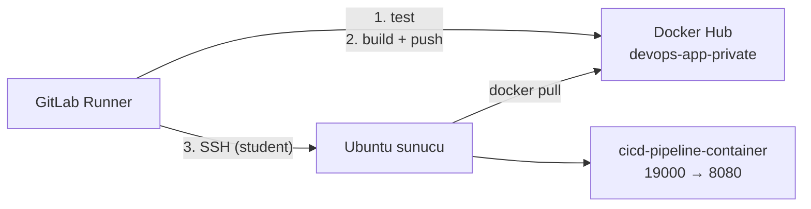

# GitLab CI/CD ile Ubuntu'ya Docker dağıtımı

Pipeline kodu test eder, imajı Docker Hub'daki private `devops-app-private` reposuna yollar ve SSH ile sunucuda container'ı günceller. Tanım `.gitlab-ci.yml` dosyasındadır.



## 0. Projeyi kendi hesabınıza alın

Fork veya import ile projeyi kendi GitLab.com hesabınıza alın:

- **Fork:** `https://gitlab.com/devops-practitioner-labs/ci-cd-docker` → **Fork** → kendi kullanıcı adınızı seçin → **Fork project**.
- **Import:** **New project → Import project → Repository by URL** → `https://gitlab.com/devops-practitioner-labs/ci-cd-docker.git` → **Create project**.

Sonraki adımlar kendi projenizde yapılır. GitLab yeni hesaplardan runner kullanmadan önce telefon veya kart doğrulaması isteyebilir.

## 1. Sunucuyu kontrol et

Sunucuda `student` kullanıcısıyla Docker çalışmalıdır:

```bash
docker ps
```

<details>
<summary><strong>Docker kurulu değilse</strong></summary>

Docker CE kurulu sunucuda `docker.io` kurmayın; paketler çakışır.

```bash
sudo apt update && sudo apt install -y docker.io
sudo systemctl enable --now docker
sudo usermod -aG docker student
```

Ardından oturumu kapatıp yeniden açın.

</details>

## 2. SSH anahtarını oluştur

Pipeline sunucuya `student` kullanıcısıyla bu anahtarla bağlanır. Anahtarı sunucuda, parolasız oluşturun:

```bash
ssh-keygen -t ed25519 -C "gitlab-ci-deploy" -f ~/.ssh/gitlab_ci_deploy -N ""
```

```bash
cat ~/.ssh/gitlab_ci_deploy.pub >> ~/.ssh/authorized_keys
```

```bash
chmod 600 ~/.ssh/authorized_keys
```

Anahtarla bağlanmayı deneyin; `docker ps` çıktısı gelir:

```bash
ssh -i ~/.ssh/gitlab_ci_deploy -o IdentitiesOnly=yes -o StrictHostKeyChecking=accept-new student@localhost 'docker ps'
```

3\. adımda gerekecek private anahtar ve sunucu IP'si:

```bash
cat ~/.ssh/gitlab_ci_deploy
```

```bash
curl -s ifconfig.me; echo
```

## 3. CI/CD değişkenlerini ekle

Docker Hub'da private `devops-app-private` reposu ve bir access token gerekir.

**Settings → CI/CD → Variables → Add variable** ile ekleyin. **Protect variable** kutusunu kaldırın:

| Ad | Tür | Değer |
| --- | --- | --- |
| `DOCKER_USERNAME` | Variable | Docker Hub kullanıcı adı |
| `DOCKERHUB_TOKEN` | Variable, Masked | Docker Hub access token |
| `SSH_PRIVATE_KEY` | File | `cat ~/.ssh/gitlab_ci_deploy` çıktısının tamamı |
| `SERVER_IP` | Variable | Sunucunun IP adresi |
| `SSH_USER` | Variable | `student` |

## 4. Pipeline'ı çalıştır

**Build → Pipelines → New pipeline** → `main` → **Run pipeline**. Sonraki her `main` push'u pipeline'ı kendiliğinden başlatır.

Pipeline bitince sunucuda kontrol edin:

```bash
docker ps --filter name=cicd-pipeline-container
```

```bash
curl -s http://localhost:19000/; echo
```

Tarayıcı adresi:

```bash
echo "http://$(curl -s ifconfig.me):19000"
```

## Temizlik

```bash
docker rm -f cicd-pipeline-container
```

```bash
sed -i '/gitlab-ci-deploy/d' ~/.ssh/authorized_keys
```

```bash
rm -f ~/.ssh/gitlab_ci_deploy ~/.ssh/gitlab_ci_deploy.pub
```
