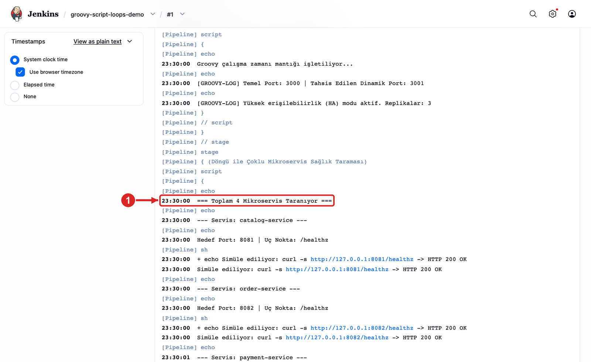

# BONUS-JEN-01 — Groovy `script` Blokları, Döngüler ve Koşullar

| Profil / Araçlar | Açık Portlar |
|---|---|
| Jenkins, Declarative Pipeline, Groovy | 18080 |

## Amaç

- Declarative Pipeline içinde `script { }` ile Groovy kodu çalıştırmak.
- Liste ve map üzerinde döngü (`for`, `.each`) kurmak.
- `if-else` ile parametreye ya da değere göre dallanmak.

## Ön Koşullar

- LAB-JEN-01 B bölümündeki Jenkins çalışıyor olmalıdır; LAB-JEN-02 tamamlanmış olmalıdır.

```bash
cd ~/jenkins-labs/bonus-labs/01-groovy-script-loops-conditions
```

Declarative Pipeline'da `steps` içine yalnızca adımlar (`echo`, `sh`) yazılır. Değişken, döngü ve koşul gerektiğinde kod `script { }` bloğuna alınır.

## Adım Adım Uygulama Rehberi

### 1. Küçük örnekler

`groovy-snippets` adında bir **Pipeline** job'u oluşturun (**New Item** → ad → **Pipeline** → **OK**). Her dosyanın içeriğini **Configure → Pipeline → Script** kutusuna yapıştırıp **Save** → **Build Now** ile çalıştırın:

```bash
cat snippets/01-script-basics.groovy
```

`def` ile değişken ve hesap. **Console Output**:

```text
Hesaplanan Deger: 50
```

```bash
cat snippets/02-loops.groovy
```

Sayı aralığında `for` ve liste üzerinde `.each`:

```text
=== For Dongusu Ornegi ===
Iterasyon #1 - Islem Tamamlandi
...
Iterasyon #5 - Islem Tamamlandi
=== Koleksiyon Uzerinde Dongu ===
Hedef Ortam: development
Hedef Ortam: staging
Hedef Ortam: production
```

```bash
cat snippets/03-conditions.groovy
```

`TARGET_ENV` parametresine göre `if-else`. İlk build'de varsayılan (`dev`) kullanılır:

```text
BILGI: Gelistirme ortamina hizli gecis yapiliyor.
```

Sonra **Build with Parameters**'ta `prod` seçip çalıştırın; çıktı `DIKKAT: Production ortamina ozel guvenlik kontrolleri devrede.` olur.

### 2. Hepsini birleştiren pipeline

`groovy-script-loops-demo` adında bir **Pipeline** job'u oluşturun ve `Jenkinsfile` içeriğini **Script** kutusuna yapıştırın:

```bash
cat Jenkinsfile
```

- `Groovy Script Bloğu ile Hesaplama`: `BUILD_NUMBER` metinden sayıya çevrilir (`Integer.parseInt`) ve port hesaplanır.
- `Döngü ile Çoklu Mikroservis Sağlık Taraması`: map'lerden oluşan bir liste `for` ile gezilir; her servis için `sh` çalışır.
- `Dinamik Koşullu Dağıtım Matrisi`: ortam listesi `.each` ile gezilir, `production` için ayrı dal çalışır.

**Save** → **Build Now** → **Console Output** (1):

{width=75%}

```text
[GROOVY-LOG] Temel Port: 3000 | Tahsis Edilen Dinamik Port: 3001
[GROOVY-LOG] Yüksek erişilebilirlik (HA) modu aktif. Replikalar: 3
=== Toplam 4 Mikroservis Taranıyor ===
--- Servis: catalog-service ---
--- Servis: order-service ---
--- Servis: payment-service ---
--- Servis: notification ---
[FAST-TRACK] development ortamına hızlı otomatik onay verildi.
[FAST-TRACK] staging ortamına hızlı otomatik onay verildi.
[GATEKEEPER] production ortamı için ekstra güvenlik doğrulama adımları devrede.
[SUCCESS] Tüm döngü ve koşul blokları hatasız yürütüldü.
```

Port, build numarasıyla değişir: `#2`'de `3002` olur.

## Temizlik

İki job'u **Delete Pipeline** ile silebilirsiniz.
