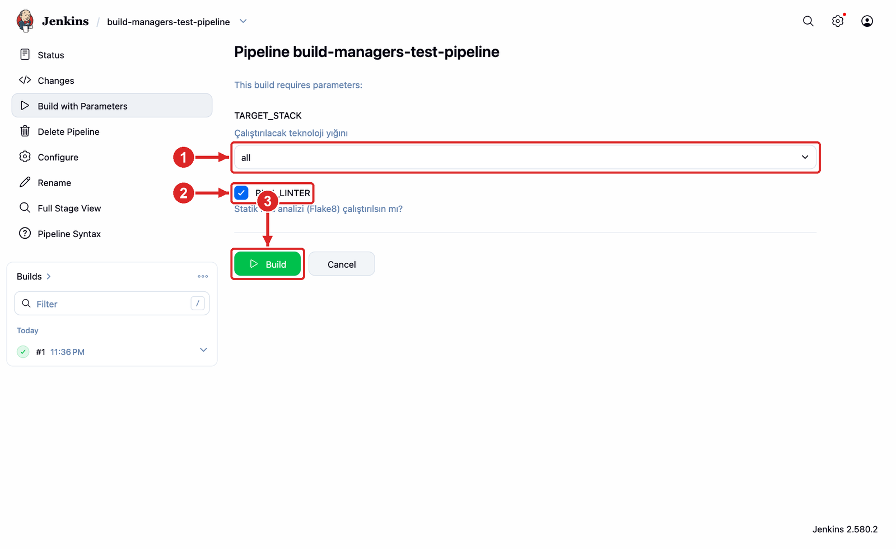
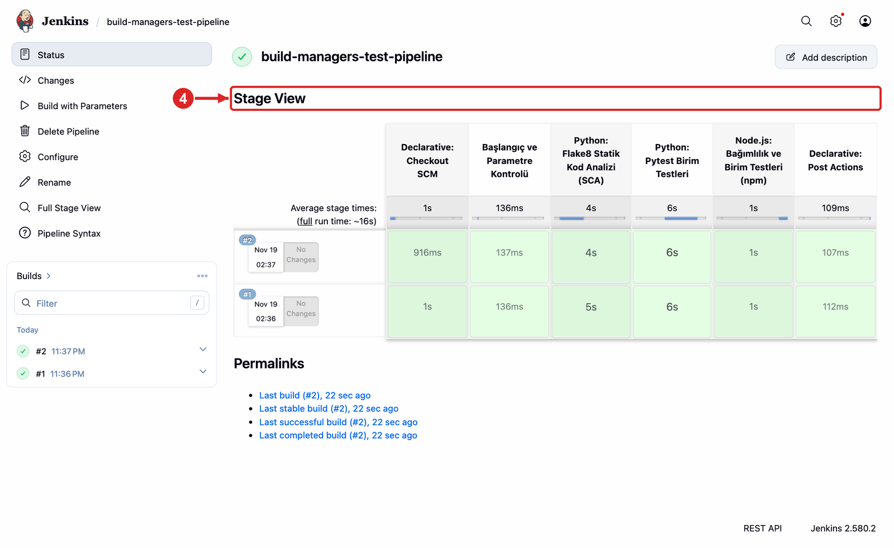

# BONUS-JEN-02 — Python ve Node.js Testlerini Container'da Çalıştırma

| Profil / Araçlar | Açık Portlar |
|---|---|
| Jenkins, `docker`, `python:3.11-slim` (flake8, pytest), `node:18-alpine` (npm) | 18080 |

## Amaç

- Jenkins'e Python veya Node.js kurmadan, testleri o dilin container'ında çalıştırmak.
- Python'da `flake8` ile kod stili denetimi ve `pytest` ile birim testi yapmak.
- Node.js'te `npm test` çalıştırmak; hangi yığının test edileceğini parametreyle seçmek.

## Ön Koşullar

- LAB-JEN-01 B bölümündeki Jenkins çalışıyor olmalıdır; LAB-JEN-02 tamamlanmış olmalıdır.

```bash
cd ~/jenkins-labs/bonus-labs/02-build-managers-npm-python
```

```bash
ls app-python app-python/tests app-node
```

```bash
cat app-python/tests/test_app.py
```

```bash
cat app-node/package.json
```

Her test adımı `docker run --volumes-from jenkins -w <klasör> <image>` ile çalışır: container Jenkins'in workspace'ini görür, testi çalıştırır ve silinir. Jenkins container'ında Python veya Node.js yoktur.

## Adım Adım Uygulama Rehberi

### 1. Job'u oluşturma

`build-managers-test-pipeline` adında bir **Pipeline** job'u oluşturun. Pipeline uygulama klasörlerine ihtiyaç duyduğu için repodan çalışmalıdır; LAB-JEN-02'deki gibi **Pipeline script from SCM**:

| Alan | Değer |
|---|---|
| Repository URL | `https://gitlab.com/devops-practitioner-labs/jenkins-labs.git` |
| Branch Specifier | `*/main` |
| Script Path | `bonus-labs/02-build-managers-npm-python/Jenkinsfile` |

```bash
cat Jenkinsfile
```

- `python -m pytest`: `app-python` klasörünü modül yoluna ekler; testler `from app import ...` ile uygulamayı bulur.
- `flake8 . --max-line-length=120`: kullanılmayan import, hatalı girinti gibi stil hatalarında build durur.

**Save** → **Build Now** (parametreleri kaydeder, varsayılanlarla çalışır).

### 2. Parametrelerle çalıştırma

**Build with Parameters**: **TARGET_STACK** `all` (1), **RUN_LINTER** işaretli (2), **Build** (3).

{width=75%}

**Console Output**'tan kısaltılmış satırlar:

```text
tests/test_app.py::test_add PASSED                                       [ 50%]
tests/test_app.py::test_get_status PASSED                                [100%]
[TEST PASSED] 2 birim test başarıyla geçti.
[SUCCESS] Tüm test ve analiz adımları başarıyla tamamlandı!
Finished: SUCCESS
```

Flake8 hata bulmazsa çıktı vermez. **Stage View** (4): `TARGET_STACK=all` iken üç test stage'i de çalışır. `python` seçilirse Node.js stage'i, `node` seçilirse Python stage'leri atlanır.

{width=75%}

## Temizlik

Job'u **Delete Pipeline** ile silebilirsiniz. Testlerin çektiği image'lar:

```bash
docker rmi python:3.11-slim node:18-alpine
```
