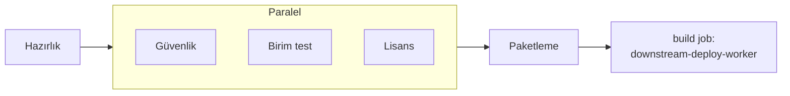
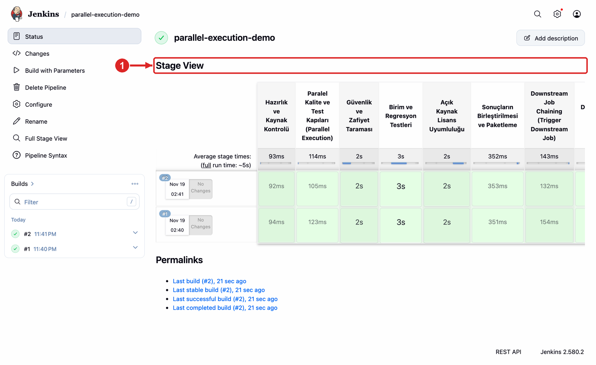
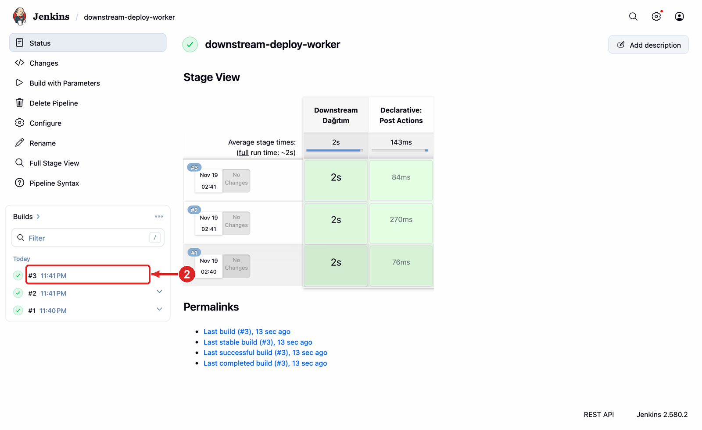
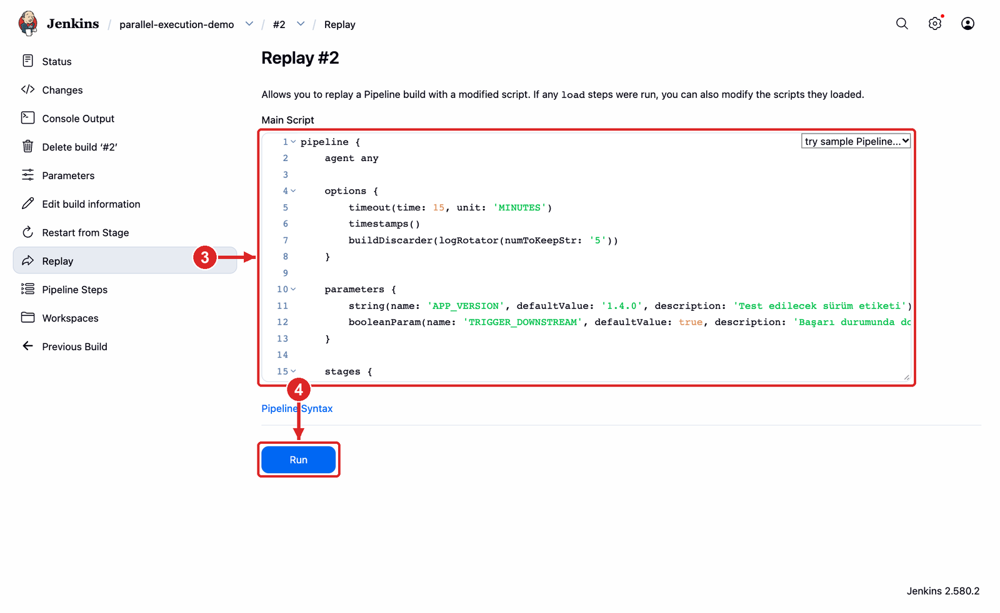
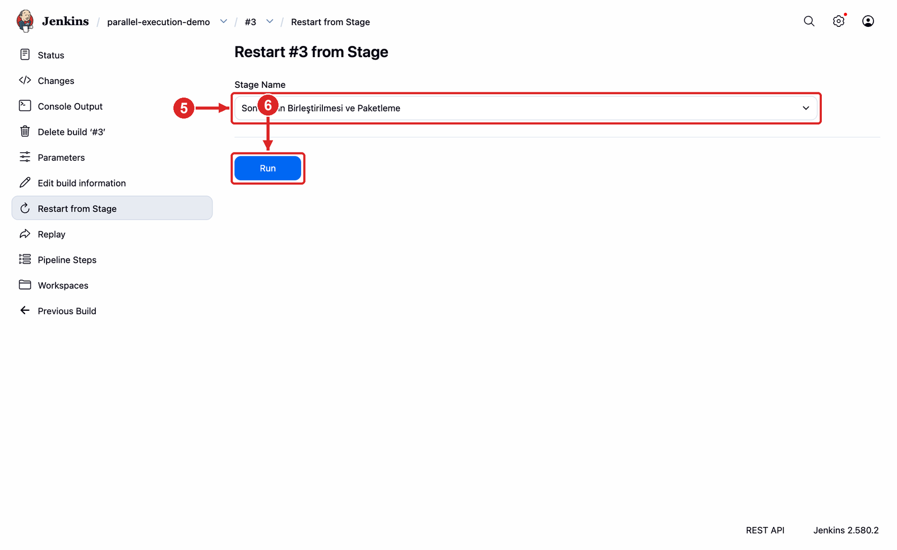

# BONUS-JEN-03 — Paralel Stage'ler, Job Tetikleme, Replay ve Restart from Stage

| Profil / Araçlar | Açık Portlar |
|---|---|
| Jenkins, `parallel`, `build job`, Replay, Restart from Stage | 18080 |

## Amaç

- Birbirinden bağımsız adımları `parallel` ile aynı anda çalıştırmak.
- Bir pipeline'ın sonunda başka bir job'u parametreyle tetiklemek.
- Jenkinsfile'ı commit atmadan **Replay** ile değiştirip denemek; **Restart from Stage** ile build'i ortadaki bir stage'den yeniden başlatmak.

## Ön Koşullar

- LAB-JEN-01 B bölümündeki Jenkins çalışıyor olmalıdır; LAB-JEN-02 ve LAB-JEN-03 tamamlanmış olmalıdır.

```bash
cd ~/jenkins-labs/bonus-labs/03-parallel-execution-replay
```



## Adım Adım Uygulama Rehberi

### 1. Tetiklenecek job

`downstream-deploy-worker` adında bir **Pipeline** job'u oluşturun ve bu dosyanın içeriğini **Script** kutusuna yapıştırın:

```bash
cat downstream-job/Jenkinsfile
```

**Save** → **Build Now**. Declarative pipeline'da parametreler Jenkins'e ilk build'de kaydedilir (LAB-JEN-02); `UPSTREAM_VERSION`'ın tetiklemeden önce tanımlı olması için job'u bir kez çalıştırın. Bu build varsayılan değeri (`unknown`) yazar.

### 2. Paralel pipeline

`parallel-execution-demo` adında bir **Pipeline** job'u oluşturun ve `Jenkinsfile` içeriğini yapıştırın:

```bash
cat Jenkinsfile
```

- `parallel { stage(...) stage(...) stage(...) }`: üç stage aynı anda başlar; hepsi bitince sonraki stage'e geçilir. Biri başarısız olursa paralel stage başarısız sayılır.
- `build job: 'downstream-deploy-worker', parameters: [...], wait: false`: diğer job'u `UPSTREAM_VERSION` ile tetikler; `wait: false` olduğu için onun bitmesini beklemez.

**Save** → **Build Now** (parametreleri kaydeder). Sonra **Build with Parameters**: `APP_VERSION` `1.5.0`, `TRIGGER_DOWNSTREAM` işaretli → **Build**. **Console Output**:

```text
[PARALEL 1] Bağımlılık ve statik güvenlik denetimleri koşturuluyor...
[PARALEL 2] Birim ve regresyon test paketleri koşturuluyor...
[PARALEL 3] Üçüncü taraf paketlerin lisansları denetleniyor...
[SECURITY] Bilinen CVE açığı tespit edilmedi: PASSED
[COMPLIANCE] GPL ihlali bulunamadı, MIT/Apache 2.0 onaylandı: PASSED
[TESTS] 48 test başarıyla tamamlandı: PASSED
[DOWNSTREAM] 'downstream-deploy-worker' job'ı tetiklendi.
Finished: SUCCESS
```

Üç `[PARALEL]` satırı art arda gelir: kollar aynı anda başladı. Sonuç satırları en kısa süren koldan başlayarak gelir (`[TESTS]` 3 saniye sürdüğü için en sonda). **Stage View** (1) paralel kolları ayrı sütunlarda gösterir.

{width=75%}

`downstream-deploy-worker` job'unda yeni bir build belirir (2); konsolunda tetikleyen job ve gelen sürüm yazar:

```text
Started by upstream project "parallel-execution-demo" build number 2
Upstream pipeline'dan gelen sürüm: 1.5.0
```

{width=75%}

### 3. Replay

`parallel-execution-demo` → son build → sol menüden **Replay**. Editörde o build'in Jenkinsfile'ı açılır (3). Örneğin `echo "Sürüm: ${params.APP_VERSION}"` satırını `echo "Sürüm (Replay ile değişti): ${params.APP_VERSION}"` yapın ve **Run**'a basın (4).

{width=75%}

Yeni build değiştirdiğiniz satırı yazar; konsolun başında `Replayed #2` görünür. Değişiklik yalnızca o build içindir: job'un kayıtlı script'i ve repodaki Jenkinsfile değişmez. Denediğiniz değişikliği kalıcı yapmak için Jenkinsfile'a yazmanız gerekir.

### 4. Restart from Stage

Son build → sol menüden **Restart from Stage**. Listeden `Sonuçların Birleştirilmesi ve Paketleme` seçin (5), **Run** (6).

{width=75%}

Önceki stage'ler çalışmadan atlanır, build seçilen stage'den başlar:

```text
Restarted from build #3, stage Sonuçların Birleştirilmesi ve Paketleme
Stage "Hazırlık ve Kaynak Kontrolü" skipped due to this build restarting at stage "Sonuçların Birleştirilmesi ve Paketleme"
Stage "Paralel Kalite ve Test Kapıları (Parallel Execution)" skipped due to this build restarting at stage "Sonuçların Birleştirilmesi ve Paketleme"
Version: 1.5.0
```

Uzun süren test stage'lerinden sonra paketleme veya deploy adımı hata verdiğinde, düzeltmeden sonra testleri baştan çalıştırmadan devam etmek için kullanılır. Yalnızca tamamlanmış build'ler için ve üst seviyedeki stage'lerden başlatılabilir.

## Temizlik

İki job'u **Delete Pipeline** ile silebilirsiniz.
