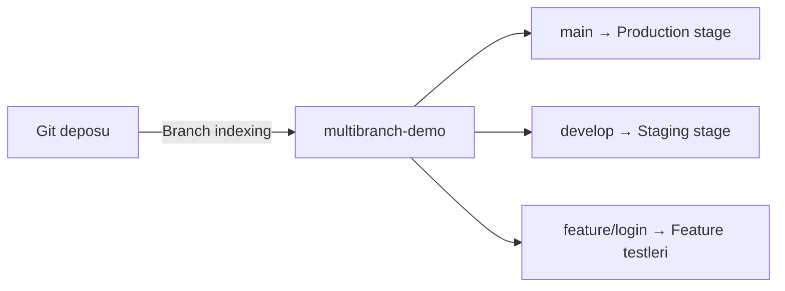
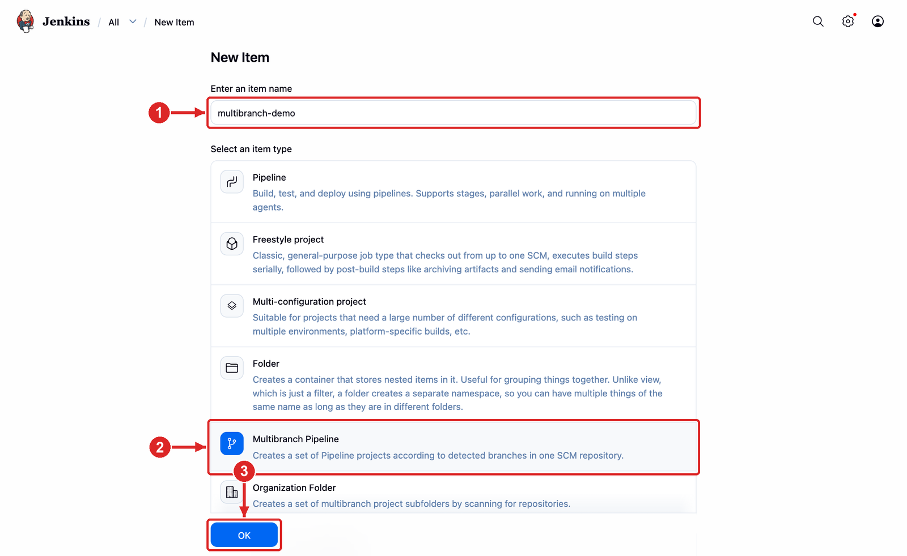
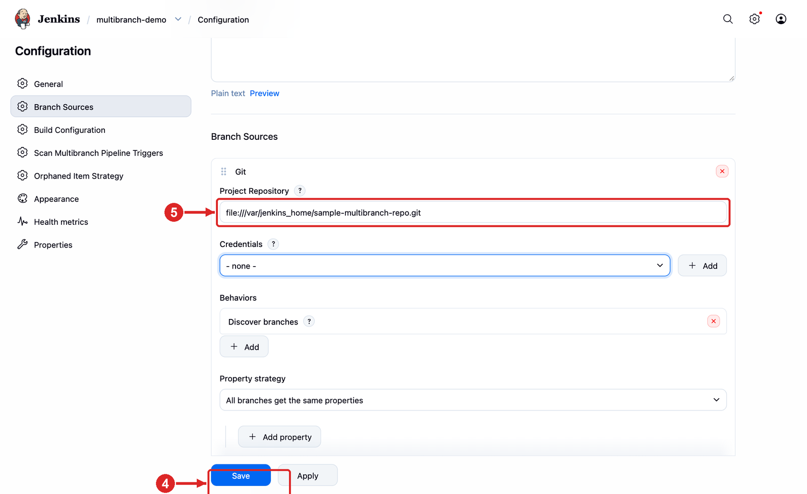
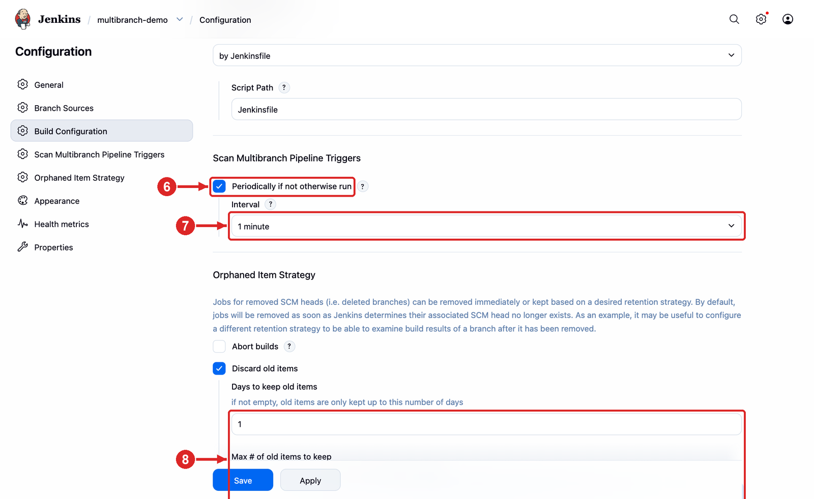
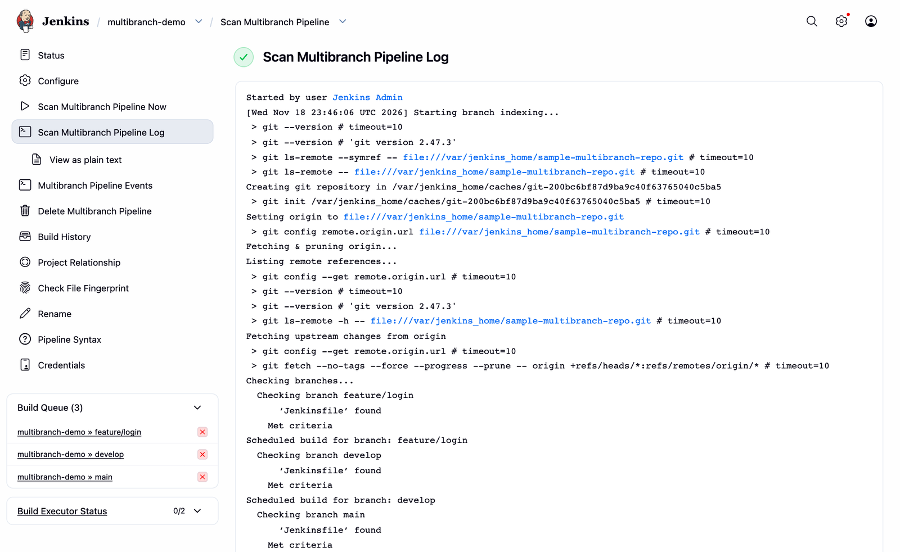
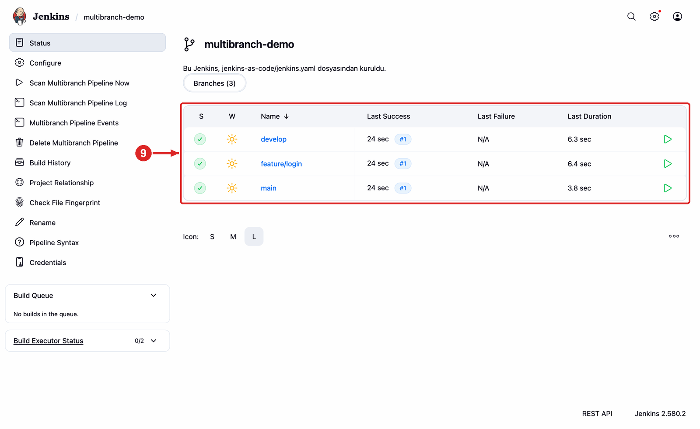

# BONUS-JEN-04 — Multibranch Pipeline: Dal Başına Otomatik Job

| Profil / Araçlar | Açık Portlar |
|---|---|
| Jenkins, Multibranch Pipeline, Git | 18080 |

## Amaç

- Tek bir Multibranch Pipeline ile repodaki her dal için Jenkins'in kendiliğinden job açmasını sağlamak.
- `when { branch ... }` ile dala göre farklı stage çalıştırmak.
- Dal tarama sıklığını ve silinen dalların job'larının ne kadar tutulacağını ayarlamak.

## Ön Koşullar

- LAB-JEN-01 B bölümündeki Jenkins çalışıyor olmalıdır; LAB-JEN-02 tamamlanmış olmalıdır.

```bash
cd ~/jenkins-labs/bonus-labs/04-multibranch-pipeline-gitflow
```



## Adım Adım Uygulama Rehberi

### 1. Üç dallı örnek depo

Betik `main`, `develop` ve `feature/login` dallarını içeren bir Git deposu kurar. Jenkins'in okuyabilmesi için Jenkins container'ında çalıştırılır ve depo `jenkins_home` volume'üne yazılır:

```bash
cat scripts/setup-local-git-repo.sh
```

```bash
docker exec jenkins bash /workspace/jenkins-labs/bonus-labs/04-multibranch-pipeline-gitflow/scripts/setup-local-git-repo.sh
```

```bash
docker exec jenkins git --git-dir=/var/jenkins_home/sample-multibranch-repo.git branch
```

```text
  develop
  feature/login
  main
```

Her dalda aynı `Jenkinsfile` vardır:

```bash
cat Jenkinsfile
```

- `when { branch 'main' }`: stage yalnızca `main` dalının job'unda çalışır.
- `when { branch pattern: 'feature/*', comparator: 'GLOB' }`: adı `feature/` ile başlayan bütün dallarda çalışır.

### 2. Multibranch Pipeline

**New Item**: ad `multibranch-demo` (1), **Multibranch Pipeline** (2), **OK** (3).

{width=75%}

**Branch Sources → Add source → Git** (4). **Project Repository** alanına (5):

```text
file:///var/jenkins_home/sample-multibranch-repo.git
```

{width=75%}

**Scan Multibranch Pipeline Triggers**: **Periodically if not otherwise run** işaretli (6), **Interval** `1 minute` (7). Jenkins depoyu dakikada bir tarar; yeni dalı kendi bulur. **Orphaned Item Strategy**: **Days to keep old items** `1`, **Max # of old items to keep** `5` (8); silinen dalın job'u en çok bir gün ya da son beş taneyle sınırlı tutulur. **Save**.

{width=75%}

### 3. Dal tarama

Kaydedince **Scan Multibranch Pipeline Log** açılır: Jenkins her dalda `Jenkinsfile` bulur ve o dal için build planlar.

{width=75%}

`multibranch-demo` sayfasında her dal ayrı bir job olarak listelenir (9); ilk build'leri kendiliğinden çalışmıştır.

{width=75%}

### 4. Dala göre farklı stage'ler

Her dalın `#1` → **Console Output**:

`main`:

```text
Stage "Feature Testleri ve Raporlama" skipped due to when conditional
Stage "Staging Ortamına Dağıtım" skipped due to when conditional
[PRODUCTION] Uygulama Canlı Production ortamına dağıtılıyor...
[SUCCESS] main dalı başarıyla derlendi ve doğrulandı.
```

`develop`:

```text
Stage "Feature Testleri ve Raporlama" skipped due to when conditional
[STAGING] Uygulama Staging test ortamına dağıtılıyor...
Stage "Production Ortamına Dağıtım" skipped due to when conditional
[SUCCESS] develop dalı başarıyla derlendi ve doğrulandı.
```

`feature/login`:

```text
[FEATURE-BRANCH] Geliştirme dalında hızlı regresyon ve smoke testleri devrede.
Stage "Staging Ortamına Dağıtım" skipped due to when conditional
Stage "Production Ortamına Dağıtım" skipped due to when conditional
[SUCCESS] feature/login dalı başarıyla derlendi ve doğrulandı.
```

## Temizlik

`multibranch-demo` sayfasında **Delete Multibranch Pipeline** bütün dal job'larıyla birlikte siler. Örnek depo:

```bash
docker exec jenkins rm -rf /var/jenkins_home/sample-multibranch-repo.git
```
