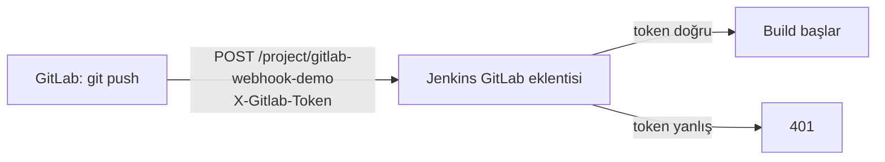
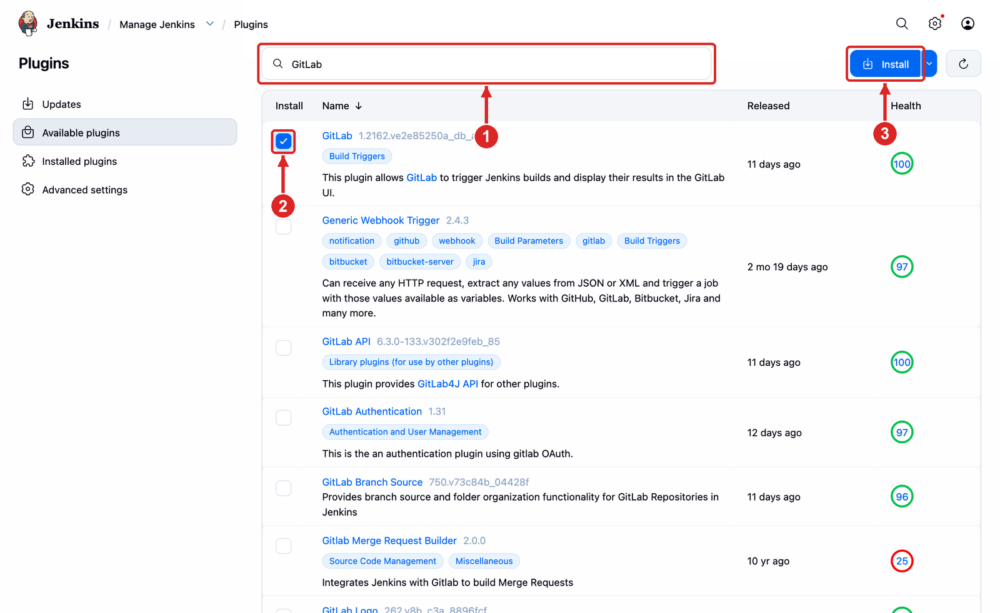
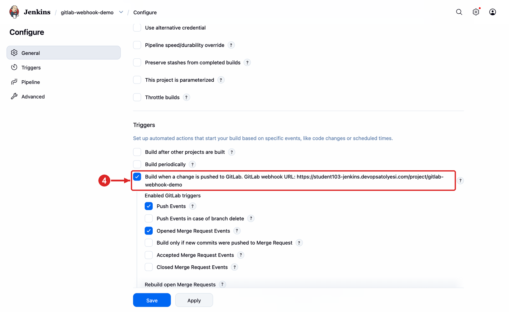
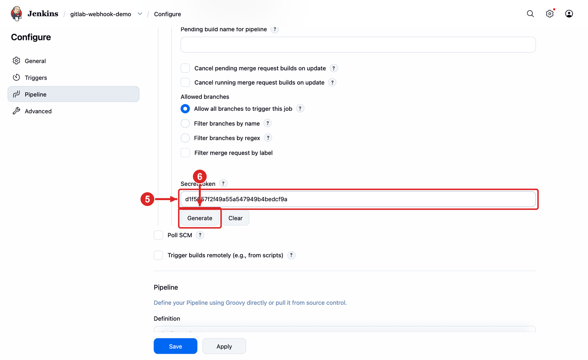
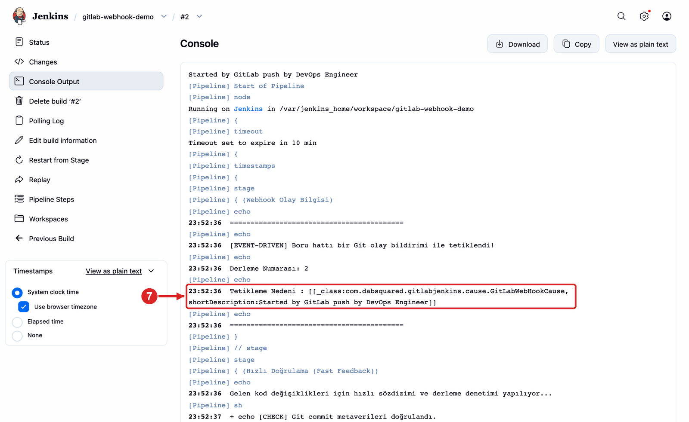

# BONUS-JEN-05 — GitLab Webhook ile Push'ta Otomatik Build

| Profil / Araçlar | Açık Portlar |
|---|---|
| Jenkins, GitLab eklentisi, `curl` | 18080 |

## Amaç

- Jenkins'e GitLab eklentisini kurmak ve job'a "push gelince build et" tetikleyicisi eklemek.
- Webhook'u gizli token ile korumak.
- GitLab'ın push'ta gönderdiği isteği yollayıp build'in kendiliğinden başladığını görmek.

## Ön Koşullar

- LAB-JEN-01 B bölümündeki Jenkins çalışıyor olmalıdır; eklenti kurmayı LAB-JEN-01 A5'te gördünüz.

```bash
cd ~/jenkins-labs/bonus-labs/05-gitlab-webhook-event-driven
```

Zamanlanmış SCM yoklaması (polling) Jenkins'in repoyu belli aralıklarla sorgulamasıdır; değişiklik yoksa boşa sorgular, varsa aralık kadar gecikir. Webhook'ta GitLab push anında Jenkins'e haber verir.



## Adım Adım Uygulama Rehberi

### 1. GitLab eklentisi

**Manage Jenkins → Plugins → Available plugins**: arama kutusuna `GitLab` yazın (1), `GitLab` satırını işaretleyin (2), **Install** (3). Kurulum yeniden başlatma gerektirmez.

{width=75%}

### 2. Webhook ile tetiklenen job

`gitlab-webhook-demo` adında bir **Pipeline** job'u oluşturun. **Triggers** bölümünde **Build when a change is pushed to GitLab** işaretleyin (4). Satırın sonundaki adres, GitLab'ın istek göndereceği webhook adresidir.

{width=75%}

Aynı bölümde **Advanced** → **Secret token** alanının altındaki **Generate** (6); üretilen token alana yazılır (5). Token'ı kopyalayın; webhook isteği bu token'ı taşımazsa reddedilir.

{width=75%}

**Pipeline → Script** kutusuna `Jenkinsfile` içeriğini yapıştırın:

```bash
cat Jenkinsfile
```

**Save** → **Build Now** (ilk build elle).

### 3. Push isteğini göndermek

Gerçek bir GitLab'da webhook **Settings → Webhooks**'a tetikleyicideki adres ve token girilerek tanımlanır; GitLab her push'ta bu adrese istek gönderir. Bu labda GitLab kurmadan, GitLab'ın gönderdiği isteğin aynısını betik yollar:

```bash
cat scripts/simulate-webhook.sh
```

- `X-Gitlab-Event: Push Hook`: olayın türü.
- `X-Gitlab-Token`: job'daki secret token; eşleşmezse Jenkins `401` döner.
- Gövde, GitLab push olayının JSON'udur (proje, dal, commit bilgisi).

Token olmadan betik çalışmaz:

```bash
./scripts/simulate-webhook.sh gitlab-webhook-demo
```

```text
./scripts/simulate-webhook.sh: line 9: SECRET_TOKEN: SECRET_TOKEN tanimli degil - job ayarinda Generate ile uretilen degeri verin
```

Yanlış token ile:

```bash
SECRET_TOKEN='yanlis' ./scripts/simulate-webhook.sh gitlab-webhook-demo
```

```text
Hedef: http://127.0.0.1:18080/project/gitlab-webhook-demo
HTTP 401
Jenkins isteği kabul etmedi (token ve job adını kontrol edin).
```

Kopyaladığınız token ile (`TOKEN` yerine yapıştırın):

```text
SECRET_TOKEN='TOKEN' ./scripts/simulate-webhook.sh gitlab-webhook-demo
```

```text
Hedef: http://127.0.0.1:18080/project/gitlab-webhook-demo
HTTP 200
Jenkins isteği kabul etti; job tetiklendi.
```

### 4. Kendiliğinden başlayan build

`gitlab-webhook-demo` job'unda tıklamadan yeni bir build (`#2`) başlar. **Console Output**'un ilk satırı build'i kimin tetiklediğini yazar (7):

{width=75%}

```text
Started by GitLab push by DevOps Engineer
[EVENT-DRIVEN] Boru hattı bir Git olay bildirimi ile tetiklendi!
Derleme Numarası: 2
[SUCCESS] GitLab Webhook kaynaklı derleme başarıyla tamamlandı.
Finished: SUCCESS
```

`DevOps Engineer`, isteğin gövdesindeki `user_name` alanıdır; gerçek GitLab'da push yapan kullanıcının adı gelir.

## Temizlik

Job'u **Delete Pipeline** ile silebilirsiniz. GitLab eklentisini **Installed plugins**'ten kaldırabilirsiniz (LAB-JEN-01 A5).
