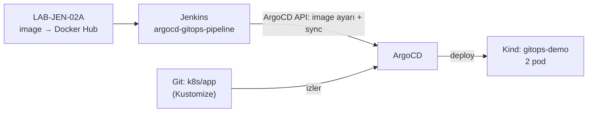
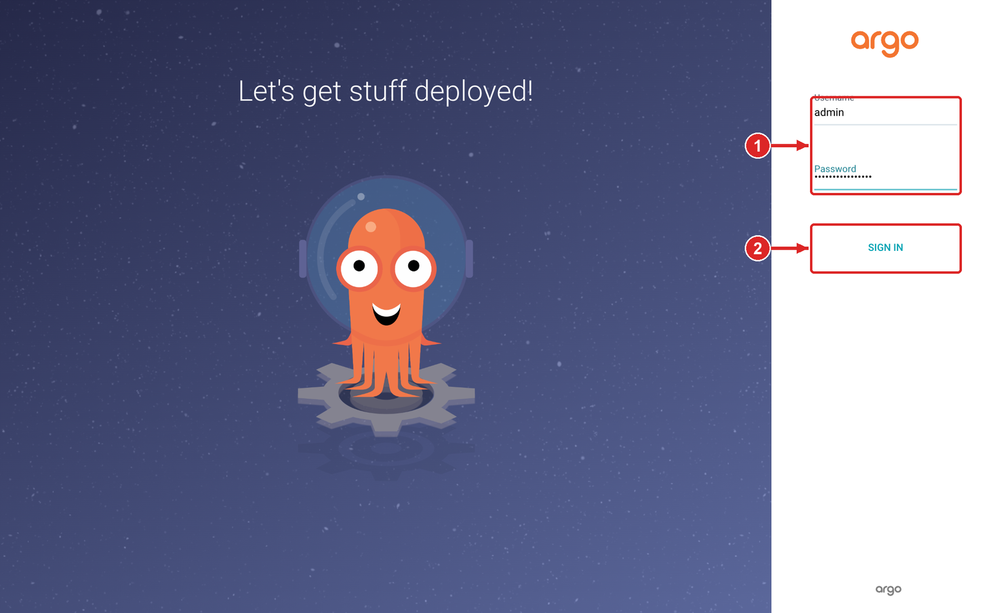
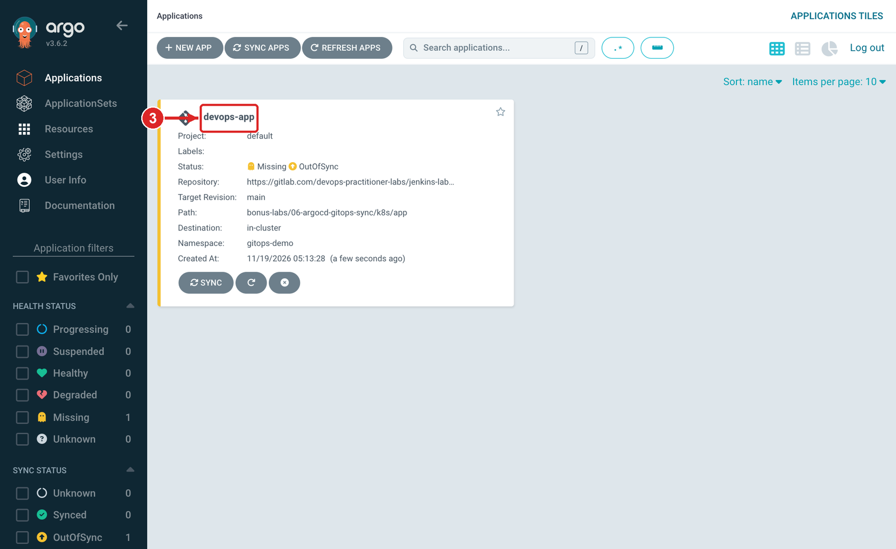
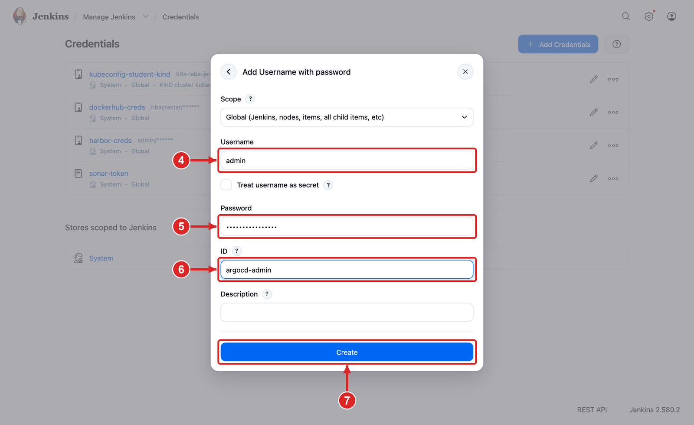
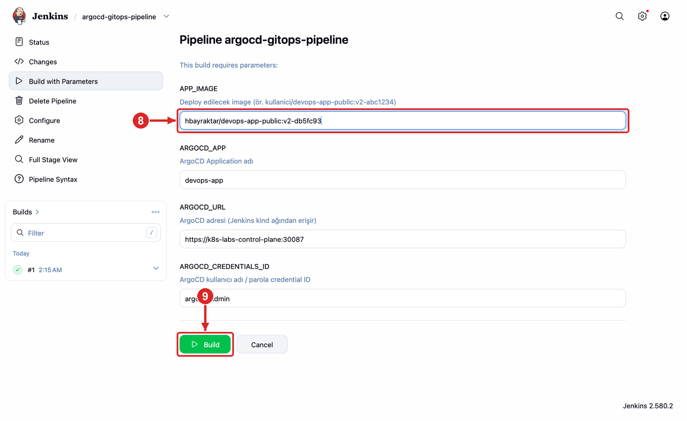
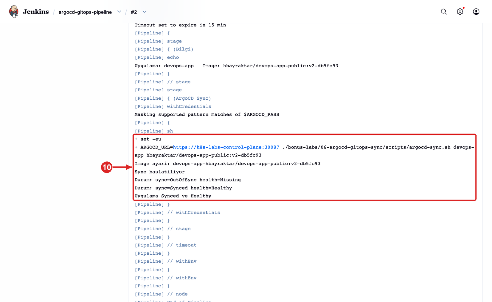
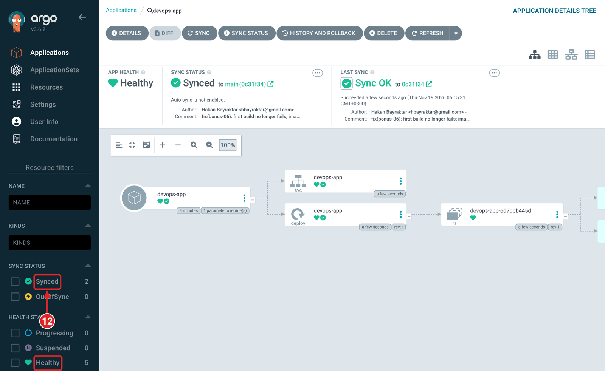

# BONUS-JEN-06 — Jenkins ve ArgoCD ile GitOps Deploy

| Profil / Araçlar | Açık Portlar |
|---|---|
| Jenkins, ArgoCD v3.6.2, Kind, Kustomize | 18080, 30087 (ArgoCD) |

## Amaç

- Kind cluster'ına ArgoCD kurmak ve bir Git klasörünü izleyen Application tanımlamak.
- Jenkins'in cluster'a doğrudan deploy etmek yerine ArgoCD'ye hangi image'ın çalışacağını söylemesini sağlamak.
- ArgoCD'nin deploy'u yapıp uygulamayı `Synced` ve `Healthy` duruma getirdiğini görmek.

## Ön Koşullar

- LAB-JEN-01 B bölümündeki Jenkins ve `k8s-labs` Kind cluster'ı çalışıyor olmalıdır (LAB-JEN-06 Ön Koşullar).
- LAB-JEN-02A'da Docker Hub'a gönderilen bir `devops-app-public` image'ı olmalıdır. Etiketleri:

```bash
docker images --format '{{.Repository}}:{{.Tag}}' | grep devops-app-public
```

- `30087` portu firewall'da açık olmalıdır (ArgoCD arayüzü).

```bash
cd ~/jenkins-labs/bonus-labs/06-argocd-gitops-sync
```



Jenkins cluster'a `kubectl apply` yapmaz. İstenen durum Git'teki manifest'lerdir; ArgoCD cluster'ı bu duruma getirir ve sapmayı gösterir.

## Adım Adım Uygulama Rehberi

### 1. ArgoCD kurulumu

```bash
kubectl create namespace argocd
```

```bash
kubectl apply -n argocd --server-side --force-conflicts -f https://raw.githubusercontent.com/argoproj/argo-cd/v3.6.2/manifests/install.yaml
```

Pod'ların hepsi `Running` ve `1/1` olana kadar izleyin (bir iki dakika); `Ctrl+C` ile çıkın:

```bash
kubectl -n argocd get pods -w
```

Arayüzü sunucunun `30087` portundan açmak için servisi NodePort yapın. `k8s-labs` cluster'ı `30087`'yi sunucuya yönlendirir:

```bash
kubectl -n argocd patch svc argocd-server -p '{"spec":{"type":"NodePort","ports":[{"name":"https","port":443,"protocol":"TCP","targetPort":8080,"nodePort":30087}]}}'
```

```bash
echo "https://$(curl -s ifconfig.me):30087"
```

ArgoCD kendinden imzalı sertifika kullanır; tarayıcı uyarısını geçin. İlk `admin` parolası:

```bash
kubectl -n argocd get secret argocd-initial-admin-secret -o jsonpath='{.data.password}' | base64 -d; echo
```

`admin` ve bu parolayla girin (1, 2).

{width=75%}

### 2. Application

ArgoCD'ye hangi Git klasörünü hangi namespace'e uygulayacağını Application söyler:

```bash
cat k8s/application.yaml
```

```bash
ls k8s/app
```

- `source`: jenkins-labs reposunun `main` dalındaki `k8s/app` klasörü (Kustomize: Deployment + Service).
- `destination`: aynı cluster, `gitops-demo` namespace'i (`CreateNamespace=true` yoksa açar).
- Deployment'taki `image: devops-app` bir yer tutucudur; gerçek image Application'daki `kustomize.images` ile verilir. Otomatik sync yoktur; sync'i pipeline başlatır.

```bash
kubectl apply -f k8s/application.yaml
```

ArgoCD arayüzünde `devops-app` `OutOfSync` / `Missing` görünür (3): Git'te tanımlı kaynaklar cluster'da henüz yok.

{width=75%}

### 3. Jenkins tarafı

**Manage Jenkins → Credentials → Add Credentials → Username with password**: **Username** `admin` (4), **Password** ArgoCD parolası (5), **ID** `argocd-admin` (6), **Create** (7).

{width=75%}

```bash
cat Jenkinsfile
```

```bash
cat scripts/argocd-sync.sh
```

Betik ArgoCD API'siyle oturum açar, Application'ın image ayarını değiştirir, sync başlatır ve uygulama `Synced` + `Healthy` olana kadar 5 saniyede bir durumu yazar. Jenkins ArgoCD'ye `kind` Docker ağı üzerinden `https://k8s-labs-control-plane:30087` adresiyle erişir.

`argocd-gitops-pipeline` adında bir **Pipeline** job'u oluşturun. LAB-JEN-02'deki gibi **Pipeline script from SCM**:

| Alan | Değer |
|---|---|
| Repository URL | `https://gitlab.com/devops-practitioner-labs/jenkins-labs.git` |
| Branch Specifier | `*/main` |
| Script Path | `bonus-labs/06-argocd-gitops-sync/Jenkinsfile` |

**Save** → **Build Now**. Bu ilk build parametreleri kaydeder; `APP_IMAGE` boş olduğu için sync stage'i atlanır.

### 4. Image ile deploy

**Build with Parameters**: **APP_IMAGE** alanına Docker Hub image'ınızı yazın, ör. `hbayraktar/devops-app-public:v2-db5fc93` (8), **Build** (9).

{width=75%}

**Console Output** (10):

```text
Image ayari: devops-app=hbayraktar/devops-app-public:v2-db5fc93
Sync baslatiliyor
Durum: sync=OutOfSync health=Missing
Durum: sync=Synced health=Healthy
Uygulama Synced ve Healthy
Finished: SUCCESS
```

{width=75%}

ArgoCD'de uygulama `Healthy` (11) ve `Synced` (12); kaynak ağacında Deployment, ReplicaSet, pod'lar ve Service görünür.

{width=75%}

Cluster'da:

```bash
kubectl -n gitops-demo get deploy,pods,svc
```

```bash
kubectl -n gitops-demo get deploy devops-app -o jsonpath='{.spec.template.spec.containers[0].image}'; echo
```

```bash
kubectl -n gitops-demo exec deploy/devops-app -- wget -qO- http://127.0.0.1:8080/health; echo
```

Deployment `2/2`, image `hbayraktar/devops-app-public:v2-db5fc93`, sağlık cevabı `{"status":"healthy"}` olur.

Gerçek GitOps'ta yeni etiket Git'teki manifest'e commit edilir ve ArgoCD değişikliği oradan alır. Bu labda repo herkese açık olduğu ve yazma yetkisi gerektirmemek için etiket ArgoCD Application'ındaki `kustomize.images` ayarıyla verilir; manifest'lerin kendisi yine Git'ten gelir.

## Temizlik

```bash
kubectl delete -f k8s/application.yaml
```

```bash
kubectl delete namespace gitops-demo
```

ArgoCD'yi tamamen kaldırmak için:

```bash
kubectl delete namespace argocd
```

Job'u **Delete Pipeline** ile silebilirsiniz.
