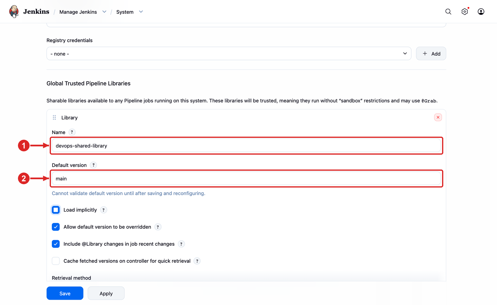
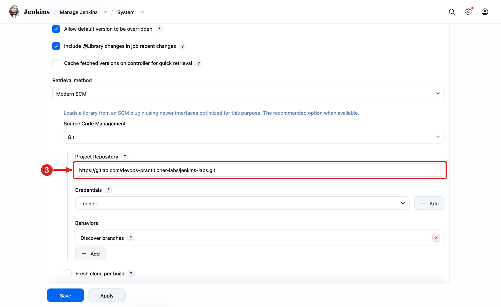
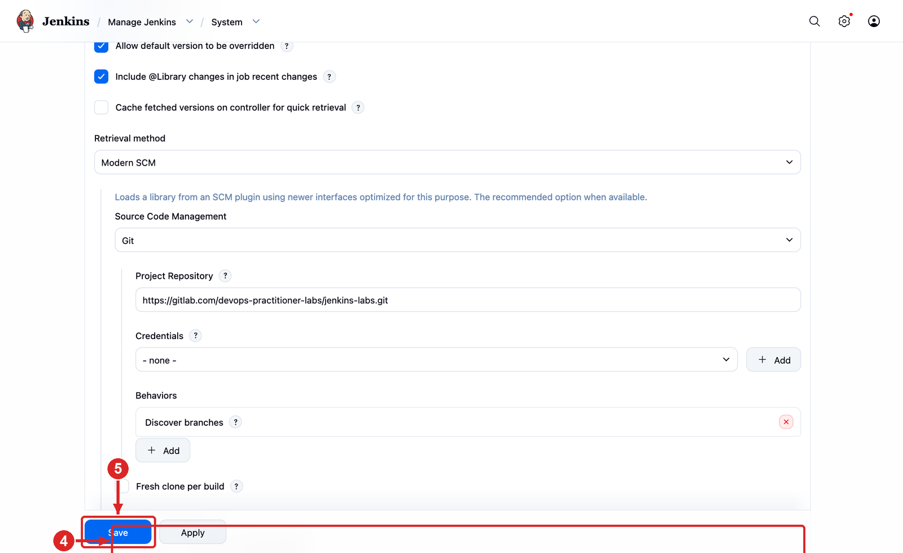
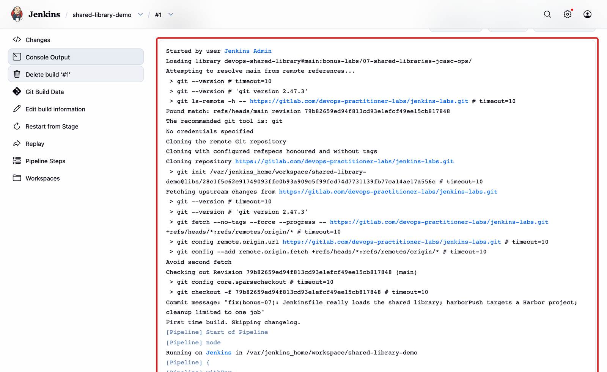
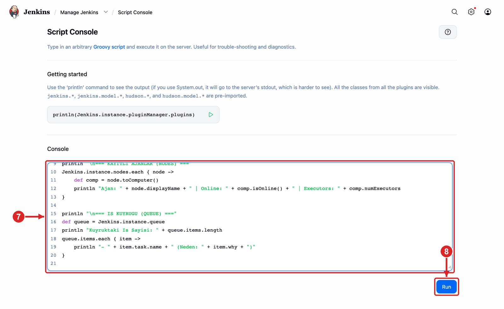
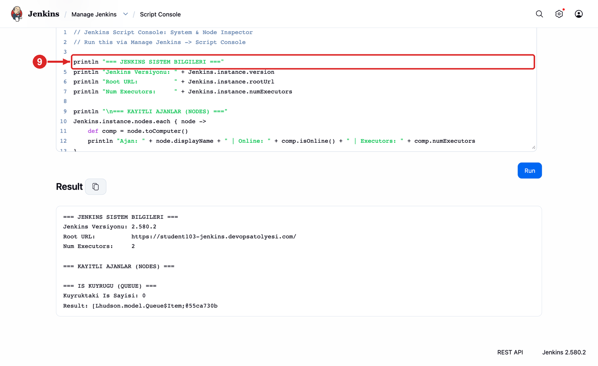
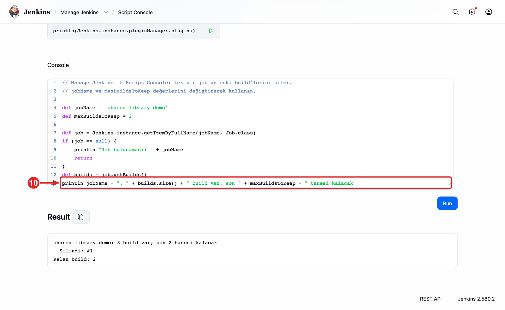

# BONUS-JEN-07 — Shared Library, Script Console ve Parola Kurtarma

| Profil / Araçlar | Açık Portlar |
|---|---|
| Jenkins, Global Pipeline Libraries, Script Console, Harbor | 18080, 18444 |

## Amaç

- Ortak pipeline adımlarını bir Shared Library'de (`vars/`) tutup Jenkinsfile'dan tek satırla çağırmak.
- Script Console'da Groovy ile Jenkins'i sorgulamak ve bir job'un eski build'lerini silmek.
- JCasC ile kurulan Jenkins'te unutulan yönetici parolasını sıfırlamak.

## Ön Koşullar

- LAB-JEN-01 B bölümündeki Jenkins çalışıyor olmalıdır.
- `harborPush` adımı için LAB-JEN-04'teki Harbor, `devops-public` projesi ve `harbor-creds` credential'ı gereklidir.

```bash
cd ~/jenkins-labs/bonus-labs/07-shared-libraries-jcasc-ops
```

## Adım Adım Uygulama Rehberi

### 1. Kütüphane adımları

`vars/` altındaki her dosya bir pipeline adımıdır; dosya adı adımın adıdır, `call` fonksiyonu çağrıldığında çalışır:

```bash
cat vars/logInfo.groovy
```

```bash
cat vars/harborPush.groovy
```

```bash
cat vars/notifyStatus.groovy
```

- `logInfo('mesaj')`: saatli, standart biçimde log satırı.
- `harborPush(image: 'x', tag: 'y')`: yerel image'ı Harbor'daki `devops-public` projesine gönderir; login, tag, push ve logout tek adımda.
- `notifyStatus(status: ..., message: ...)`: standart durum mesajı.

Kütüphane ayrı bir repoda olabilir; bu labda jenkins-labs reposundaki bu klasör kullanılır.

### 2. Kütüphaneyi Jenkins'e tanıtma

**Manage Jenkins → System → Global Trusted Pipeline Libraries → Add**: **Name** `devops-shared-library` (1), **Default version** `main` (2).

{width=75%}

**Retrieval method** `Modern SCM`, **Source Code Management** `Git`, **Project Repository** (3):

```text
https://gitlab.com/devops-practitioner-labs/jenkins-labs.git
```

{width=75%}

**Library Path** `bonus-labs/07-shared-libraries-jcasc-ops/` (4): `vars/` klasörü repo kökünde değil, bu alt klasördedir. **Save** (5).

{width=75%}

### 3. Kütüphaneyi kullanan pipeline

`shared-library-demo` adında bir **Pipeline** job'u oluşturun ve `Jenkinsfile` içeriğini **Script** kutusuna yapıştırın:

```bash
cat Jenkinsfile
```

`@Library('devops-shared-library') _` satırı kütüphaneyi yükler; `logInfo`, `harborPush` ve `notifyStatus` artık Jenkins'in kendi adımları gibi kullanılır. **Save** → **Build Now** → **Console Output** (6):

{width=75%}

```text
Loading library devops-shared-library@main:bonus-labs/07-shared-libraries-jcasc-ops/
[DEVOPS-AUDIT] [2026-11-18 23:57:34 UTC] => order-service v1.5.0 build başladı
[SHARED-LIB-HARBOR] order-service:1.5.0 -> 127.0.0.1:18444/devops-public/order-service:1.5.0
1.5.0: digest: sha256:c64c687cbea9300178b30c95835354e34c4e4febc4badfe27102879de0483b5e size: 1023
[SHARED-LIB-HARBOR] Push tamamlandı: 127.0.0.1:18444/devops-public/order-service:1.5.0
[NOTIFICATION-SUCCESS] Job: shared-library-demo #1 | Mesaj: Bütün aşamalar tamamlandı
Finished: SUCCESS
```

Kütüphanedeki bir adımı değiştirdiğinizde, onu kullanan bütün pipeline'lar sonraki build'de yeni hâli kullanır.

### 4. Script Console

**Manage Jenkins → Script Console**, Jenkins'in içinde Groovy çalıştırır; tam yetkilidir, yalnızca yöneticiler kullanır. Bu dosyanın içeriğini editöre yapıştırın (7) ve **Run** (8):

```bash
cat scripts/system-info.groovy
```

{width=75%}

Sonuç (9):

{width=75%}

```text
=== JENKINS SISTEM BILGILERI ===
Jenkins Versiyonu: 2.580.2
Root URL:          https://student103-jenkins.devopsatolyesi.com/
Num Executors:     2
=== KAYITLI AJANLAR (NODES) ===
=== IS KUYRUGU (QUEUE) ===
Kuyruktaki Is Sayisi: 0
```

Ayrı agent tanımlı olmadığı için ajan listesi boştur; build'ler Jenkins'in kendisinde çalışır. En alttaki `Result:` satırı script'in son ifadesinin değeridir.

### 5. Bir job'un eski build'lerini silmek

`shared-library-demo` job'unu iki kez daha **Build Now** ile çalıştırın (üç build olur). Bu script yalnızca `jobName` değişkenindeki job'un son `maxBuildsToKeep` build'ini bırakır; başka job'lara dokunmaz:

```bash
cat scripts/clean-build-history.groovy
```

İçeriği Script Console'a yapıştırıp **Run** (10):

{width=75%}

```text
shared-library-demo: 3 build var, son 2 tanesi kalacak
  Silindi: #1
Kalan build: 2
```

Silinen build geri gelmez. Kalıcı çözüm, Jenkinsfile'daki `buildDiscarder(logRotator(numToKeepStr: '5'))` gibi otomatik saklama ayarıdır.

### 6. Unutulan yönetici parolası

Bu Jenkins kullanıcısını JCasC ile `.env`'deki değerden oluşturur; parola `.env` değiştirilip container yeniden oluşturularak sıfırlanır:

```bash
cat emergency-recovery.md
```

## Temizlik

Job'u **Delete Pipeline** ile silebilirsiniz. Kütüphane tanımını **Manage Jenkins → System → Global Trusted Pipeline Libraries** altındaki çarpıyla kaldırıp **Save**'e basın. Harbor'a gönderilen image **Projects → devops-public → devops-public/order-service** altından silinebilir.
