# LAB-JEN-01 — Jenkins Kurulumu: Arayüzle ve Kodla

| Profil / Araçlar | Açık Portlar |
|---|---|
| `docker compose`, Jenkins LTS (JDK 21), JCasC, Job DSL | 18080 (Jenkins), 50000 (agent) |

## Amaç

- Jenkins'i hazır image ve kurulum sihirbazıyla kurmak, arayüzü tanımak (A).
- Arayüzden pipeline oluşturmak, eklenti kurup kaldırmak (A).
- Aynı Jenkins'i kodla, tek komutla kurmak; sonraki lablar bunu kullanır (B).

## Ön Koşullar

- Sunucuda `docker` ve `docker compose` çalışıyor olmalıdır.
- `18080` ve `50000` portları boş olmalıdır.

İki kurulumun dosyaları ayrı klasörlerdedir: A için `a-arayuz/`, B için `b-kod/`. A bölümünün sonunda A'nın Jenkins'i silinir; B aynı portları kullanır.

## A. Arayüzle kurulum

### A1. Jenkins'i başlatma

A, hazır `jenkins/jenkins:lts-jdk21` image'ını hiçbir ek ayar olmadan çalıştırır:

```bash
cd ~/jenkins-labs/lab-01-jenkins-docker-setup/a-arayuz
```

```bash
cat docker-compose.yml
```

```bash
docker compose up -d
```

`Jenkins is fully up and running` satırını görünce `Ctrl+C` ile çıkın:

```bash
docker compose logs -f jenkins
```

### A2. Kurulum sihirbazı

İlk giriş parolasını kopyalayın:

```bash
docker exec jenkins cat /var/jenkins_home/secrets/initialAdminPassword
```

Tarayıcıda açılacak adres:

```bash
echo "https://$(hostname)-jenkins.devopsatolyesi.com"
```

Sunucunun firewall'unda `18080` açıksa IP ile de açılır:

```bash
echo "http://$(curl -s ifconfig.me):18080"
```

**Unlock Jenkins:** parolayı yapıştırın (1), **Continue** (2).

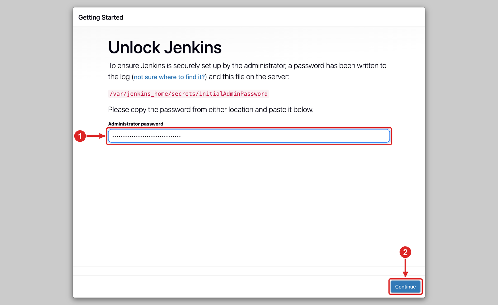{width=75%}

**Customize Jenkins:** **Install suggested plugins** (3). Git, Pipeline, Credentials gibi en çok kullanılan eklentiler kurulur.

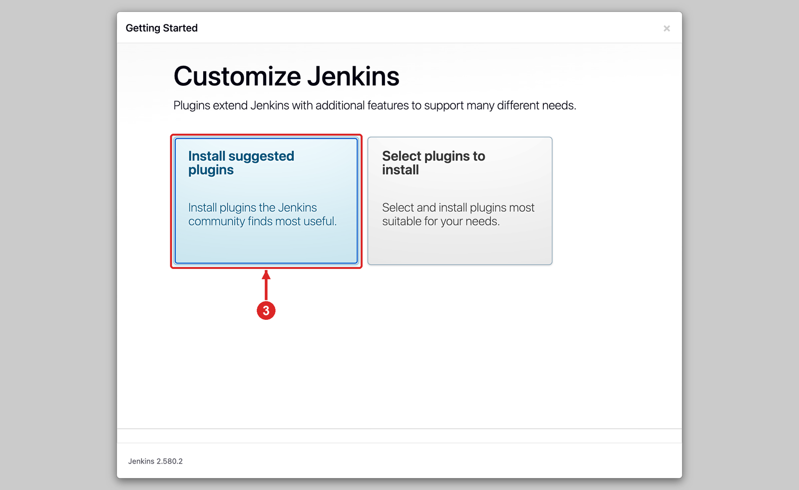{width=75%}

Eklentiler birkaç dakikada kurulur.

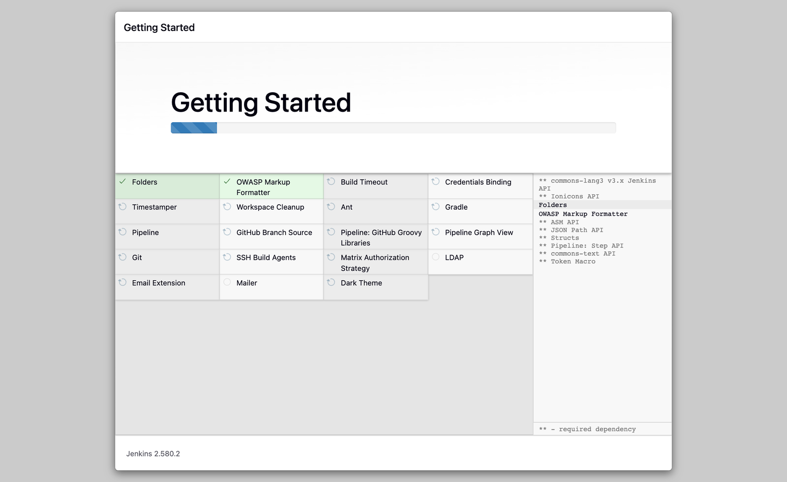{width=75%}

**Create First Admin User:** kullanıcı adı, parola, ad ve e-posta (4), **Save and Continue** (5).

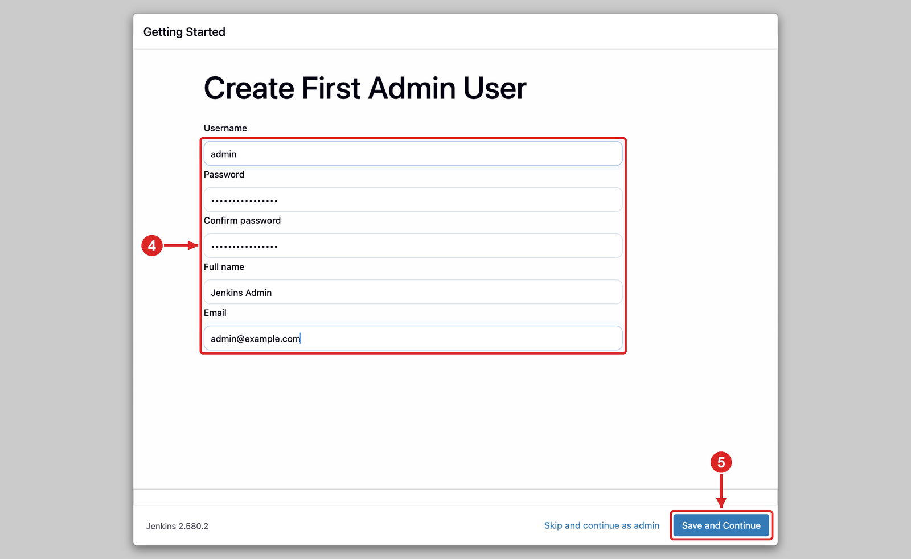{width=75%}

**Instance Configuration:** **Jenkins URL** tarayıcıdaki adrestir (6), **Save and Finish** (7).

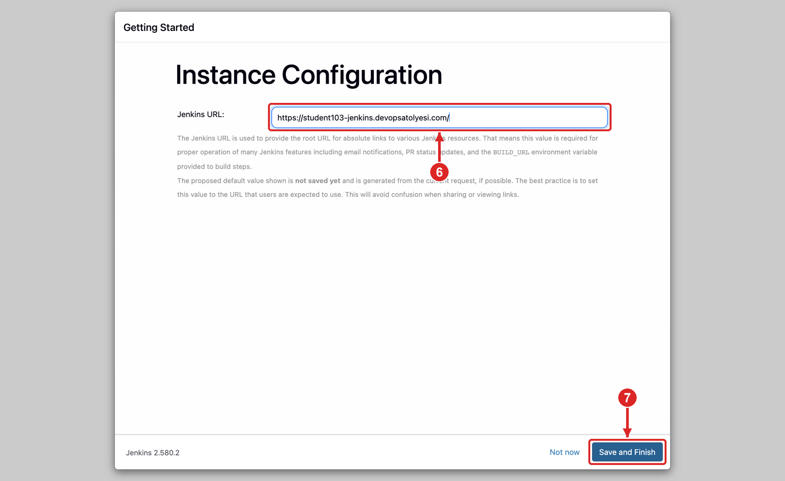{width=75%}

**Start using Jenkins** (8).

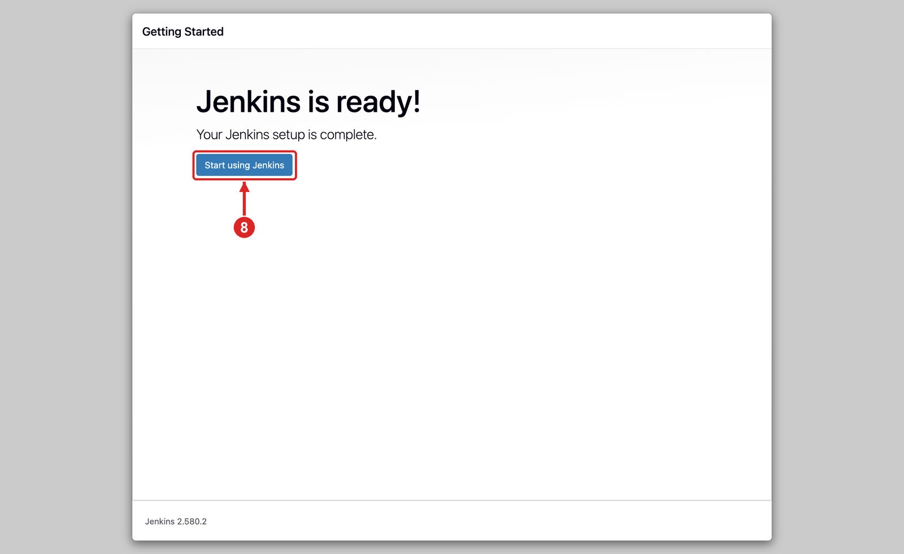{width=75%}

### A3. Arayüzü tanıma

Ana sayfa:

1. **New Item:** yeni job oluşturur.
2. **Build History:** bütün job'ların build geçmişi.
3. **Build Executor Status:** build çalıştıran node'lar ve boş executor sayısı.
4. **Manage Jenkins** (dişli simgesi): bütün yönetim ayarları.
5. Kullanıcı menüsü: profil, API token, çıkış.

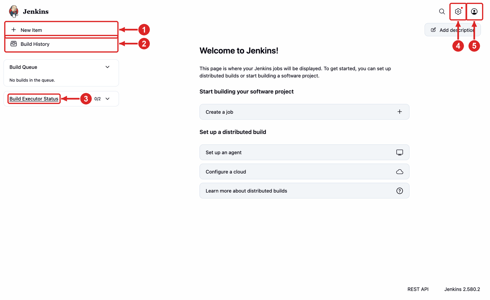{width=75%}

**Manage Jenkins** sayfasında en çok kullanılan bölümler:

1. **System:** Jenkins URL, e-posta, global değişkenler.
2. **Tools:** JDK, Maven, Git gibi araçların yolu veya otomatik kurulumu.
3. **Plugins:** eklenti kurma, güncelleme, kaldırma (A5).
4. **Nodes:** build çalıştıran makineler (agent).
5. **Security:** giriş yöntemi ve kimin ne yapabileceği.
6. **Credentials:** parola, token, SSH anahtarı; pipeline'lar bunları ID ile kullanır.
7. **Users:** kullanıcı ekleme, silme.

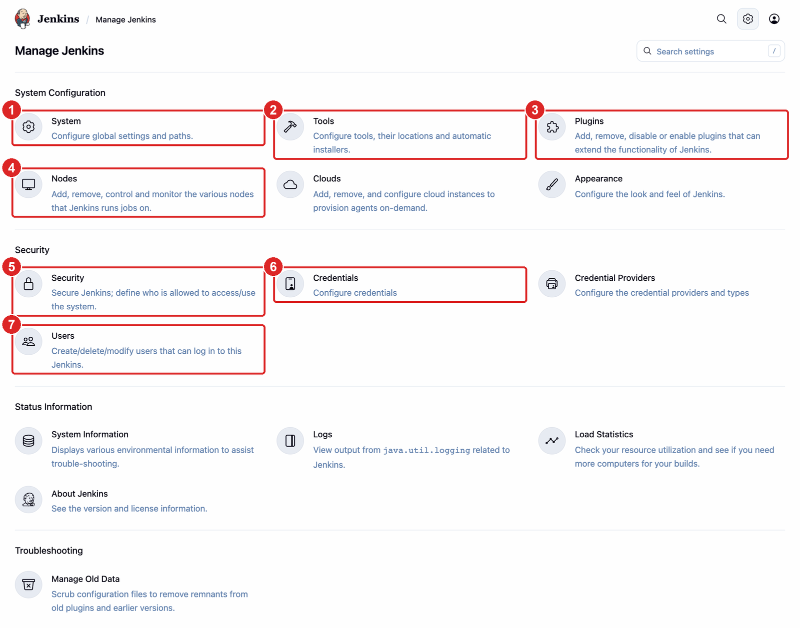{width=75%}

### A4. Arayüzden ilk Pipeline

Ana sayfada **New Item**'a tıklayın. **Enter an item name** alanına `ilk-pipeline` yazın (1), **Pipeline** seçin (2), **OK** (3).

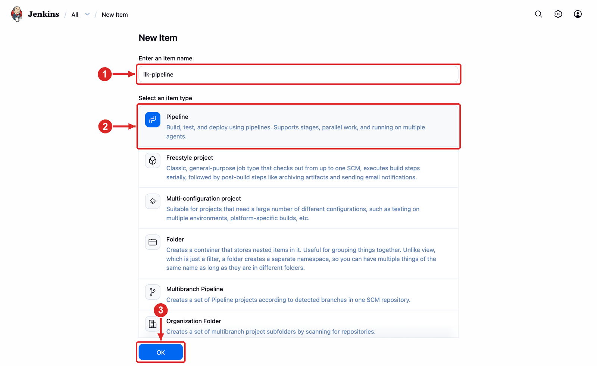{width=75%}

**Pipeline** bölümünde **Definition** `Pipeline script` kalsın. **Script** kutusuna aşağıdaki kodu yapıştırın (4), **Save** (5):

```groovy
pipeline {
    agent any
    stages {
        stage('Merhaba') {
            steps {
                echo 'Jenkins arayüzünden ilk pipeline'
                sh 'hostname && whoami'
            }
        }
    }
}
```

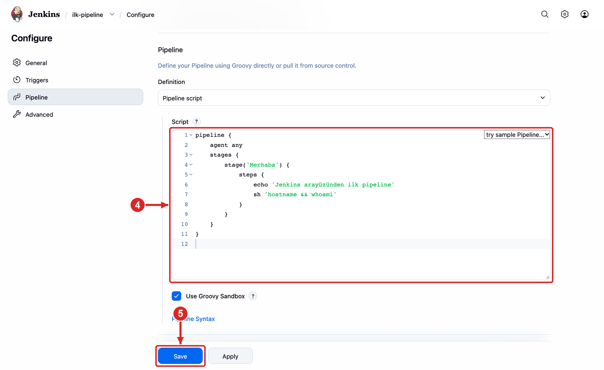{width=75%}

**Build Now** (6).

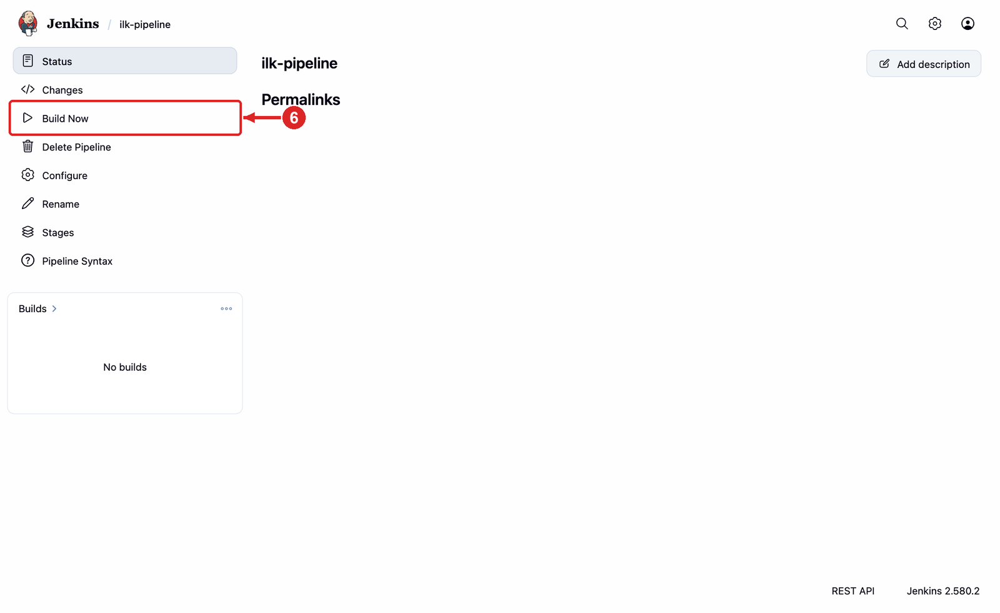{width=75%}

Job sayfası:

7. **Configure:** pipeline kodunu ve ayarları değiştirir.
8. **Stages:** stage'lerin akışı ve süreleri.
9. **Builds** listesindeki `#1`: build'in ayrıntıları ve konsolu.

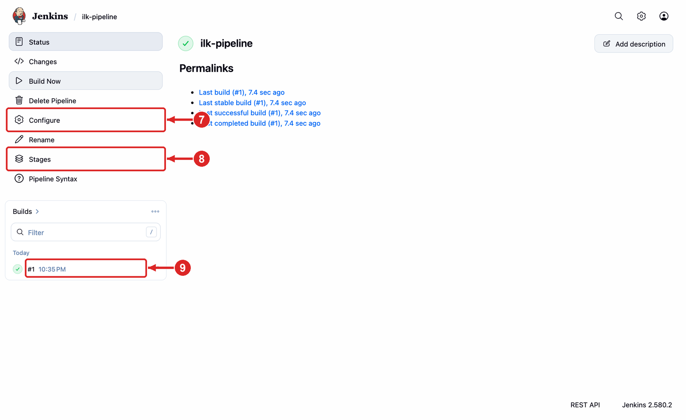{width=75%}

`#1` → **Console Output**. `echo` satırı (10) ve `sh` komutlarının çıktısı görünür; son satır `Finished: SUCCESS` olur:

```text
Jenkins arayüzünden ilk pipeline
+ hostname
9809e260ab91
+ whoami
jenkins
Finished: SUCCESS
```

`hostname` çıktısı Jenkins container'ının kimliğidir; değer sizde farklı olur. Pipeline, Jenkins container'ının içinde `jenkins` kullanıcısıyla çalışır.

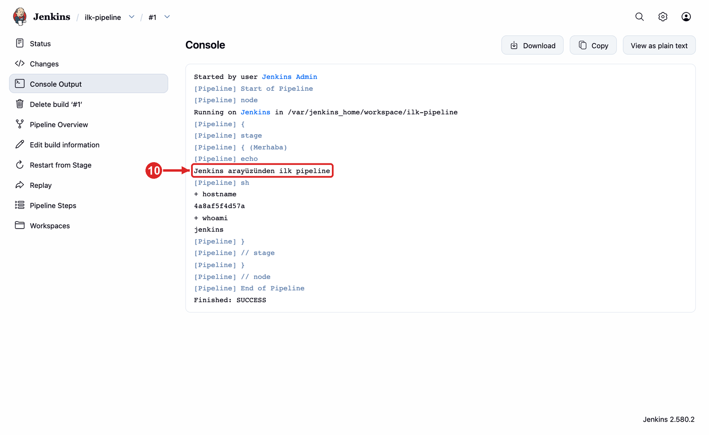{width=75%}

### A5. Eklenti kurma ve kaldırma

Örnek olarak **Rebuilder** eklentisini kurun; bir build'i aynı parametrelerle yeniden çalıştıran **Rebuild** düğmesini ekler.

**Manage Jenkins → Plugins → Available plugins** (1). Arama kutusuna `Rebuilder` yazın (2), satırı işaretleyin (3), **Install** (4).

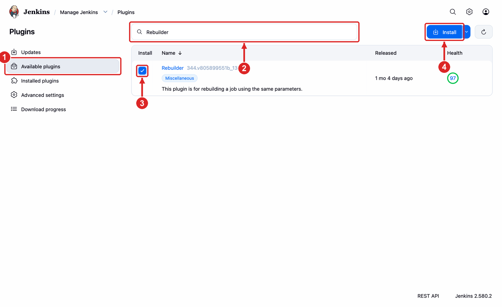{width=75%}

**Download progress** sayfasında `Rebuilder` için `Success` görünür. Bu eklenti yeniden başlatma istemez.

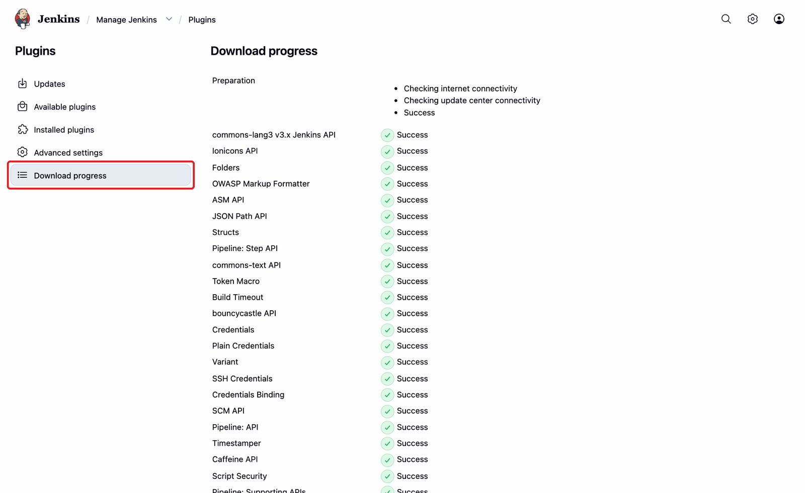{width=75%}

`ilk-pipeline` → `#1` sayfasında sol menüde artık **Rebuild** vardır.

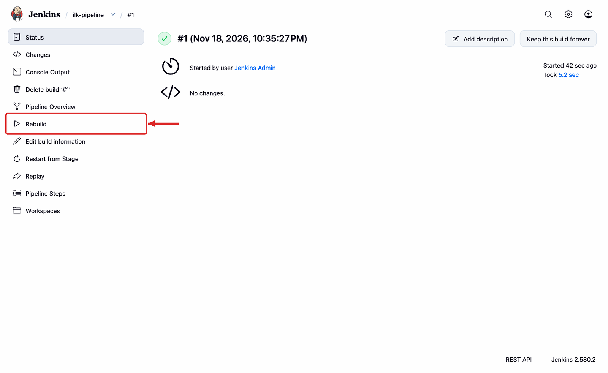{width=75%}

Kaldırmak için **Manage Jenkins → Plugins → Installed plugins** (1). Arama kutusuna `Rebuilder` yazın (2), satırın sonundaki kırmızı çarpı (3). **Enabled** anahtarı ise eklentiyi silmeden kapatır.

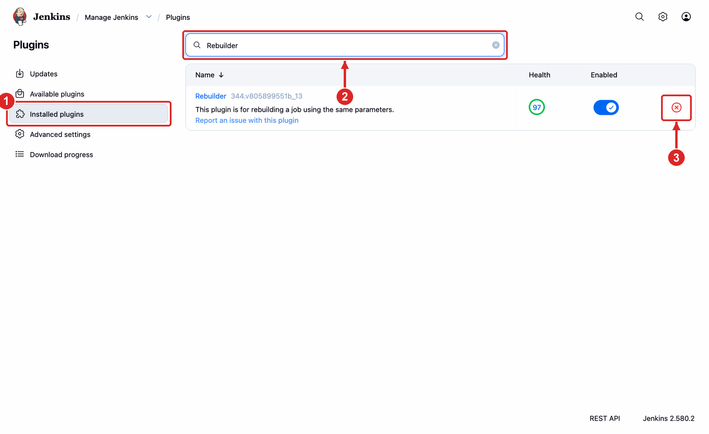{width=75%}

Onay penceresinde **Yes** (4).

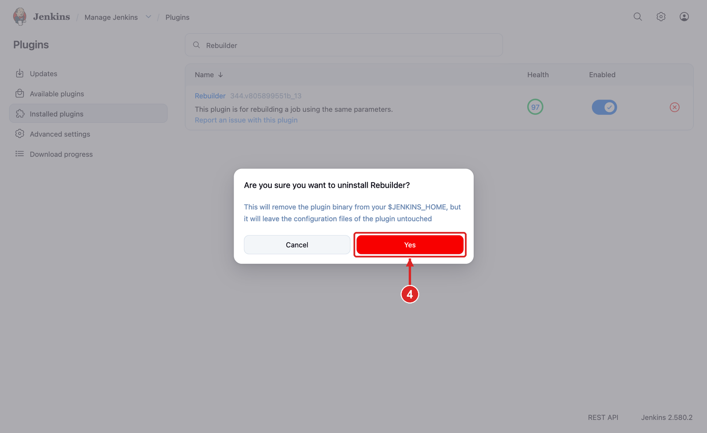{width=75%}

Kaldırma, Jenkins yeniden başlayınca tamamlanır. Adres çubuğunda Jenkins adresinin sonuna `/safeRestart` ekleyip açın ve **Restart** düğmesine basın (5). Jenkins çalışan build'lerin bitmesini bekler, sonra yeniden başlar.

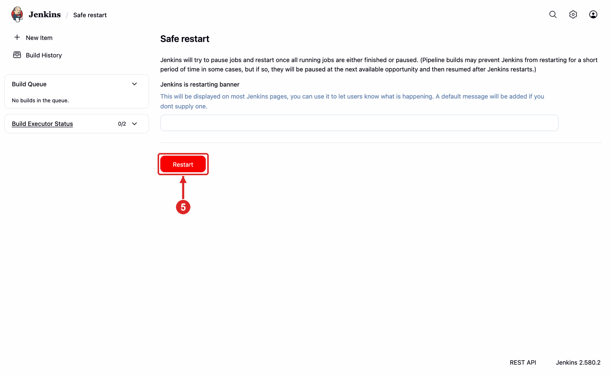{width=75%}

Giriş ekranı geri gelince **Installed plugins** listesinde `Rebuilder` yoktur.

### A6. A'yı silme

B aynı portları kullanır. A'nın container'ını ve job'larını tutan volume'ü silin:

```bash
cd ~/jenkins-labs/lab-01-jenkins-docker-setup/a-arayuz
```

```bash
docker compose down -v
```

## B. Kodla kurulum

A'da elle yapılan her şey B'de dosyalarda tanımlıdır: eklentiler image'a build sırasında kurulur, yönetici kullanıcı ve örnek job'lar Jenkins açılırken oluşturulur. Sihirbaz açılmaz. Jenkins silinip yeniden kurulsa da aynı hâle gelir. Sonraki bütün lablar bu Jenkins'i kullanır.

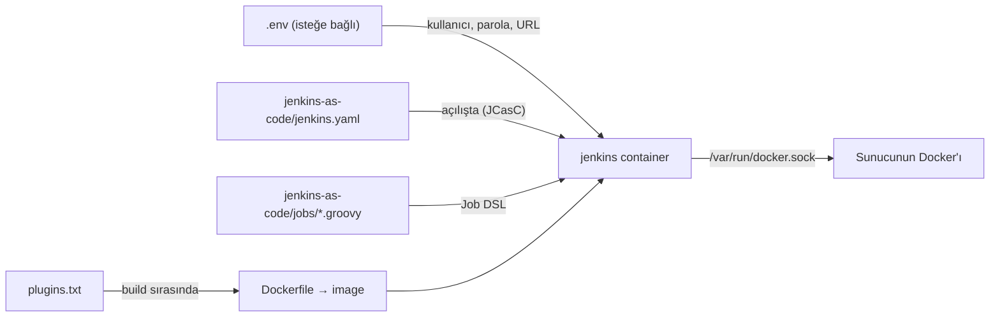

### Config dosyaları

```bash
cd ~/jenkins-labs/lab-01-jenkins-docker-setup/b-kod
```

```bash
ls -a
```

**`Dockerfile`:** `jenkins/jenkins:lts-jdk21` üzerine `docker` CLI, `kubectl` ve `kind` ekler, eklentileri `plugins.txt`'den kurar. Pipeline'lar bu araçlarla image build eder ve Kubernetes'e deploy eder.

**`plugins.txt`:** satır başına bir eklenti. A'da **Plugins** sayfasından yapılan kurulumun kod hâlidir; eklenti eklemek için satır ekleyip image'ı yeniden build edersiniz.

```bash
cat plugins.txt
```

**`docker-compose.yml`:** önemli satırlar:

| Satır | Ne işe yarar |
|---|---|
| `JENKINS_ADMIN_PASSWORD=${JENKINS_ADMIN_PASSWORD:-DevOps2026!}` | Değer `.env` dosyasından okunur; `.env` yoksa `:-` sonrasındaki varsayılan kullanılır. Kullanıcı adı ve URL de aynı şekilde gelir. |
| `runSetupWizard=false` | Kurulum sihirbazı açılmaz. |
| `CASC_JENKINS_CONFIG` | JCasC'nin okuyacağı dosya: `/var/jenkins_config/jenkins.yaml`. |
| `/var/run/docker.sock` | Pipeline'daki `docker` komutları sunucunun Docker'ında çalışır. |
| `networks: kind` | Sonraki lablarda Jenkins, Kind cluster'ına bu ağdan erişir. |

**`jenkins-as-code/jenkins.yaml`:** Jenkins'in ayarları. `${...}` değerleri container'ın ortam değişkenlerinden gelir:

```bash
cat jenkins-as-code/jenkins.yaml
```

- `securityRealm.local.users`: A'daki **Create First Admin User** adımının kod hâli.
- `authorizationStrategy`: giriş yapan her şeyi yapar, giriş yapmayan hiçbir şey göremez.
- `unclassified.location.url`: A'daki **Jenkins URL** adımının kod hâli.
- `jobs`: `jobs/` klasöründeki Job DSL betiklerini çalıştırır.

**`jenkins-as-code/jobs/*.groovy`:** her dosya bir job tanımlar. A'da **New Item** ile yapılanın kod hâlidir:

```bash
cat jenkins-as-code/jobs/01-hello.groovy
```

### B1. `.env` dosyası

`.env` olmadan da Jenkins varsayılan değerlerle açılır: kullanıcı `admin`, parola `DevOps2026!`. Jenkins URL'sini sunucunun adresi yapmak ve isterseniz parolayı değiştirmek için `.env` oluşturun:

```bash
cp .env.example .env
```

```bash
sed -i "s|^JENKINS_URL=.*|JENKINS_URL=https://$(hostname)-jenkins.devopsatolyesi.com/|" .env
```

```bash
cat .env
```

`.env` git'e eklenmez.

### B2. Başlatma

Compose dosyası `kind` Docker ağına bağlanır. Ağ yoksa oluşturun:

```bash
docker network create kind 2>/dev/null || true
```

İlk build birkaç dakika sürer:

```bash
docker compose up -d --build
```

`Jenkins is fully up and running` satırını görünce `Ctrl+C` ile çıkın. Hemen üstünde JCasC'nin üç job'u oluşturduğu satırlar (`createOrUpdateConfig`) görünür:

```bash
docker compose logs -f jenkins
```

### B3. Giriş

Tarayıcıda Jenkins adresini açın. Sihirbaz yerine giriş ekranı gelir. Kullanıcı adı ve parolayı girin (1), **Sign in** (2). `.env` oluşturmadıysanız `admin` / `DevOps2026!`.

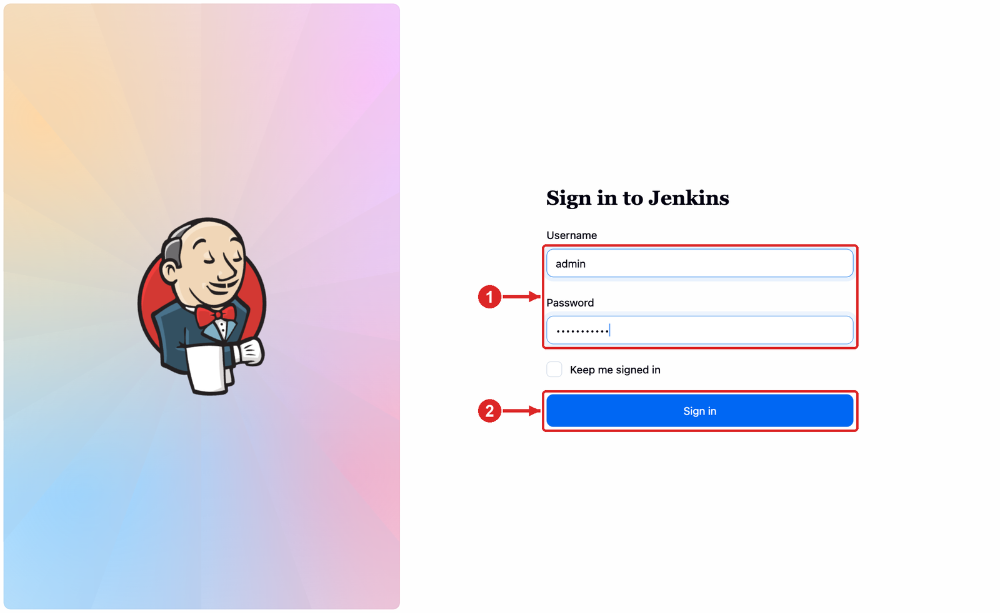{width=75%}

Ana sayfada `jenkins.yaml`'daki `systemMessage` (3) ve Job DSL'in oluşturduğu üç job (4) görünür.

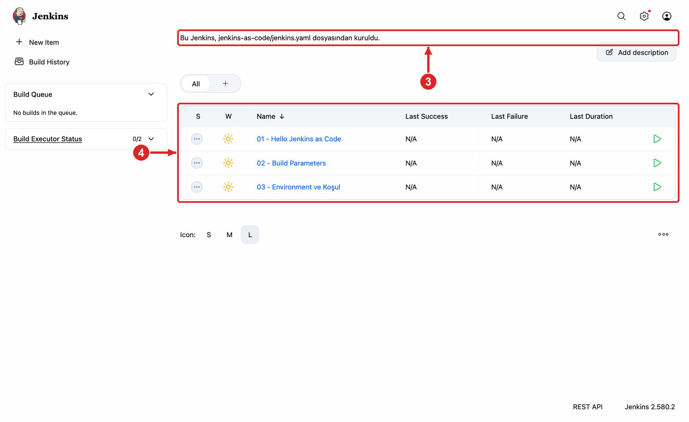{width=75%}

**Manage Jenkins → Configuration as Code** sayfası uygulanan dosyayı gösterir (5). `jenkins.yaml`'ı değiştirdiğinizde Jenkins'i yeniden başlatmadan buradan yeniden yükleyebilirsiniz (6).

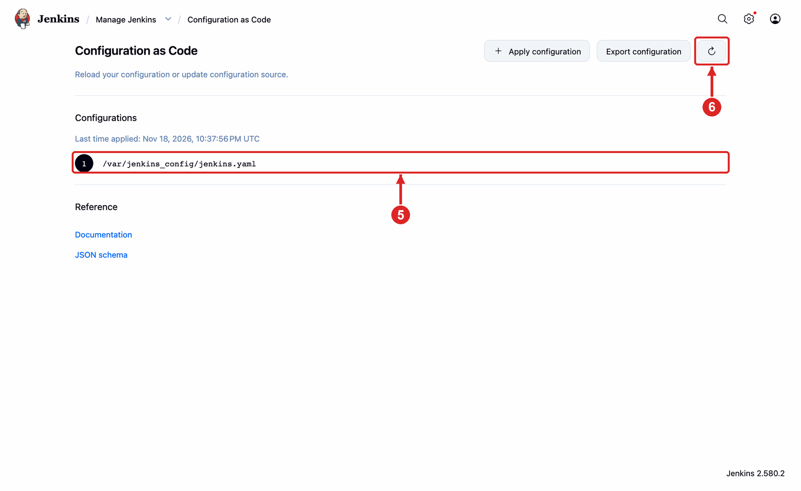{width=75%}

### B4. Kodla tanımlanmış job'ları çalıştırma

**01 - Hello Jenkins as Code** → **Build Now** → `#1` → **Console Output**:

```text
Merhaba! Job: 01-hello-jcasc, build: #1
```

**02 - Build Parameters** job'unda **Build Now** yerine **Build with Parameters** vardır; parametreler Job DSL dosyasında tanımlıdır. Değerleri değiştirin (7), **Build** (8).

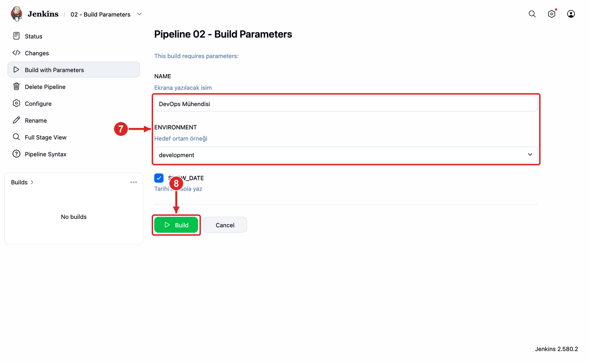{width=75%}

Varsayılan değerlerle **Console Output**:

```text
Merhaba DevOps Mühendisi; ortam: development
```

**03 - Environment ve Koşul** → **Build Now**. `DEPLOY_ENV` değeri `test` olduğu için `when` koşulu sağlanır:

```text
Koşul sağlandı: test ortamı adımı çalıştı.
```

## Temizlik

B'nin Jenkins'i sonraki lablarda kullanılır; kaldırmayın.

<details>
<summary><strong>B'yi tamamen kaldırmak</strong></summary>

`-v` job'ları tutan `jenkins_home` volume'ünü de siler:

```bash
cd ~/jenkins-labs/lab-01-jenkins-docker-setup/b-kod && docker compose down -v
```

</details>
