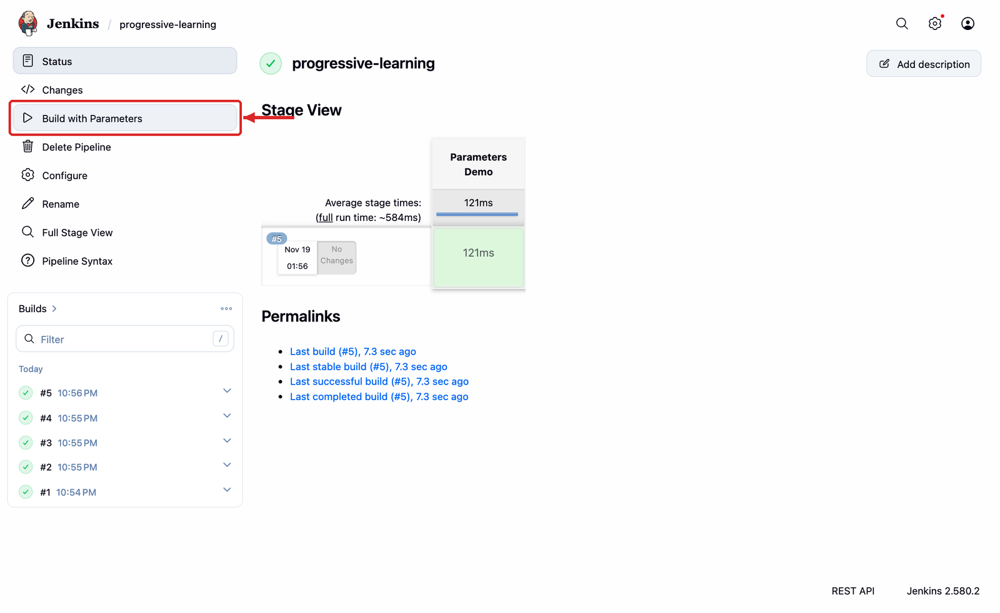
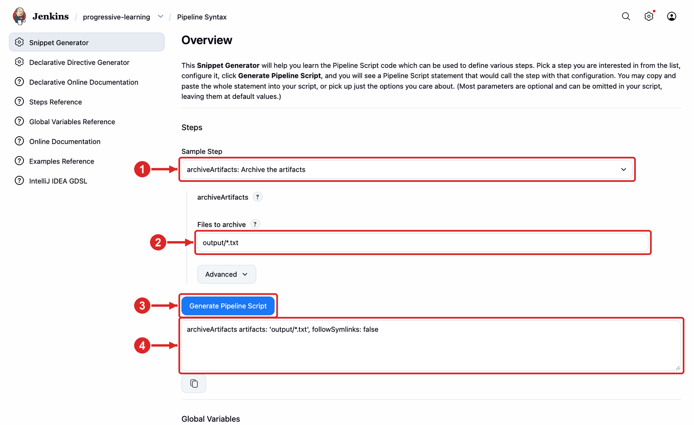
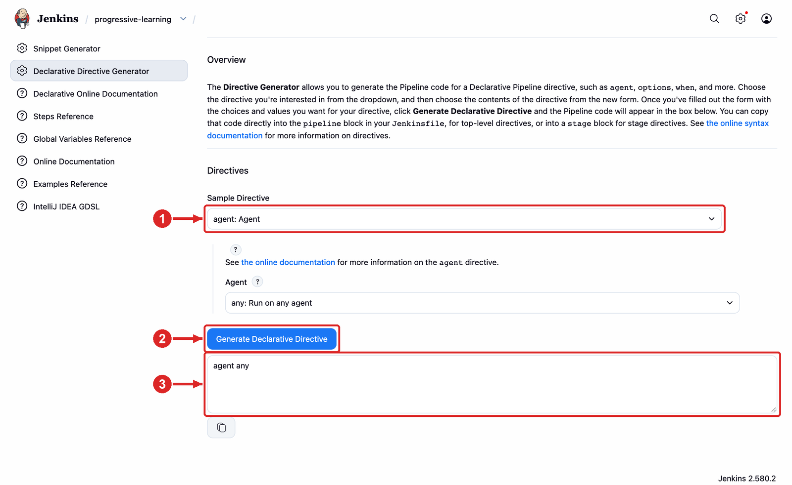
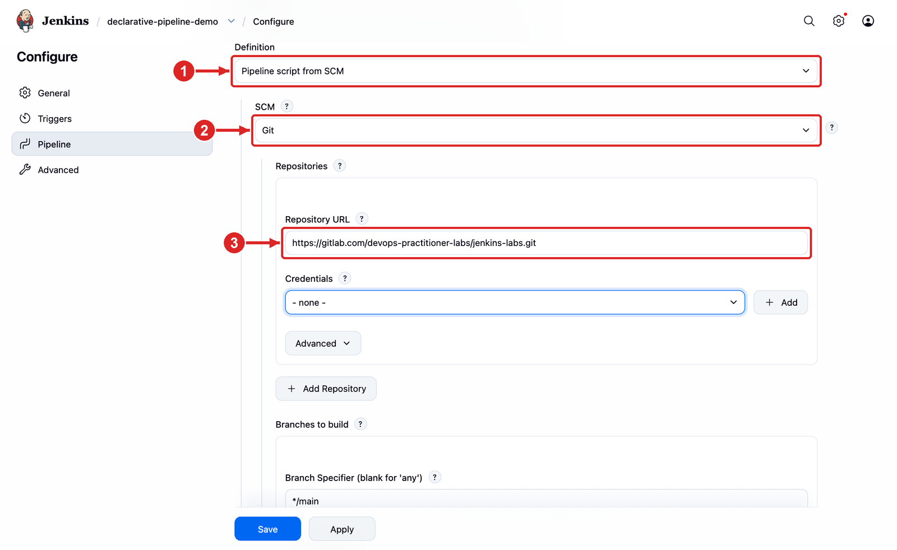
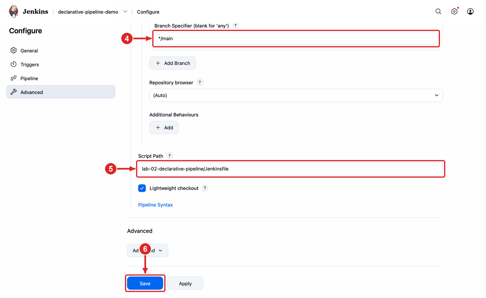
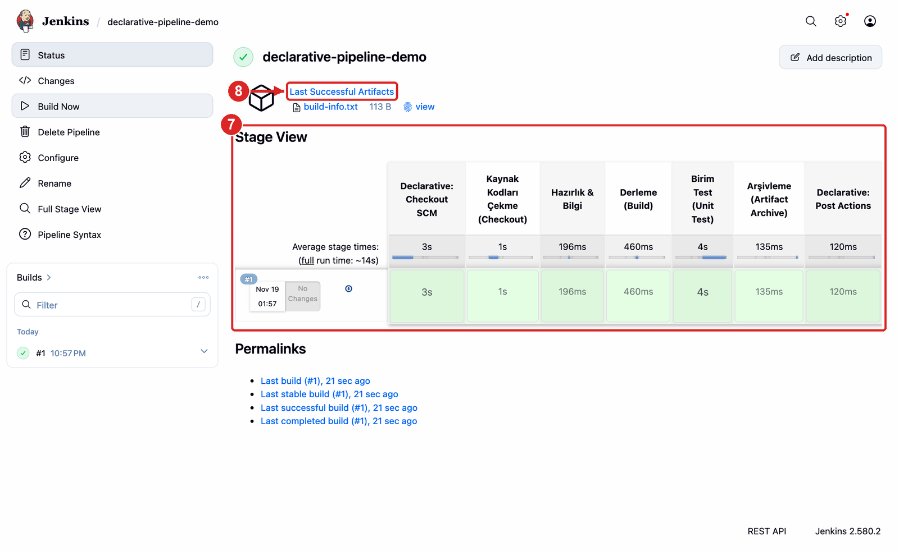

# LAB-JEN-02 — Declarative Pipeline Temelleri

| Profil / Araçlar | Açık Portlar |
|---|---|
| Jenkins, Declarative Pipeline, Snippet Generator, `docker` | 18080 |

## Amaç

- Declarative Pipeline bloklarını (`stages`, `environment`, `options`, `parameters`, `post`) sırayla denemek.
- Snippet Generator ve Directive Generator ile kod üretmek.
- Jenkinsfile'ı Git reposundan çalıştırmak, testi container'da koşturmak, artifact arşivlemek.

## Ön Koşullar

- LAB-JEN-01 B bölümündeki Jenkins çalışıyor olmalıdır (`docker ps` çıktısında `jenkins`).

```bash
cd ~/jenkins-labs/lab-02-declarative-pipeline
```

## 1. Pipeline blokları

Jenkins'te `progressive-learning` adında bir **Pipeline** job'u oluşturun (**New Item** → ad → **Pipeline** → **OK**). Aşağıdaki her kodu sırayla **Configure → Pipeline → Script** kutusuna yapıştırın, **Save** → **Build Now** ile çalıştırıp `#N` → **Console Output**'a bakın. Kodlar `snippets/` klasöründe de var:

```bash
ls snippets
```

### 1.1 En küçük pipeline

`pipeline`, `agent` ve en az bir `stage` zorunludur:

```groovy
pipeline {
    agent any
    stages {
        stage('Build stage') {
            steps {
                echo "This is build stage"
            }
        }
        stage('Test stage') {
            steps {
                echo "This is test stage"
            }
        }
        stage('Deploy stage') {
            steps {
                echo "This is deploy stage"
            }
        }
    }
}
```

```text
This is build stage
This is test stage
This is deploy stage
Finished: SUCCESS
```

### 1.2 Jenkins'in hazır değişkenleri

Jenkins her build'e `env.JOB_NAME`, `env.BUILD_NUMBER` gibi değişkenler verir:

```groovy
pipeline {
    agent any
    stages {
        stage('Built-in Variables') {
            steps {
                echo "Job Name        : ${env.JOB_NAME}"
                echo "Build Number    : ${env.BUILD_NUMBER}"
                echo "Build ID        : ${env.BUILD_ID}"
                echo "Build URL       : ${env.BUILD_URL}"
                echo "Node Name       : ${env.NODE_NAME}"
                echo "Workspace Path  : ${env.WORKSPACE}"
            }
        }
    }
}
```

Çıktıda job adı `progressive-learning`, node adı `built-in` (Jenkins'in kendisi), workspace `/var/jenkins_home/workspace/progressive-learning` olur.

### 1.3 Kendi değişkenleriniz: `environment`

```groovy
pipeline {
    agent any
    environment {
        APP_NAME    = 'my-microservice'
        APP_ENV     = 'staging'
        PORT_NUMBER = '8080'
    }
    stages {
        stage('Environment Usage') {
            steps {
                echo "Deploying application: ${env.APP_NAME}"
                echo "Target environment  : ${env.APP_ENV}"
                echo "Service port        : ${env.PORT_NUMBER}"
            }
        }
    }
}
```

```text
Deploying application: my-microservice
Target environment  : staging
Service port        : 8080
```

### 1.4 Pipeline davranışı: `options`

`buildDiscarder` en çok 5 build saklar, `timestamps` her satıra saat ekler, `timeout` 10 dakikada build'i durdurur, `retry(1)` hata olursa bir kez daha dener:

```groovy
pipeline {
    agent any
    options {
        buildDiscarder(logRotator(numToKeepStr: '5', daysToKeepStr: '7'))
        timestamps()
        timeout(time: 10, unit: 'MINUTES')
        retry(1)
    }
    stages {
        stage('Options Stage') {
            steps {
                echo "This build has timestamps enabled and max 5 builds kept."
            }
        }
    }
}
```

Satırların başında saat görünür:

```text
[2026-11-18T20:49:07.372Z] Timeout set to expire in 10 min
[2026-11-18T20:49:07.544Z] This build has timestamps enabled and max 5 builds kept.
```

### 1.5 Dışarıdan değer almak: `parameters`

```groovy
pipeline {
    agent any
    parameters {
        string(name: 'APP_VERSION', defaultValue: '1.0.0', description: 'Uygulama surum numarasi')
        choice(name: 'DEPLOY_ENV', choices: ['dev', 'qa', 'prod'], description: 'Hedef dagitim ortami')
        booleanParam(name: 'RUN_TESTS', defaultValue: true, description: 'Testler kosturulsun mu?')
    }
    stages {
        stage('Parameters Demo') {
            steps {
                echo "Surum           : ${params.APP_VERSION}"
                echo "Hedef Ortam     : ${params.DEPLOY_ENV}"
                echo "Test Kosulsun mu: ${params.RUN_TESTS}"
            }
        }
    }
}
```

Parametreler Jenkins'e ilk build'de kaydedilir: bir kez **Build Now** ile çalıştırın. Sonra sol menüde **Build with Parameters** belirir.

{width=75%}

**Build with Parameters**'ta `APP_VERSION=2.0.0`, `DEPLOY_ENV=qa` seçip `RUN_TESTS` işaretini kaldırın, **Build**:

```text
Surum           : 2.0.0
Hedef Ortam     : qa
Test Kosulsun mu: false
```

### 1.6 Build sonrası: `post`

`always` her durumda, `success` yalnızca başarıda, `failure` yalnızca hatada, `cleanup` en sonda çalışır:

```groovy
pipeline {
    agent any
    stages {
        stage('Execution Stage') {
            steps {
                echo "Pipeline adimlari icra ediliyor..."
            }
        }
    }
    post {
        always {
            echo "[POST: ALWAYS] Bu blok build sonucu ne olursa olsun (basarili/hatali) daima calisir."
        }
        success {
            echo "[POST: SUCCESS] Tebrikler! Tum asamalar basariyla tamamlandi."
        }
        failure {
            echo "[POST: FAILURE] Dikkat! Asamalardan biri basarisiz oldu."
        }
        cleanup {
            echo "[POST: CLEANUP] Gecici dosyalar ve calisma alani temizlendi."
        }
    }
}
```

1.5'teki parametreler job'da bir sonraki build'e kadar kalır: sol menüde **Build Now** yerine hâlâ **Build with Parameters** görünür. Ona tıklayıp açılan sayfada **Build**'e basın; bu build'den sonra parametreler kalkar.

Build başarılı olduğu için `failure` satırı yazılmaz:

```text
[POST: ALWAYS] Bu blok build sonucu ne olursa olsun (basarili/hatali) daima calisir.
[POST: SUCCESS] Tebrikler! Tum asamalar basariyla tamamlandi.
[POST: CLEANUP] Gecici dosyalar ve calisma alani temizlendi.
```

## 2. Kod üreteçleri

Adımların yazımını ezberlemek gerekmez. Job sayfasında sol menüden **Pipeline Syntax** açın.

**Snippet Generator:** **Sample Step** listesinden `archiveArtifacts` seçin (1), **Files to archive** alanına `output/*.txt` yazın (2), **Generate Pipeline Script** (3). Üretilen satırı (4) pipeline'da `steps` içine yapıştırabilirsiniz.

{width=75%}

**Declarative Directive Generator** (sol menü): **Sample Directive** listesinden bir blok seçin (1), **Generate Declarative Directive** (2). Örnekte `agent` → `any` seçili; çıktı `agent any` olur (3). `options`, `parameters`, `triggers` bloklarını da buradan üretebilirsiniz.

{width=75%}

## 3. Jenkinsfile'ı Git'ten çalıştırma

Kod Jenkins'te değil, repoda durur. Jenkins her build'de repoyu çeker ve `Jenkinsfile`'ı çalıştırır. Bu labın Jenkinsfile'ı:

```bash
cat Jenkinsfile
```

- **Birim Test:** testler Jenkins'e Node.js kurmadan `node:18-alpine` container'ında çalışır. `--volumes-from jenkins`, container'a Jenkins'in workspace'ini bağlar; `-w "$PWD/app"` test klasörüne geçer.
- **Arşivleme:** `archiveArtifacts` derleme çıktısını build'e ekler; job sayfasından indirilebilir.

`declarative-pipeline-demo` adında bir **Pipeline** job'u oluşturun. **Pipeline** bölümünde **Definition** olarak `Pipeline script from SCM` (1), **SCM** olarak `Git` seçin (2). **Repository URL**:

```text
https://gitlab.com/devops-practitioner-labs/jenkins-labs.git
```

{width=75%}

**Branch Specifier** `*/main` (4), **Script Path** `lab-02-declarative-pipeline/Jenkinsfile` (5), **Save** (6).

{width=75%}

**Build Now**. İlk build `node:18-alpine` image'ını çektiği için biraz uzun sürer. Job sayfasında **Stage View** her stage'in süresini gösterir (7); **Last Successful Artifacts** altında `build-info.txt` vardır (8).

{width=75%}

**Console Output**'tan kısaltılmış satırlar:

```text
--- Birim Test Başlatılıyor ---
Test Başarılı: Sunucu objesi geçerli.
--- Tüm Testler Geçti ---
Archiving artifacts
[SUCCESS] Pipeline başarıyla tamamlandı. Artefaktlar arşivlendi.
Finished: SUCCESS
```

## Temizlik

İki job'u silmek için job sayfasında **Delete Pipeline** → **Yes**. Testin çektiği image:

```bash
docker rmi node:18-alpine
```
