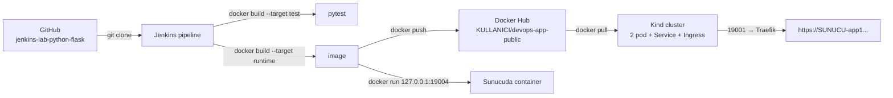
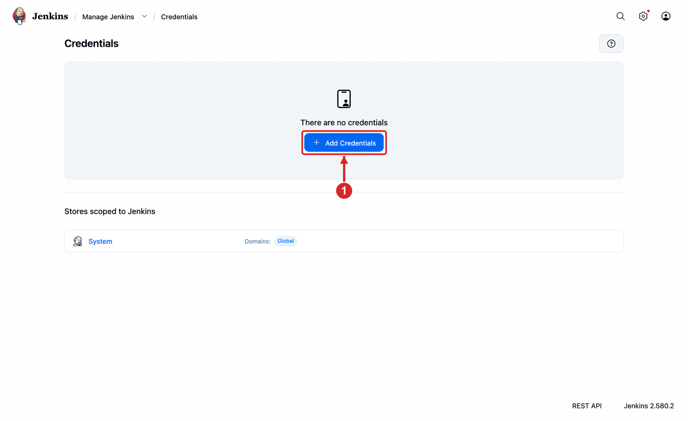
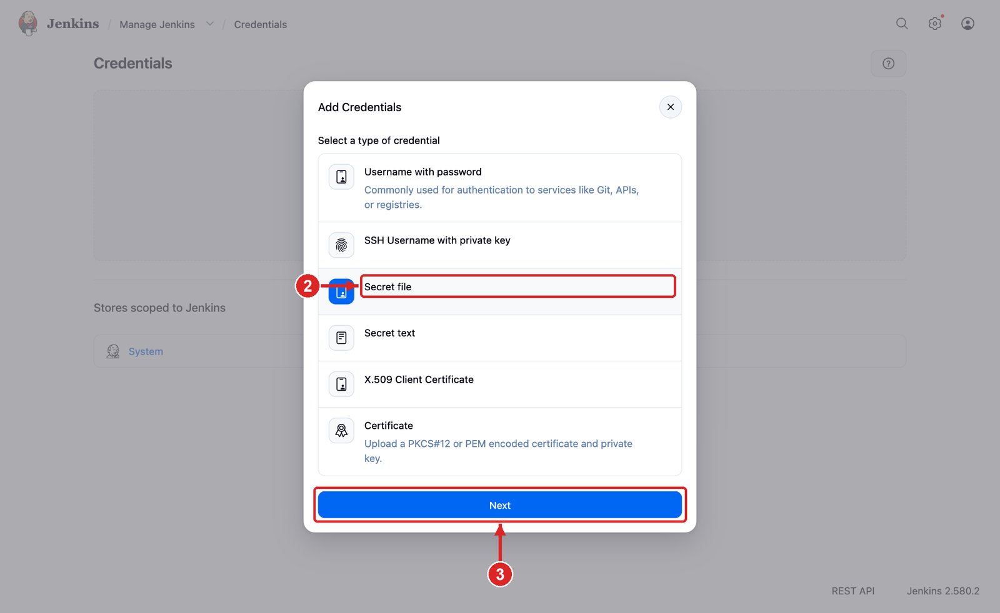
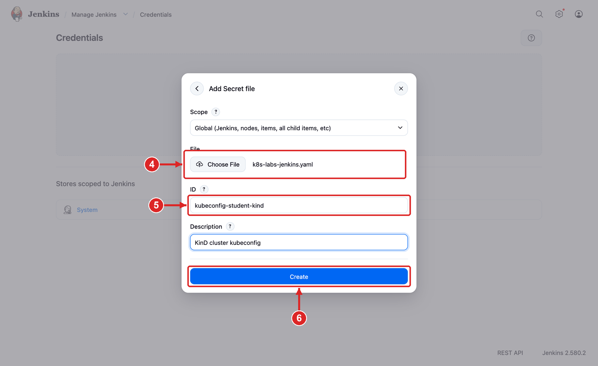
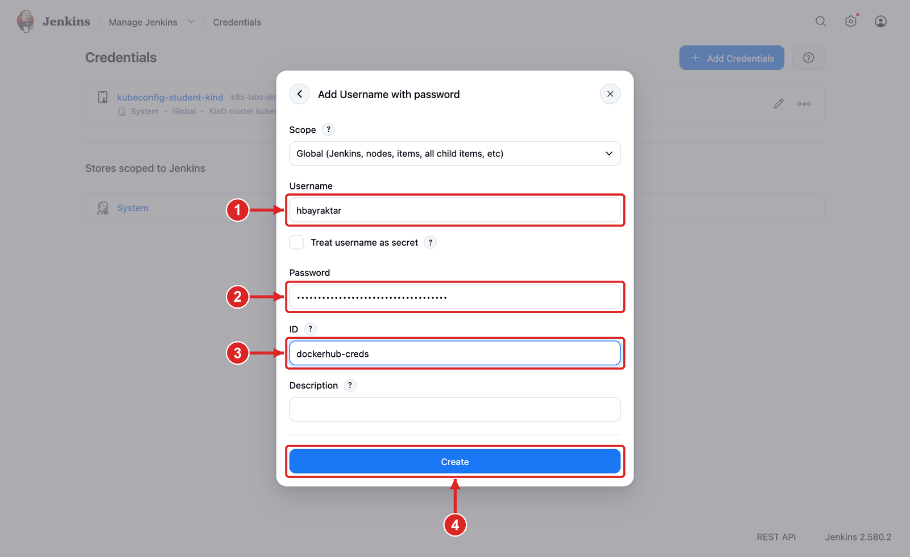
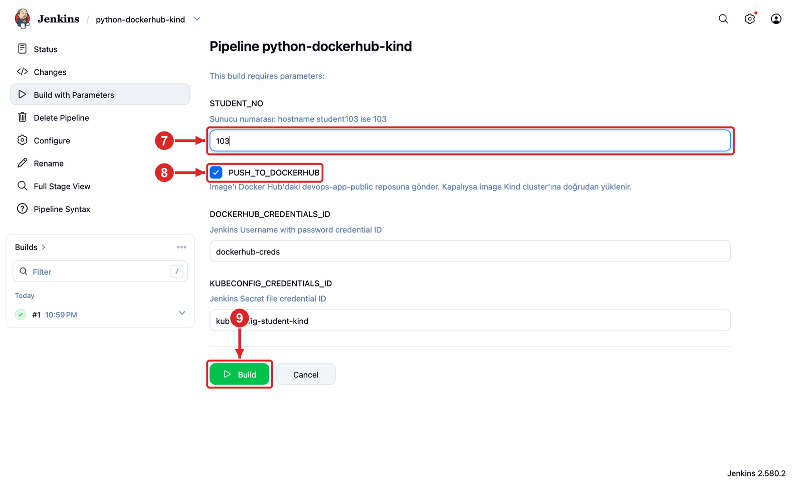
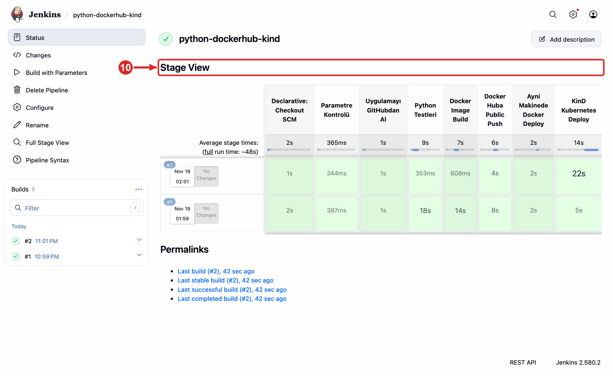
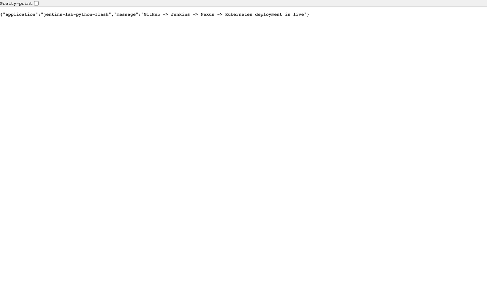

# LAB-JEN-02A — Python Flask: Test, Docker Build ve Kind'a Deploy

| Profil / Araçlar | Açık Portlar |
|---|---|
| Jenkins, `docker`, `kind`, `kubectl`, Python/pytest, Docker Hub | 18080, 127.0.0.1:19004, 19001 (Kind ingress), `https://<sunucu-adı>-app1.devopsatolyesi.com` |

## Amaç

- Bir Flask uygulamasını pipeline içinde test edip image'ını build etmek.
- Image'ı Docker Hub'daki `devops-app-public` reposuna push etmek.
- Image'ı aynı sunucuda container olarak ve Kind cluster'ına deploy etmek.

## Ön Koşullar

- LAB-JEN-01 B bölümündeki Jenkins çalışıyor olmalıdır.
- Docker Hub hesabı ve `devops-app-public` adlı public repository (docker-labs LAB-07'de açılan repo; yoksa ilk push onu oluşturur).
- `k8s-labs` Kind cluster'ı çalışıyor olmalıdır (`kubectl get nodes` üç node gösterir). Alan adıyla erişim için cluster'da ingress controller gerekir; `k8s-labs`'ta Traefik.



Pipeline jenkins-labs reposundaki `Jenkinsfile`'dır; uygulama kodunu (`Dockerfile`, `k8s/`) GitHub'daki `jenkins-lab-python-flask` reposundan çeker:

```bash
cat ~/jenkins-labs/lab-02a-python-dockerhub-kind/Jenkinsfile
```

Uygulamanın Dockerfile'ı GitHub reposundadır:

```bash
curl -fsS https://raw.githubusercontent.com/devopsatolyesi-labs/jenkins-lab-python-flask/main/Dockerfile
```

- `base`: bağımlılıkları (test araçları dahil) kurar.
- `test`: `pytest` çalıştırır. Pipeline `docker build --target test` ile yalnızca buraya kadar build eder; test başarısızsa build durur.
- `runtime`: yalnızca çalışma bağımlılıklarıyla küçük image; root olmayan kullanıcı (`10001`) ve `gunicorn` ile 8080'de çalışır. Push edilen ve deploy edilen image budur.

## Adım Adım Uygulama Rehberi

### 1. Jenkins için kubeconfig

Sunucudaki `~/.kube/config` API adresi olarak `127.0.0.1:<port>` yazar. Jenkins container'ından bu adres sunucuyu değil container'ın kendisini gösterir. Jenkins `kind` Docker ağında olduğu için adresi Kind control-plane container'ının adıyla değiştirin:

```bash
sed -E 's#https://127\.0\.0\.1:[0-9]+#https://k8s-labs-control-plane:6443#' \
  ~/.kube/config > ~/.kube/k8s-labs-jenkins.yaml
chmod 600 ~/.kube/k8s-labs-jenkins.yaml
```

Dosyayı tarayıcıdan yükleyebilmek için **kendi bilgisayarınıza** kopyalayın (komutu kendi bilgisayarınızın terminalinde çalıştırın):

```text
scp student@SUNUCU_IP:~/.kube/k8s-labs-jenkins.yaml .
```

### 2. Kubeconfig credential'ı

**Manage Jenkins → Credentials**, **Add Credentials** (1).

{width=75%}

**Secret file** seçin (2), **Next** (3).

{width=75%}

**File** ile `k8s-labs-jenkins.yaml` dosyasını seçin (4), **ID** alanına `kubeconfig-student-kind` yazın (5), **Create** (6). Pipeline credential'ı bu ID ile bulur.

{width=75%}

Pipeline içinde `withCredentials([file(...)])` dosyayı geçici bir yola yazar ve yolu `KUBECONFIG` değişkenine koyar; dosyanın içeriği konsolda `****` olarak maskelenir.

### 3. Docker Hub credential'ı

Docker Hub'da **Account Settings → Personal access tokens → Generate new token**: izin **Read & Write**. Üretilen token'ı kopyalayın; bir daha gösterilmez.

Jenkins'te **Manage Jenkins → Credentials → Add Credentials → Username with password → Next**: **Username** Docker Hub kullanıcı adınız (1), **Password** token (2), **ID** `dockerhub-creds` (3), **Create** (4).

{width=75%}

Pipeline Docker Hub kullanıcı adını bu credential'dan okur; image adı `KULLANICI/devops-app-public:v<build>-<commit>` olur.

### 4. Pipeline job'u

`python-dockerhub-kind` adında bir **Pipeline** job'u oluşturun. LAB-JEN-02'deki gibi **Definition** `Pipeline script from SCM`, **SCM** `Git`:

| Alan | Değer |
|---|---|
| Repository URL | `https://gitlab.com/devops-practitioner-labs/jenkins-labs.git` |
| Branch Specifier | `*/main` |
| Script Path | `lab-02a-python-dockerhub-kind/Jenkinsfile` |

**Save** → **Build Now**. Bu ilk build parametreleri Jenkins'e kaydeder ve varsayılan değerlerle (`STUDENT_NO=101`, push açık) çalışır.

### 5. Parametrelerle çalıştırma

Sunucu numaranız `hostname` çıktısındaki sayıdır:

```bash
hostname
```

**Build with Parameters**: `STUDENT_NO` alanına numaranızı yazın (7). `PUSH_TO_DOCKERHUB` işaretli kalsın (8). **Build** (9).

{width=75%}

**Stage View** (10): `Python Testleri` → `Docker Image Build` → `Docker Huba Public Push` → `Ayni Makinede Docker Deploy` → `KinD Kubernetes Deploy`. **Console Output**'ta `Login Succeeded` ve push edilen etiketin `digest` satırı görünür.

{width=75%}

### 6. Sonuç

Sunucuda çalışan container (yalnızca sunucunun kendisinden erişilir):

```bash
curl -fsS http://127.0.0.1:19004/health
```

Kind cluster'ındaki kaynaklar:

```bash
kubectl -n student-python-lab get deployment,pods,service,ingress
```

`python-flask` deployment'ı `2/2`, ingress sınıfı `traefik`, host `<sunucu-adı>-app1.devopsatolyesi.com` olur. Pod'lar image'ı Docker Hub'dan çeker:

```bash
kubectl -n student-python-lab get deployment python-flask -o jsonpath='{.spec.template.spec.containers[0].image}'; echo
```

Çıktı `KULLANICI/devops-app-public:v<build>-<commit>` biçimindedir. Docker Hub'da repository'nin **Tags** sekmesinde aynı etiket görünür.

Ingress'e sunucudan istek:

```bash
curl -fsS -H "Host: $(hostname)-app1.devopsatolyesi.com" http://127.0.0.1:19001/health
```

Üç komut da şunu döner:

```json
{"status":"healthy"}
```

Tarayıcıda açılacak adres:

```bash
echo "https://$(hostname)-app1.devopsatolyesi.com"
```

Ingress kuralı alan adına bağlı olduğu için `http://IP:19001` ile açılmaz; DNS kaydı yoksa yukarıdaki `curl -H "Host: ..."` komutuyla deneyin.

{width=75%}

<details>
<summary><strong>Docker Hub hesabı olmadan</strong></summary>

**Build with Parameters**'ta `PUSH_TO_DOCKERHUB` işaretini kaldırın. Push stage'i atlanır, image `local/devops-app-public:...` adıyla build edilir ve `kind load docker-image` ile cluster node'larına doğrudan yüklenir.

</details>

## Temizlik

```bash
kubectl delete namespace student-python-lab
```

```bash
docker rm -f student-python-flask
```

Job'u **Delete Pipeline** ile silebilirsiniz. Kubeconfig credential'ı LAB-JEN-06'da yeniden kullanılır.
