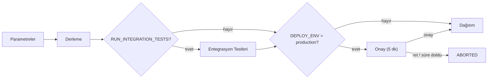
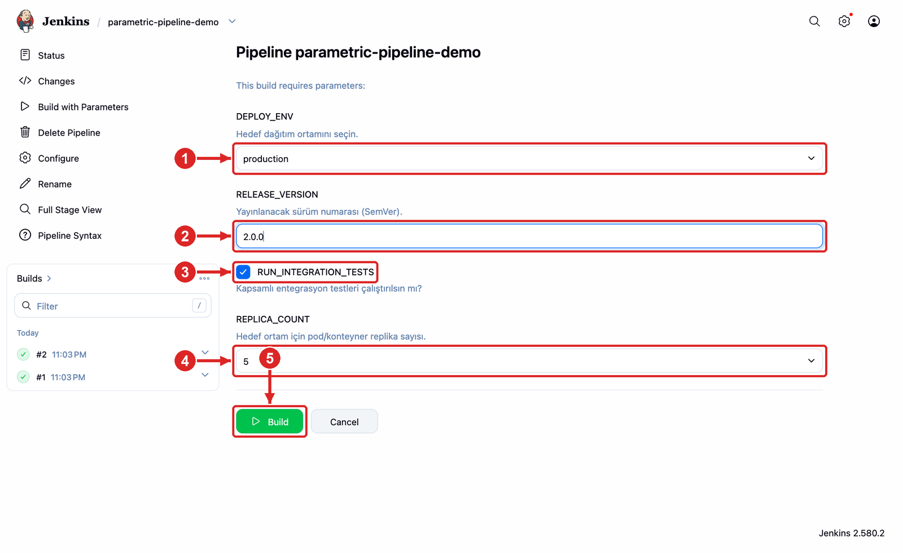
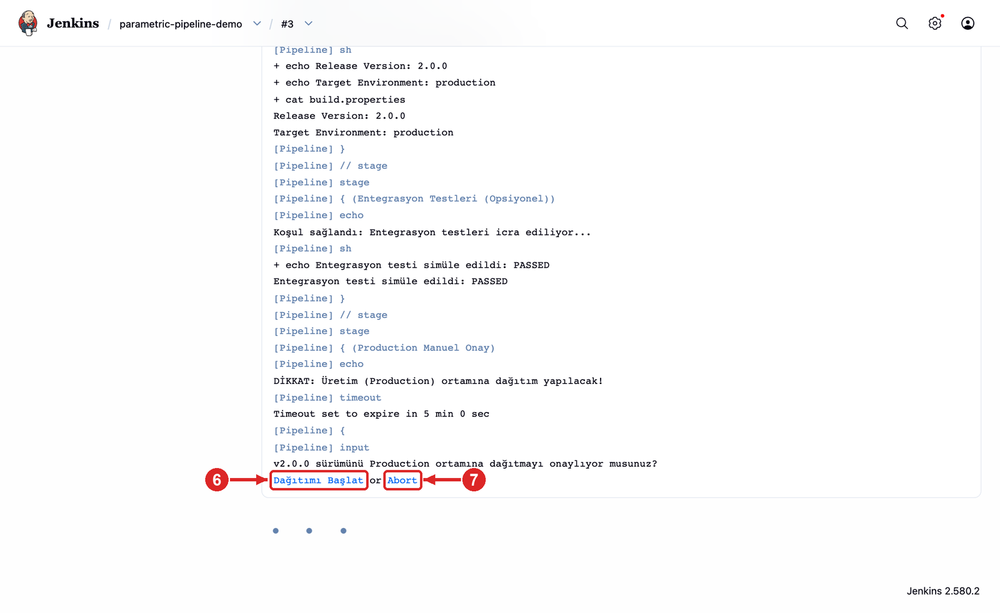
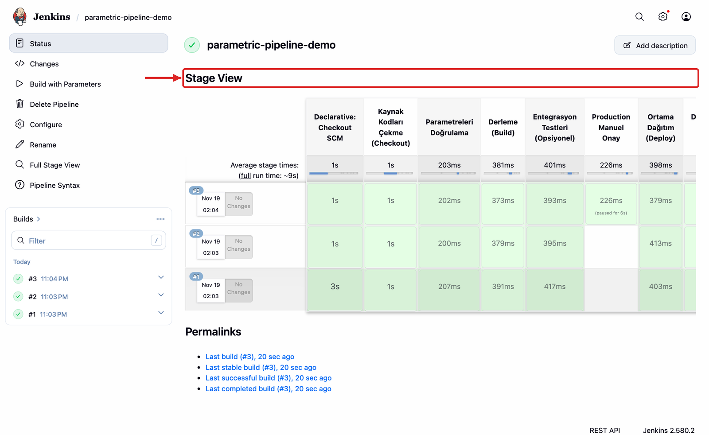
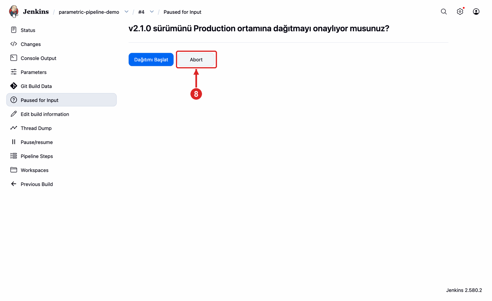
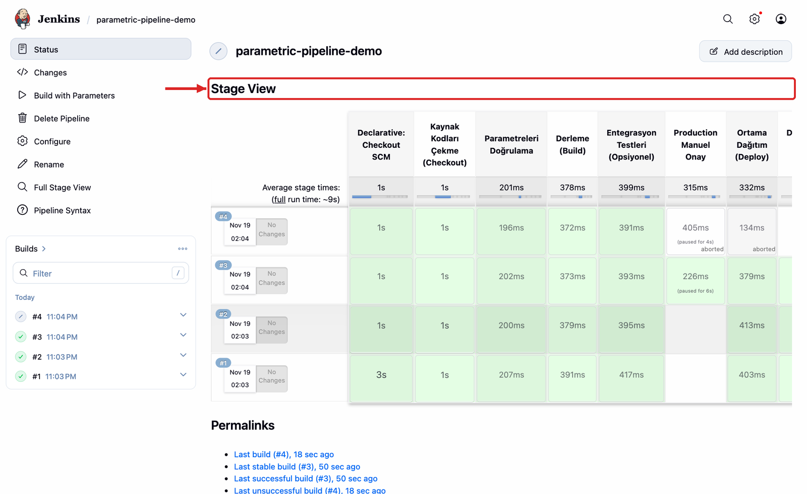

# LAB-JEN-03 — Parametreler, Koşullu Stage'ler ve Onay Kapısı

| Profil / Araçlar | Açık Portlar |
|---|---|
| Jenkins, `parameters`, `when`, `input`, `options` | 18080 |

## Amaç

- Tek Jenkinsfile'ı parametrelerle farklı ortamlar için çalıştırmak.
- `when` ile stage'leri koşula bağlamak.
- Production'dan önce `input` ile onay istemek; onay, ret ve zaman aşımını görmek.

## Ön Koşullar

- LAB-JEN-01 B bölümündeki Jenkins çalışıyor olmalıdır.

## Jenkinsfile

```bash
cd ~/jenkins-labs/lab-03-parameters-approval-resilience
```

```bash
cat Jenkinsfile
```



- `parameters`: `DEPLOY_ENV` (development, staging, production), `RELEASE_VERSION`, `RUN_INTEGRATION_TESTS`, `REPLICA_COUNT`.
- `when { expression { ... } }`: koşul sağlanmazsa stage atlanır (Stage View'da boş kalır).
- `input`: pipeline durur ve onay bekler. `timeout(time: 5, unit: 'MINUTES')` içinde olduğu için 5 dakika sonra kendiliğinden iptal olur.
- `disableConcurrentBuilds()`: aynı anda tek build çalışır; ikinci build birincinin bitmesini bekler.

## Adım Adım Uygulama Rehberi

### 1. Job'u oluşturma

`parametric-pipeline-demo` adında bir **Pipeline** job'u oluşturun. LAB-JEN-02'deki gibi **Pipeline script from SCM**:

| Alan | Değer |
|---|---|
| Repository URL | `https://gitlab.com/devops-practitioner-labs/jenkins-labs.git` |
| Branch Specifier | `*/main` |
| Script Path | `lab-03-parameters-approval-resilience/Jenkinsfile` |

**Save** → **Build Now**. Bu ilk build parametreleri kaydeder ve varsayılan değerlerle (`development`) çalışır. Sol menüde artık **Build with Parameters** vardır.

### 2. Development: onay yok

**Build with Parameters**: `DEPLOY_ENV=development`, `RELEASE_VERSION=1.2.1`, `RUN_INTEGRATION_TESTS` işaretli, `REPLICA_COUNT=1` → **Build**. **Console Output**:

```text
HEDEF ORTAM      : development
SÜRÜM            : 1.2.1
ENTEGRASYON TEST : true
REPLİKA SAYISI   : 1
...
Koşul sağlandı: Entegrasyon testleri icra ediliyor...
Stage "Production Manuel Onay" skipped due to when conditional
development ortamına 1 adet replika ile dağıtım yapılıyor...
Finished: SUCCESS
```

Ortam `production` olmadığı için onay stage'i atlanır.

### 3. Production: onay

**Build with Parameters**: `DEPLOY_ENV` olarak `production` (1), sürüm (2), entegrasyon testleri işaretli (3), `REPLICA_COUNT=5` (4) → **Build** (5).

{width=75%}

Pipeline `Production Manuel Onay` stage'inde durur. **Console Output**'ta soru ve iki bağlantı görünür: **Dağıtımı Başlat** (6) onaylar, **Abort** (7) reddeder. Aynı düğmeler Stage View'da duran stage'in üzerine gelince de çıkar. **Dağıtımı Başlat**'a basın.

{width=75%}

```text
v2.0.0 sürümünü Production ortamına dağıtmayı onaylıyor musunuz?
Dağıtımı Başlat or Abort
Approved by Jenkins Admin
production ortamına 5 adet replika ile dağıtım yapılıyor...
Finished: SUCCESS
```

`Approved by` satırı onayı kimin verdiğini kaydeder.

{width=75%}

### 4. Production: ret

Yeni bir `production` build'i başlatın. Onay beklerken build sayfasında sol menüdeki **Paused for Input** sayfasını (ya da konsoldaki **Abort** bağlantısını) açıp **Abort**'a basın (8).

{width=75%}

```text
Rejected by Jenkins Admin
Finished: ABORTED
```

Stage View'da bu build'in onay ve dağıtım stage'leri `aborted` görünür; dağıtım yapılmamıştır.

{width=75%}

### 5. Production: zaman aşımı

Bir `production` build'i daha başlatın ve onay vermeden 5 dakika bekleyin. `timeout` süresi dolunca build kendiliğinden iptal olur:

```text
v2.2.0 sürümünü Production ortamına dağıtmayı onaylıyor musunuz?
Dağıtımı Başlat or Abort
Cancelling nested steps due to timeout
Stage "Ortama Dağıtım (Deploy)" skipped due to earlier failure(s)
Timeout has been exceeded
Finished: ABORTED
```

Onay bekleyen bir build executor'ı süresiz tutmaz.

## Temizlik

Job'u **Delete Pipeline** ile silebilirsiniz.
