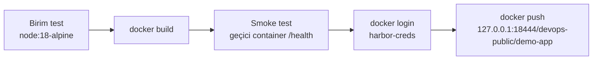
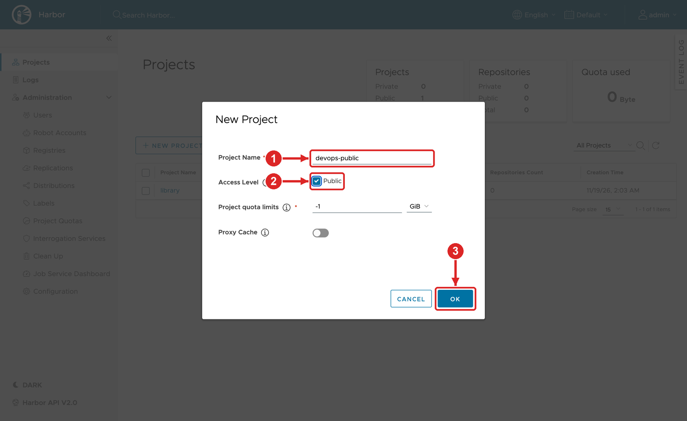
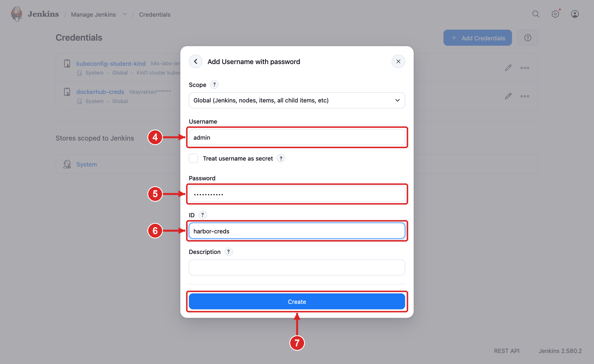
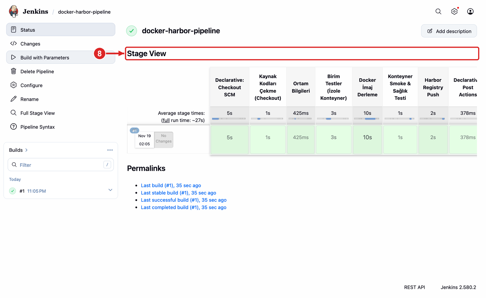
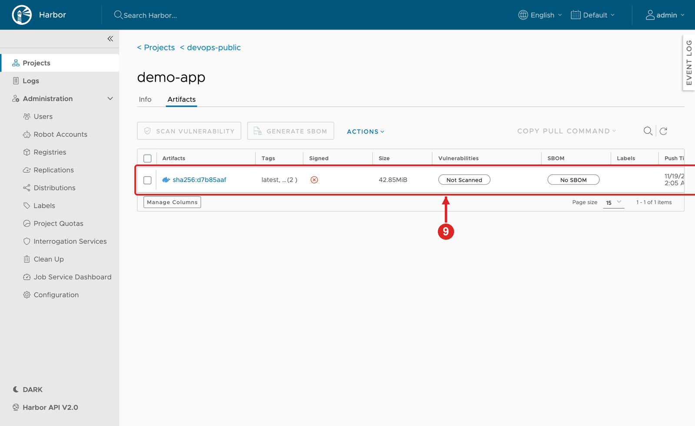

# LAB-JEN-04 — Credentials, Docker Build ve Harbor'a Push

| Profil / Araçlar | Açık Portlar |
|---|---|
| Jenkins, `docker`, Harbor 2.x | 18080, 18444 (Harbor), `https://<sunucu-adı>-harbor.devopsatolyesi.com` |

## Amaç

- Registry parolasını Jenkins credential'ı olarak saklamak ve pipeline'da `withCredentials` ile kullanmak.
- Image'ı build edip geçici bir container'la sağlık testinden geçirmek.
- Image'ı Harbor'a sürüm etiketi ve `latest` ile push etmek.

## Ön Koşullar

- LAB-JEN-01 B bölümündeki Jenkins çalışıyor olmalıdır.
- `18444` portu Harbor için boş olmalıdır.

## Pipeline

```bash
cd ~/jenkins-labs/lab-04-credentials-docker-harbor-push
```

```bash
cat Jenkinsfile
```



- `withCredentials([usernamePassword(...)])`: credential'ı yalnızca bu blok boyunca `HARBOR_USER` / `HARBOR_PASS` değişkenlerine koyar; konsolda parola `****` görünür.
- `docker login --password-stdin`: parola komut satırına yazılmaz, stdin'den okunur.
- Etiket `v<build>-<commit>`: hangi build'in hangi koddan üretildiği image adından okunur. `latest` her build'de yeni image'ı gösterir.
- Push'tan önce image geçici bir container olarak çalıştırılır ve `/health` `UP` dönmezse build durur; bozuk image registry'ye gitmez.

## Adım Adım Uygulama Rehberi

### 1. Harbor kurulumu

Harbor çalışıyor mu bakın:

```bash
curl -s http://127.0.0.1:18444/api/v2.0/systeminfo | jq -r .harbor_version
```

Sürüm (`v2.12.2-...`) yazıyorsa Harbor kuruludur; bu adımı atlayın. Boş çıktı geliyorsa labdaki betikle kurun:

```bash
cat install_harbor.sh
```

- Harbor `v2.12.2` kurulum paketini indirir ve `/opt/harbor` altına açar.
- `harbor.yml`'da portu `18444`, admin parolasını `Harbor12345` yapar; HTTPS'i kapatır (TLS önündeki Nginx'te sonlanır).
- `harbor.lab.local` adını `/etc/hosts`'a `127.0.0.1` olarak ekler ve Harbor'ı Trivy tarayıcısıyla başlatır.

```bash
sudo bash install_harbor.sh
```

Kurulum birkaç dakika sürer ve `Harbor hazir: http://127.0.0.1:18444` satırıyla biter. Harbor'ın servisleri bundan sonra 20-30 saniyede açılır; sürüm kontrolünü sürüm görünene kadar tekrarlayın (`jq: parse error` Harbor henüz açılmadı demektir). Docker `127.0.0.1` adresindeki registry'lere TLS olmadan bağlanabildiği için `/etc/docker/daemon.json` değişikliği gerekmez.

### 2. Harbor projesi

Harbor arayüzü:

```bash
echo "https://$(hostname)-harbor.devopsatolyesi.com"
```

`admin` / `Harbor12345` ile girin. **Projects → New Project**: **Project Name** `devops-public` (1), **Public** işaretli (2), **OK** (3).

{width=75%}

<details>
<summary><strong>Aynı işlem API ile</strong></summary>

```bash
curl -s -o /dev/null -w '%{http_code}\n' -u 'admin:Harbor12345' \
  -X POST -H 'Content-Type: application/json' \
  -d '{"project_name": "devops-public", "public": true}' \
  http://127.0.0.1:18444/api/v2.0/projects
```

`201` proje oluşturuldu demektir.

</details>

### 3. Jenkins credential'ı

**Manage Jenkins → Credentials → Add Credentials → Username with password → Next**: **Username** `admin` (4), **Password** `Harbor12345` (5), **ID** `harbor-creds` (6), **Create** (7).

{width=75%}

### 4. Pipeline job'u

`docker-harbor-pipeline` adında bir **Pipeline** job'u oluşturun. LAB-JEN-02'deki gibi **Pipeline script from SCM**:

| Alan | Değer |
|---|---|
| Repository URL | `https://gitlab.com/devops-practitioner-labs/jenkins-labs.git` |
| Branch Specifier | `*/main` |
| Script Path | `lab-04-credentials-docker-harbor-push/Jenkinsfile` |

**Save** → **Build Now**. Varsayılan parametreler (`HARBOR_HOST=127.0.0.1:18444`, `HARBOR_PROJECT=devops-public`, `PUSH_TO_HARBOR` açık) bu lab için doğrudur.

**Stage View** (8): bütün stage'ler yeşil olur.

{width=75%}

**Console Output**'tan kısaltılmış satırlar:

```text
Unit tests passed successfully
[SUCCESS] Konteyner sağlık testi başarıyla tamamlandı.
Login Succeeded
v1-aca74d4: digest: sha256:d7b85aaf99cd6842385febf3015aa9c4273ddf6ebbc044c621abf08b0008673a size: 1835
latest: digest: sha256:d7b85aaf99cd6842385febf3015aa9c4273ddf6ebbc044c621abf08b0008673a size: 1835
[SUCCESS] İmaj Harbor'a başarıyla yüklendi: 127.0.0.1:18444/devops-public/demo-app:v1-aca74d4
Finished: SUCCESS
```

Etiketteki build numarası, commit ve digest sizde farklıdır. İki etiketin digest'i aynıdır: ikisi de aynı image'ı gösterir.

### 5. Harbor'da image

Harbor'da **Projects → devops-public → devops-public/demo-app**: tek artifact ve iki etiketi (9) görünür.

{width=75%}

API ile etiketler:

```bash
curl -s -u 'admin:Harbor12345' \
  http://127.0.0.1:18444/api/v2.0/projects/devops-public/repositories/demo-app/artifacts \
  | jq -r '.[].tags[].name'
```

```text
latest
v1-aca74d4
```

## Temizlik

Harbor'daki repository ve proje:

```bash
curl -s -o /dev/null -w '%{http_code}\n' -u 'admin:Harbor12345' -X DELETE \
  http://127.0.0.1:18444/api/v2.0/projects/devops-public/repositories/demo-app
```

```bash
curl -s -o /dev/null -w '%{http_code}\n' -u 'admin:Harbor12345' -X DELETE \
  http://127.0.0.1:18444/api/v2.0/projects/devops-public
```

Job'u **Delete Pipeline** ile silebilirsiniz. Harbor ve `harbor-creds` LAB-JEN-07'de yeniden kullanılır.
