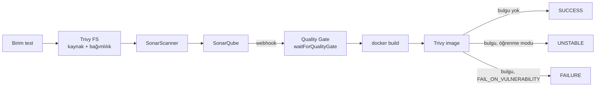
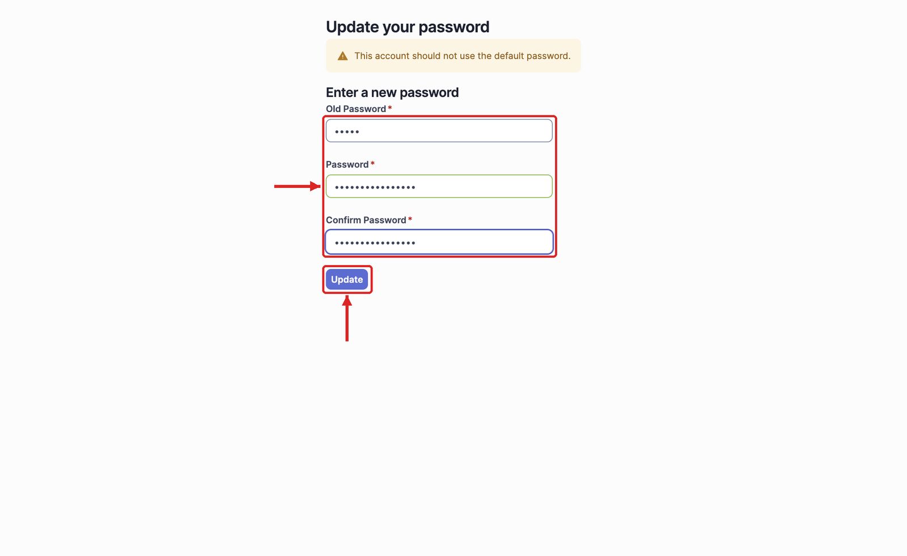
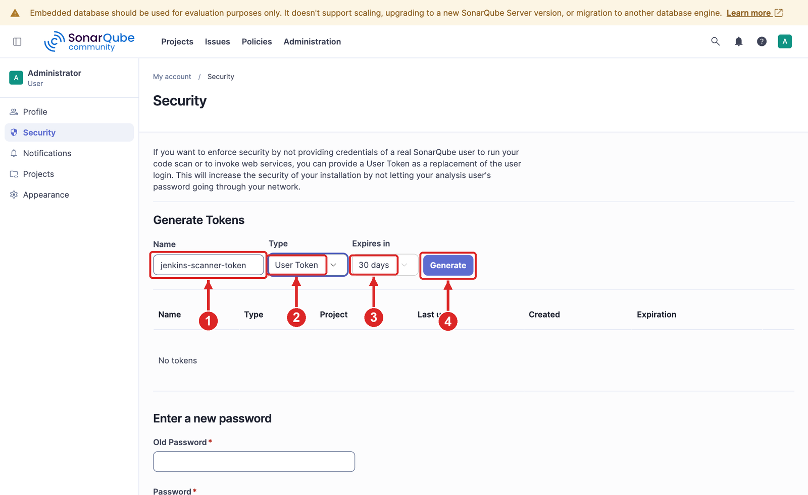
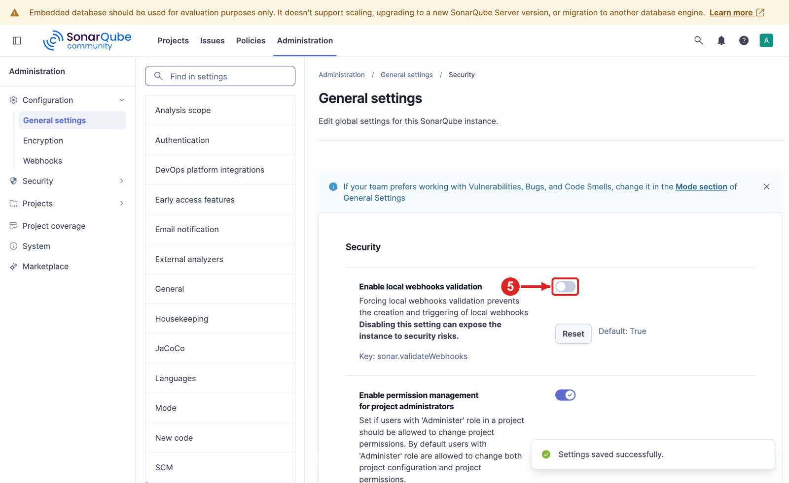
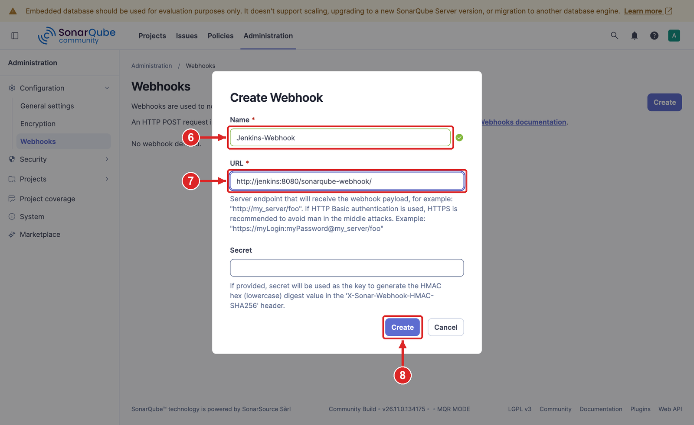
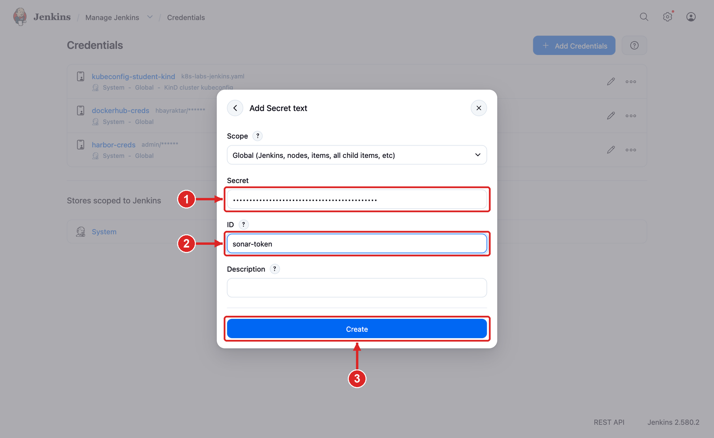
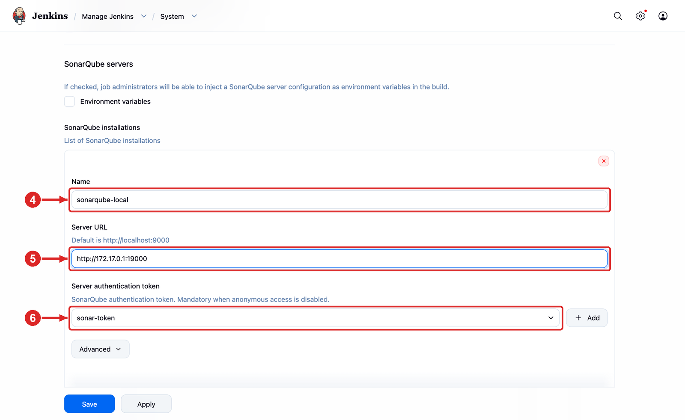
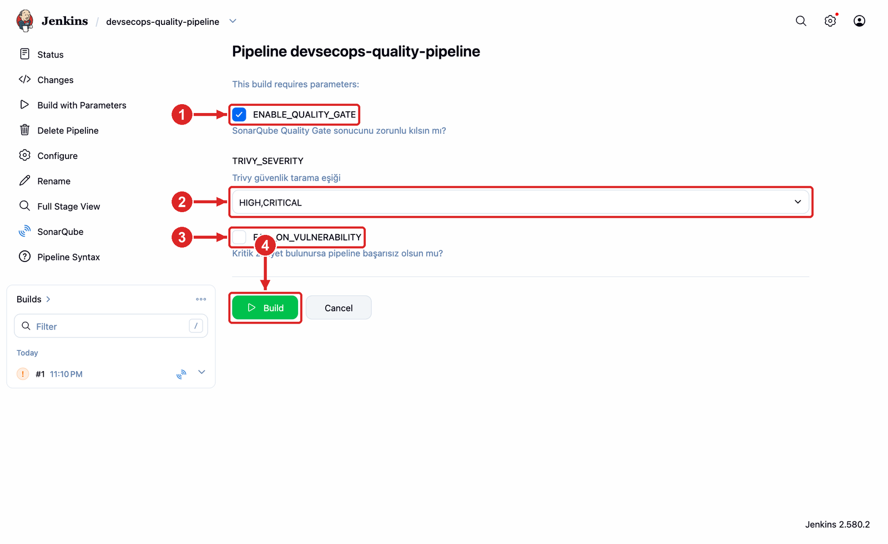
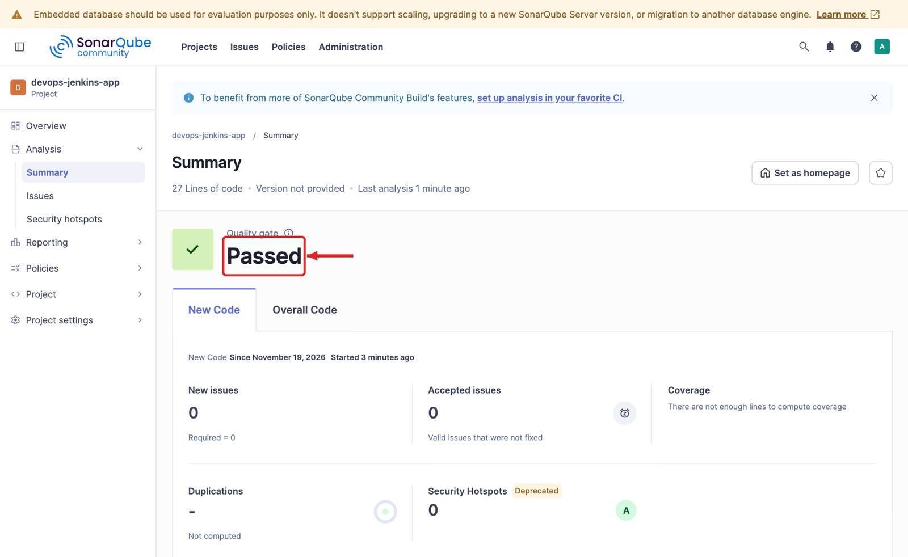
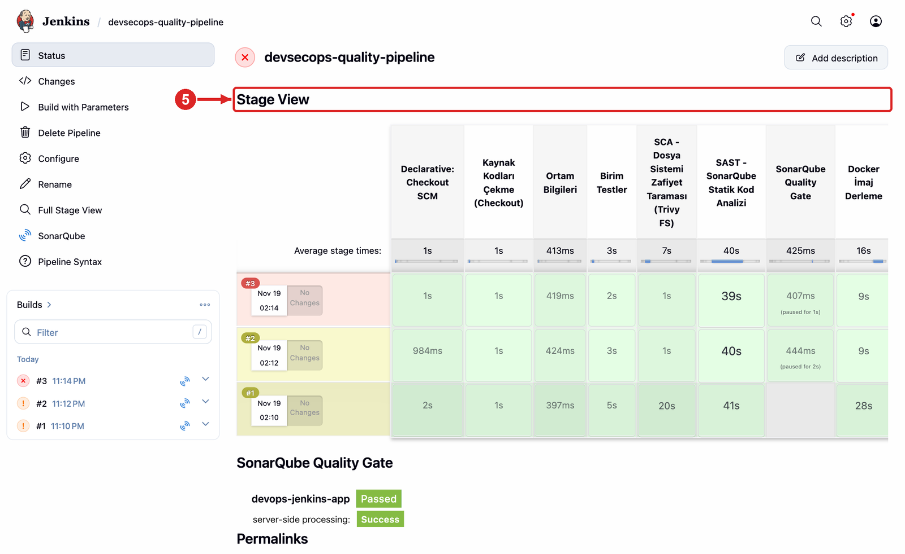

# LAB-JEN-05 — SonarQube Quality Gate ve Trivy Taraması

| Profil / Araçlar | Açık Portlar |
|---|---|
| Jenkins, SonarQube Community, `sonar-scanner-cli`, Trivy | 18080, 19000 (SonarQube), `https://<sunucu-adı>-sonar.devopsatolyesi.com` |

## Amaç

- Kodu SonarQube ile analiz edip Quality Gate sonucunu pipeline'da beklemek.
- Bağımlılıkları ve image'ı Trivy ile taramak.
- Bulgu varsa build'i `UNSTABLE` yapmak ya da tamamen durdurmak.

## Ön Koşullar

- LAB-JEN-01 B bölümündeki Jenkins çalışıyor olmalıdır.
- `19000` portu boş olmalıdır; SonarQube en az 2 GB bellek ister.



## Adım Adım Uygulama Rehberi

### 1. SonarQube'u başlatma

SonarQube Jenkins'le aynı Docker ağına (`jenkins-b_default`) bağlanır; böylece Quality Gate sonucunu `http://jenkins:8080` adresine bildirebilir:

```bash
docker run -d --name sonarqube --restart unless-stopped --network jenkins-b_default -p 19000:9000 \
  -v sonarqube_data:/opt/sonarqube/data -v sonarqube_extensions:/opt/sonarqube/extensions -v sonarqube_logs:/opt/sonarqube/logs \
  sonarqube:community
```

İlk açılış bir iki dakika sürer. Durum `UP` olana kadar tekrarlayın:

```bash
curl -s http://127.0.0.1:19000/api/system/status
```

Tarayıcı adresi:

```bash
echo "https://$(hostname)-sonar.devopsatolyesi.com"
```

DNS kaydı yoksa (firewall'da `19000` açık olmalı):

```bash
echo "http://$(curl -s ifconfig.me):19000"
```

`admin` / `admin` ile girin. SonarQube ilk girişte parolayı değiştirmenizi ister: eski parola `admin`, yeni parolayı iki kez yazıp **Update**'e basın (en az 12 karakter, büyük/küçük harf, rakam ve özel karakter).

{width=75%}

### 2. Jenkins için token

Sağ üstteki profil simgesi → **My Account → Security**. **Name** `jenkins-scanner-token` (1), **Type** `User Token` (2), **Expires in** süresi (3), **Generate** (4). Token yalnızca bir kez gösterilir; kopyalayın.

{width=75%}

### 3. Yerel adrese webhook izni

SonarQube varsayılan olarak yerel ağdaki adreslere webhook göndermez; `http://jenkins:8080` adresi reddedilir. **Administration → Configuration → General Settings → Security**: **Enable local webhooks validation** kapalı olsun (5).

{width=75%}

### 4. Quality Gate webhook'u

**Administration → Configuration → Webhooks → Create**: **Name** `Jenkins-Webhook` (6), **URL** `http://jenkins:8080/sonarqube-webhook/` (7), **Create** (8). Analiz bitince SonarQube sonucu bu adrese gönderir; pipeline'daki `waitForQualityGate` bunu bekler.

{width=75%}

### 5. Jenkins'te token ve SonarQube sunucusu

**Manage Jenkins → Credentials → Add Credentials → Secret text → Next**: **Secret** SonarQube token'ı (1), **ID** `sonar-token` (2), **Create** (3).

{width=75%}

**Manage Jenkins → System → SonarQube servers → Add SonarQube**: **Name** `sonarqube-local` (4), **Server URL** `http://172.17.0.1:19000` (5), **Server authentication token** `sonar-token` (6). Sayfanın altında **Save**.

{width=75%}

`172.17.0.1`, sunucunun Docker köprü adresidir. Jenkins ve scanner container'ları SonarQube'a bu adresin `19000` portundan ulaşır. Pipeline'daki `withSonarQubeEnv('sonarqube-local')` bu ayarı adıyla bulur.

### 6. Pipeline job'u

```bash
cd ~/jenkins-labs/lab-05-sonarqube-trivy-devsecops
```

```bash
cat Jenkinsfile
```

`devsecops-quality-pipeline` adında bir **Pipeline** job'u oluşturun. LAB-JEN-02'deki gibi **Pipeline script from SCM**:

| Alan | Değer |
|---|---|
| Repository URL | `https://gitlab.com/devops-practitioner-labs/jenkins-labs.git` |
| Branch Specifier | `*/main` |
| Script Path | `lab-05-sonarqube-trivy-devsecops/Jenkinsfile` |

**Save** → **Build Now** (parametreleri kaydeder). Trivy ilk çalışmada zafiyet veritabanını (~130 MB) indirir ve `trivy-cache` volume'üne koyar; sonraki build'ler bu kopyayı kullanır.

### 7. Senaryo 1: raporla, durdurma

**Build with Parameters**: **ENABLE_QUALITY_GATE** işaretli (1), **TRIVY_SEVERITY** `HIGH,CRITICAL` (2), **FAIL_ON_VULNERABILITY** işaretsiz (3), **Build** (4).

{width=75%}

**Console Output**'tan kısaltılmış satırlar:

```text
INFO  ANALYSIS SUCCESSFUL, you can find the results at: http://172.17.0.1:19000/dashboard?id=devops-jenkins-app
INFO  EXECUTION SUCCESS
[QUALITY-GATE] Durum: OK
Total: 24 (HIGH: 22, CRITICAL: 2)
Total: 22 (HIGH: 21, CRITICAL: 1)
WARNING: [TRIVY-IMAGE] Bulgular var; öğrenme modu nedeniyle build UNSTABLE olarak işaretlendi.
Finished: UNSTABLE
```

- Quality Gate geçti (`OK`): kodda yeni hata yok.
- Taranan image `devops-app-public:scan-v<build>` adıyla yalnızca sunucuda build edilir; hiçbir registry'ye gönderilmez ve build sonunda silinir.
- Trivy image'daki işletim sistemi paketlerinde ve Node.js paketlerinde HIGH/CRITICAL açık buldu; tablo konsolda paket ve CVE adlarıyla listelenir. Sayılar zafiyet veritabanı güncellendikçe değişir.
- `FAIL_ON_VULNERABILITY` kapalı olduğu için build durmadı, `UNSTABLE` (sarı) oldu.

SonarQube'da **Projects → devops-jenkins-app**: Quality Gate `Passed`.

{width=75%}

### 8. Senaryo 2: bulguda build'i durdur

**Build with Parameters**: aynı değerler, **FAIL_ON_VULNERABILITY** işaretli → **Build**:

```text
[QUALITY-GATE] Durum: OK
Total: 24 (HIGH: 22, CRITICAL: 2)
Total: 22 (HIGH: 21, CRITICAL: 1)
ERROR: [TRIVY-IMAGE] Eşik üzerindeki zafiyet bulundu; build durduruldu.
Finished: FAILURE
```

**Stage View** (5): senaryo 1 sarı (`UNSTABLE`), senaryo 2 kırmızı (`FAILURE`) görünür. Bir sonraki adım (registry'ye push, deploy) olsaydı açıklı image oraya gitmezdi.

{width=75%}

## Temizlik

SonarQube LAB-JEN-07'de yeniden kullanılır. Kaldırmak isterseniz:

```bash
docker rm -f sonarqube
```

```bash
docker volume rm sonarqube_data sonarqube_extensions sonarqube_logs trivy-cache
```

Job'u **Delete Pipeline** ile silebilirsiniz.
