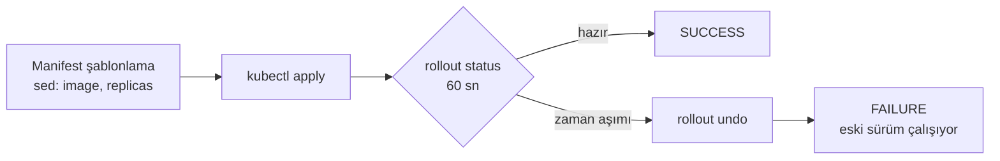
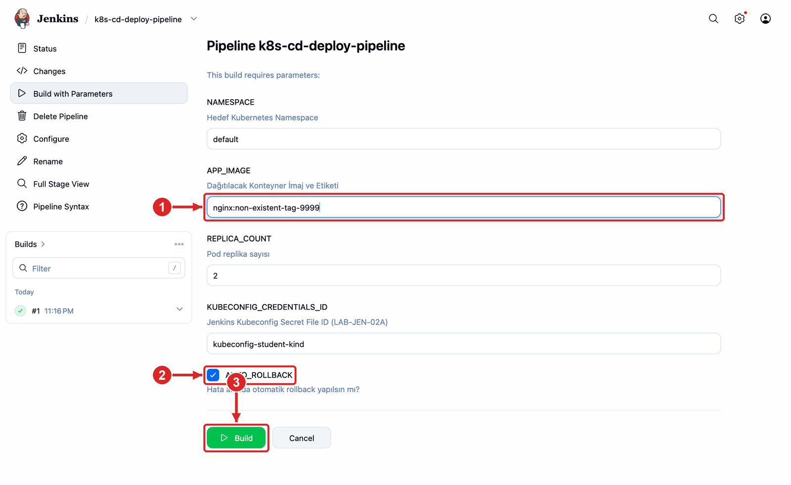
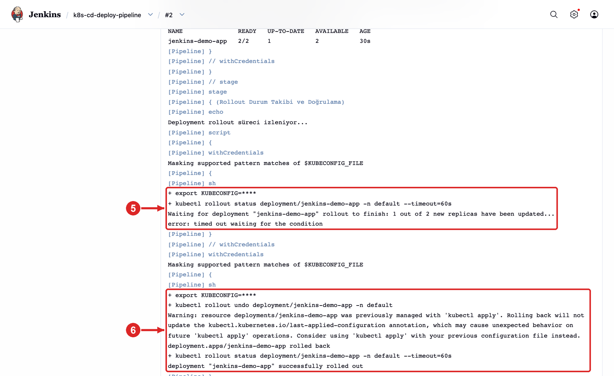
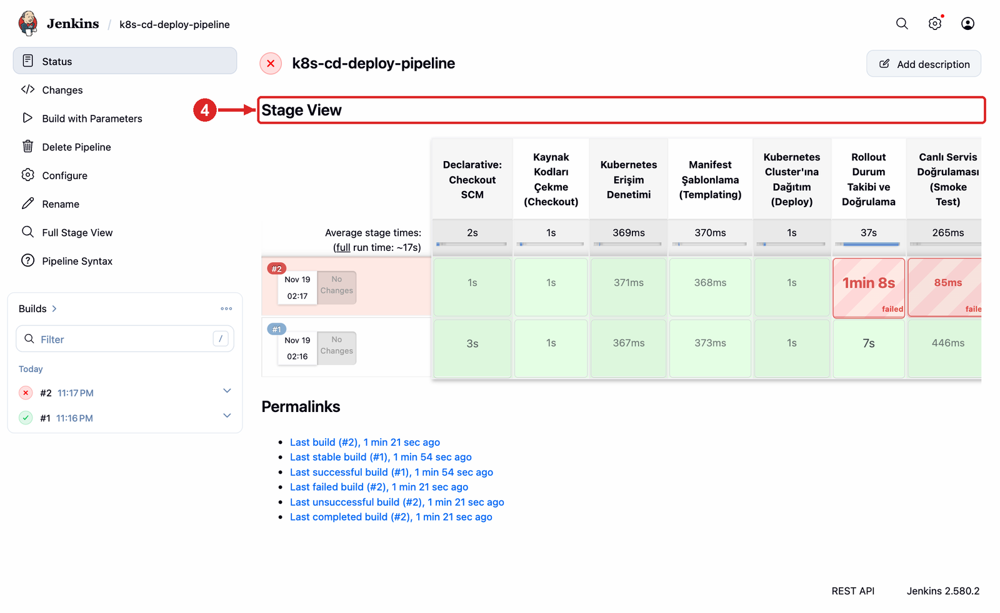

# LAB-JEN-06 — Kind'a Deploy: RollingUpdate ve Otomatik Rollback

| Profil / Araçlar | Açık Portlar |
|---|---|
| Jenkins, `kubectl`, Kind | 18080 |

## Amaç

- Pipeline'dan Kind cluster'ına manifest uygulamak; image ve replika sayısını parametreyle vermek.
- `kubectl rollout status` ile deploy'un bitmesini beklemek.
- Hatalı image'da `kubectl rollout undo` ile otomatik geri dönmek.

## Ön Koşullar

- LAB-JEN-01 B bölümündeki Jenkins çalışıyor olmalıdır.
- `k8s-labs` Kind cluster'ı çalışıyor olmalıdır; `kubectl get nodes` üç node göstermelidir:

```bash
kubectl get nodes
```

<details>
<summary><strong>Cluster yoksa</strong></summary>

Cluster, k8s-labs reposundaki `kind-cluster.yaml` ile kurulur (1 control-plane, 2 worker; `19001`-`19003` portları ingress'e yönlenir):

```bash
test -d ~/k8s-labs || git clone https://gitlab.com/devops-practitioner-labs/k8s-labs.git ~/k8s-labs
```

```bash
cd ~/k8s-labs && kind create cluster --config kind-cluster.yaml
```

</details>

- LAB-JEN-02A'daki `kubeconfig-student-kind` credential'ı Jenkins'te olmalıdır (**Manage Jenkins → Credentials**). Yoksa LAB-JEN-02A'nın 1. ve 2. adımlarıyla oluşturun.

## Pipeline

```bash
cd ~/jenkins-labs/lab-06-kubernetes-kind-rolling-update
```

```bash
cat Jenkinsfile
```



- `k8s/deployment.yaml` içindeki `image:` ve `replicas:` satırları `sed` ile parametre değerine çevrilir.
- `rollout status --timeout=60s`: yeni pod'lar 60 saniyede hazır olmazsa hata döner.
- `AUTO_ROLLBACK` açıksa `rollout undo` deployment'ı bir önceki ReplicaSet'e döndürür; build yine `FAILURE` olur, çünkü istenen sürüm deploy edilemedi.
- RollingUpdate yeni pod hazır olmadan eskiyi kapatmaz; bu yüzden hatalı image sırasında da eski pod'lar trafiğe hizmet eder.

## Adım Adım Uygulama Rehberi

### 1. Job'u oluşturma

`k8s-cd-deploy-pipeline` adında bir **Pipeline** job'u oluşturun. LAB-JEN-02'deki gibi **Pipeline script from SCM**:

| Alan | Değer |
|---|---|
| Repository URL | `https://gitlab.com/devops-practitioner-labs/jenkins-labs.git` |
| Branch Specifier | `*/main` |
| Script Path | `lab-06-kubernetes-kind-rolling-update/Jenkinsfile` |

### 2. Başarılı deploy

**Save** → **Build Now**. Varsayılan değerler: `NAMESPACE=default`, `APP_IMAGE=nginx:alpine`, `REPLICA_COUNT=2`. **Console Output**'tan kısaltılmış satırlar:

```text
deployment.apps/jenkins-demo-app created
service/jenkins-demo-service created
Waiting for deployment "jenkins-demo-app" rollout to finish: 0 of 2 updated replicas are available...
Waiting for deployment "jenkins-demo-app" rollout to finish: 1 of 2 updated replicas are available...
deployment "jenkins-demo-app" successfully rolled out
[SUCCESS] Kubernetes dağıtımı başarıyla tamamlandı.
Finished: SUCCESS
```

Cluster'da:

```bash
kubectl get deploy,pods,svc -n default -l app=jenkins-demo-app
```

Deployment `2/2`, iki pod `Running` olur.

### 3. Hatalı image ve otomatik rollback

**Build with Parameters**: **APP_IMAGE** `nginx:non-existent-tag-9999` (1), **AUTO_ROLLBACK** işaretli (2), **Build** (3).

{width=75%}

Bu tag Docker Hub'da yoktur; yeni pod image'ı çekemez. Başka bir terminalde izleyebilirsiniz; yeni pod `ErrImagePull` / `ImagePullBackOff` olurken eski iki pod `Running` kalır:

```bash
kubectl get pods -n default -l app=jenkins-demo-app -w
```

`Ctrl+C` ile çıkın. 60 saniye sonra rollout zaman aşımına uğrar (5) ve pipeline geri alır (6):

{width=75%}

```text
error: timed out waiting for the condition
deployment.apps/jenkins-demo-app rolled back
deployment "jenkins-demo-app" successfully rolled out
ERROR: Dağıtım başarısız oldu; rollback sonucu konsol çıktısında gösterildi.
Finished: FAILURE
```

**Stage View** (4): `#2` rollout stage'inde kırmızıdır, sonraki stage çalışmaz.

{width=75%}

Deployment eski image'a dönmüştür:

```bash
kubectl get deploy jenkins-demo-app -n default -o jsonpath='{.spec.template.spec.containers[0].image}'; echo
```

```text
nginx:alpine
```

```bash
kubectl get pods -n default -l app=jenkins-demo-app
```

Pod'ların `AGE` değeri 2. adımdaki deploy zamanıdır: eski pod'lar hiç kapanmadı.

## Temizlik

```bash
kubectl delete deployment jenkins-demo-app -n default
```

```bash
kubectl delete service jenkins-demo-service -n default
```

Job'u **Delete Pipeline** ile silebilirsiniz.
