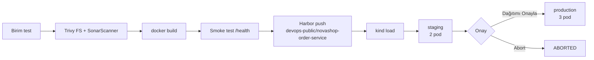
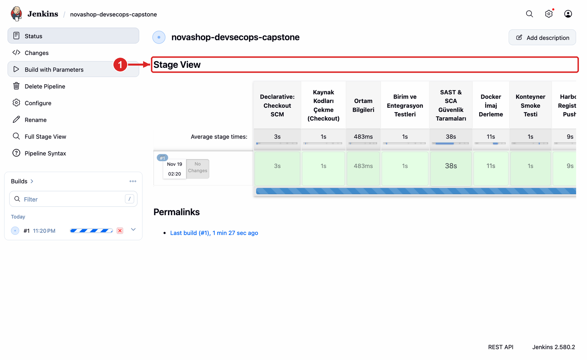
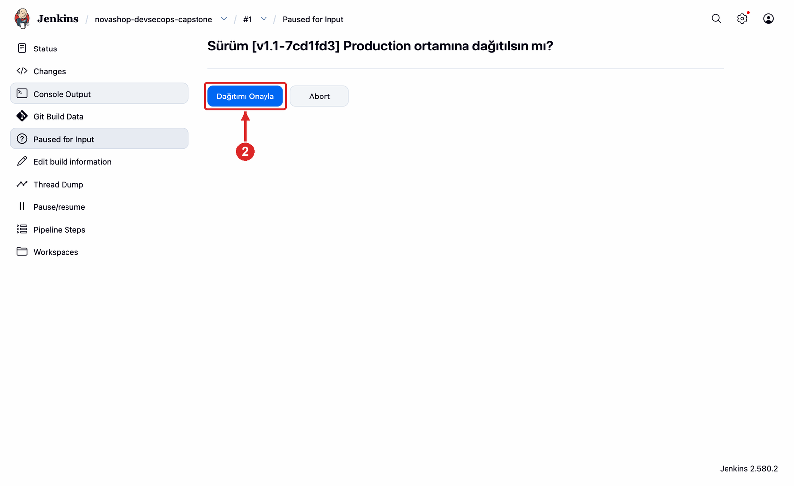
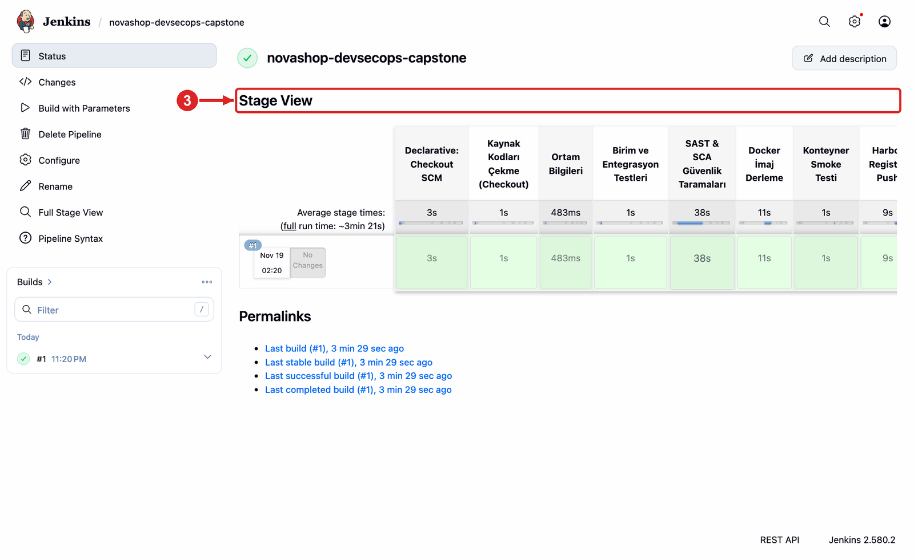
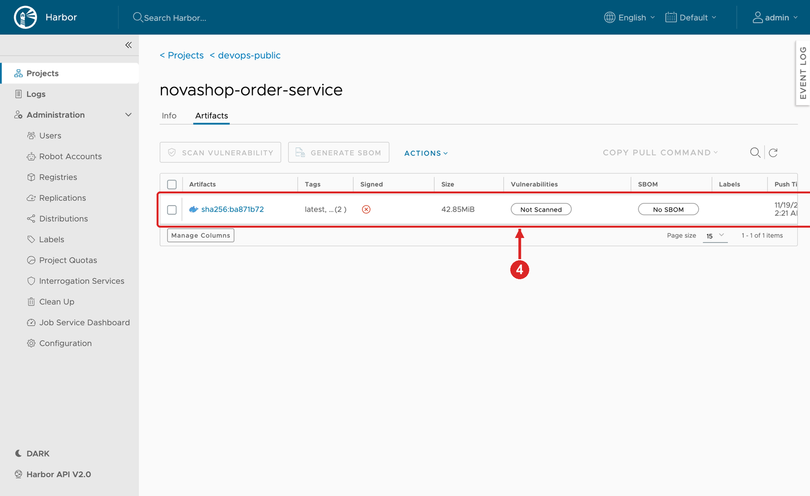
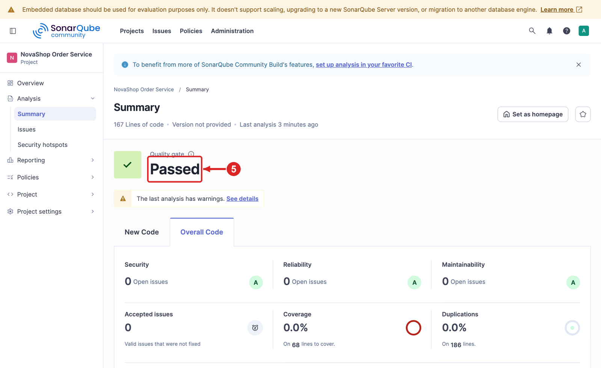

# LAB-JEN-07 — Bitirme: NovaShop Sipariş Servisi için DevSecOps Pipeline

| Profil / Araçlar | Açık Portlar |
|---|---|
| Jenkins, SonarQube, Trivy, Harbor, Kind | 18080, 18444 (Harbor), 19000 (SonarQube) |

## Amaç

- Önceki lablardaki adımları tek pipeline'da birleştirmek: test, SonarQube, Trivy, build, smoke test, Harbor.
- Image'ı Kind'da önce `staging`'e, onaydan sonra `production`'a deploy etmek.

## Ön Koşullar

Bu lab önceki lablarda kurulanları kullanır:

| Gerekli | Nerede kuruldu | Kontrol |
|---|---|---|
| Jenkins (B) | LAB-JEN-01 B | `docker ps --filter name=jenkins` |
| Harbor, `devops-public` projesi, `harbor-creds` | LAB-JEN-04 1-3. adımlar | aşağıdaki komut |
| SonarQube, `sonar-token` | LAB-JEN-05 1-5. adımlar | aşağıdaki komut |
| Kind cluster, `kubeconfig-student-kind` | LAB-JEN-06 Ön Koşullar, LAB-JEN-02A 1-2. adımlar | `kubectl get nodes` |

```bash
curl -s http://127.0.0.1:18444/api/v2.0/systeminfo | jq -r .harbor_version
```

```bash
curl -s http://127.0.0.1:19000/api/system/status
```

```bash
kubectl get nodes
```

Harbor sürümü, SonarQube'da `"status":"UP"` ve üç `Ready` node görünmelidir. Biri eksikse tablodaki lab adımlarını uygulayın.

## Pipeline

```bash
cd ~/jenkins-labs/lab-07-devsecops-capstone-novashop
```

```bash
cat Jenkinsfile
```



- Etiket `v1.<build>-<commit>`; aynı image önce staging'e, onaydan sonra production'a gider. Production'a giden image test edilmiş olanla birebir aynıdır.
- `kind load docker-image`: Kind node'ları `127.0.0.1:18444`'e erişemez (bu adres node container'ının kendisidir); image node'lara doğrudan yüklenir, manifest'teki `imagePullPolicy: IfNotPresent` onu kullanır.
- SonarQube token'ı `withCredentials([string(credentialsId: 'sonar-token', ...)])` ile alınır; LAB-JEN-05'teki gibi Jenkins'te ayrıca SonarQube sunucusu tanımı gerekmez.
- Manifest'ler `k8s/staging/` ve `k8s/production/` altındadır; `sed` yalnızca `image:` satırını değiştirir.

## Adım Adım Uygulama Rehberi

### 1. Job'u oluşturma

`novashop-devsecops-capstone` adında bir **Pipeline** job'u oluşturun. LAB-JEN-02'deki gibi **Pipeline script from SCM**:

| Alan | Değer |
|---|---|
| Repository URL | `https://gitlab.com/devops-practitioner-labs/jenkins-labs.git` |
| Branch Specifier | `*/main` |
| Script Path | `lab-07-devsecops-capstone-novashop/Jenkinsfile` |

**Save** → **Build Now**. Varsayılan parametreler (`HARBOR_HOST=127.0.0.1:18444`, `HARBOR_PROJECT=devops-public`, credential ID'leri) önceki lablarla uyumludur.

### 2. Staging ve onay

Pipeline staging'e deploy edip **Production Öncesi Manuel Onay** stage'inde durur (1).

{width=75%}

Staging'deki pod'lar:

```bash
kubectl get pods -n staging -l app=novashop-order-service
```

İki pod `Running` olur. Staging servisinden sağlık kontrolü (`env` değeri `staging`):

```bash
kubectl -n staging exec deploy/novashop-order-service-staging -- wget -qO- http://novashop-order-service-staging:8080/health; echo
```

Build sayfasında **Paused for Input**'u açın (ya da Stage View'da duran stage'e tıklayın) ve **Dağıtımı Onayla**'ya basın (2).

{width=75%}

### 3. Production

Onaydan sonra production'a 3 replika deploy edilir ve build `SUCCESS` olur (3). Etiketteki build numarası, commit ve digest sizde farklıdır.

{width=75%}

**Console Output**'tan kısaltılmış satırlar:

```text
ALL UNIT TESTS PASSED (3/3). Quality threshold met.
INFO  EXECUTION SUCCESS
Login Succeeded
v1.1-7cd1fd3: digest: sha256:ba871b7292c8f865f0bf10008709339a26bbb2ff2fa1d68f1d65581badb0432e size: 1836
latest: digest: sha256:ba871b7292c8f865f0bf10008709339a26bbb2ff2fa1d68f1d65581badb0432e size: 1836
[SUCCESS] İmaj Harbor'a yüklendi.
deployment "novashop-order-service-staging" successfully rolled out
Approved by Jenkins Admin
deployment "novashop-order-service-production" successfully rolled out
[SUCCESS] NovaShop Capstone Pipeline başarıyla tamamlandı!
Finished: SUCCESS
```

```bash
kubectl get pods,svc -n production -l app=novashop-order-service
```

```bash
kubectl -n production exec deploy/novashop-order-service-production -- wget -qO- http://novashop-order-service-production:8080/health; echo
```

```json
{"status":"HEALTHY","service":"novashop-order-service","env":"production","version":"1.0.0","uptimeSeconds":23,"timestamp":"2026-11-18T23:24:26.952Z"}
```

### 4. Harbor ve SonarQube

Harbor'da **Projects → devops-public → devops-public/novashop-order-service**: sürüm etiketi ve `latest` aynı artifact'i gösterir (4).

{width=75%}

SonarQube'da **Projects → NovaShop Order Service**: Quality Gate `Passed` (5).

{width=75%}

## Temizlik

```bash
kubectl delete namespace staging production
```

Job'u **Delete Pipeline** ile silebilirsiniz. Harbor, SonarQube ve Jenkins'i kaldırmak için LAB-JEN-04, LAB-JEN-05 ve LAB-JEN-01'in Temizlik bölümlerine bakın.
