# LAB-10 — Prometheus, Grafana, Alertmanager ve SLO

## Amaç

- NovaShop servislerinin metriklerini Prometheus ile toplamak, Grafana'da pano ve alarm kurmak.
- RED (istek hızı, hata, gecikme) ve USE (CPU, bellek) metriklerini PromQL ile sorgulamak.
- SLO ve hata bütçesini Grafana kadranında izlemek; kontrollü 500 hatasıyla bütçeyi tüketmek.
- OTel Collector ve Jaeger ile dağıtık izleri incelemek.

## Ön Koşullar

- Docker ve Docker Compose v2, `kind`, `kubectl`, `helm`, `jq`, `python3`.
- Komutlar repo kökünden çalıştırılır (`cd ~/novashop`).

Trafik ve iz üreten Python betikleri `requests` modülünü kullanır; kurun:

```bash
sudo apt-get install -y python3-requests
```

**Port uyarısı:** Bu lab aşağıdaki host portlarını kullanır; başka bir lab veya container bu portları tutuyorsa ilgili adım başlamaz.

| Port | Servis | Erişim |
|---|---|---|
| 13000 | Grafana | Tarayıcı (alan adı yuvası) |
| 19090 | Prometheus | Tarayıcı (alan adı yuvası) |
| 16686 | Jaeger UI | Yalnızca sunucu içi (`127.0.0.1`); tarayıcıdan SSH tüneliyle |
| 4466 | OTel Collector (OTLP HTTP) | Yalnızca sunucu içi (`127.0.0.1`) |
| 30080-30085 | Kind NodePort'ları (NovaShop servisleri) | Sunucu içi; Prometheus bu portlardan metrik çeker |

Portların boş olduğunu kontrol edin; doluysa portu tutan süreç görünür, boşsa `Portlar boş` yazar:

```bash
ss -ltnp | grep -E ':(13000|19090|16686|4466|3008[0-5]) ' || echo "Portlar boş"
```

Doluysa portu tutan container'ı bulun ve durdurun (ör. 13000 ve 19090'ı başka bir Kind cluster'ı tutuyorsa o cluster'ın node container'ları):

```bash
docker ps --format '{{.Names}}\t{{.Ports}}' | grep -E ':(13000|19090|16686|4466|3008[0-5])->' || echo "Portları tutan container yok"
```

Sunucuda `k8s-labs` Kind cluster'ı çalışıyorsa 13000 ve 19090 portlarını kendi izleme lab'ı için tutar. LAB-10 bitene kadar node container'larını durdurun (Temizlik adımında geri başlatılır); cluster yoksa komut bir şey yapmaz:

```bash
docker ps --format '{{.Names}}' | grep -qx k8s-labs-control-plane && docker stop k8s-labs-control-plane k8s-labs-worker k8s-labs-worker2 || echo "k8s-labs çalışmıyor"
```

Kind node'larının `Too many open files` hatası vermemesi için inotify sınırını yükseltin (kalıcıdır):

```bash
sudo sysctl -w fs.inotify.max_user_instances=512
printf 'fs.inotify.max_user_instances = 512\n' | sudo tee /etc/sysctl.d/99-novashop-kind.conf >/dev/null
```

<details>
<summary><strong>İsteğe bağlı: 8 GiB swap</strong></summary>

Bellek az olan makinelerde disk üzerinde ek bellek alanı açar; RAM'in yerine geçmez. `/swapfile` yoksa oluşturur ve kalıcı yapar:

```bash
if ! swapon --show=NAME | grep -qx '/swapfile'; then
  [ -e /swapfile ] || sudo fallocate -l 8G /swapfile
  sudo chmod 600 /swapfile
  sudo mkswap /swapfile
  sudo swapon /swapfile
fi
grep -qF '/swapfile none swap sw 0 0' /etc/fstab || echo '/swapfile none swap sw 0 0' | sudo tee -a /etc/fstab
free -h
```

</details>

## Mimari

[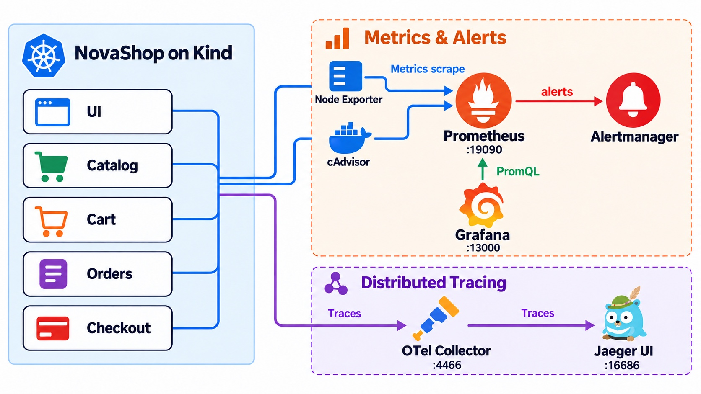](architecture-lab10.jpg)

NovaShop servisleri Kind cluster'ında NodePort ile açılır; Prometheus (Docker Compose) bu portlardan, Node Exporter'dan ve cAdvisor'dan metrik toplar. Grafana panoları Prometheus'tan beslenir, alarmlar Alertmanager'a gider. Dağıtık izler OTel Collector üzerinden Jaeger'a ulaşır.

| Servis | Teknoloji | NodePort | Metrik endpoint'i | RED metrikleri |
|---|---|:---:|---|---|
| `novashop-ui` | Java 21 / Spring Boot | 30080 | `/actuator/prometheus` | `http_server_requests_seconds_*` |
| `novashop-catalog` | Go / Gin | 30081 | `/metrics` | `gin_requests_total`, `gin_request_duration_seconds_*` |
| `novashop-cart` | Java 21 / Spring Boot | 30082 | `/actuator/prometheus` | `http_server_requests_seconds_*` |
| `novashop-orders` | Java 21 / Spring Boot | 30083 | `/actuator/prometheus` | `http_server_requests_seconds_*` |
| `novashop-checkout` | Node.js / NestJS | 30085 | `/metrics` | HTTP metriği yok; yalnızca süreç metrikleri ve `up` |

## Adım Adım Uygulama Rehberi

### 1. Kind cluster ve NovaShop servisleri

`novashop-cluster` adlı Kind cluster'ını oluşturun; NodePort'lar (30080-30085) bu cluster'ın config dosyasında host'a açılır. Cluster zaten varsa komut atlanır:

```bash
cd ~/novashop
kind get clusters | grep -qx novashop-cluster || kind create cluster --config deploy/k8s/kind-cluster-config.yaml
```

`kubectl`'i bu cluster'a yönlendirin:

```bash
kubectl config use-context kind-novashop-cluster
```

Node'lar `Ready` olana kadar bekleyin; Helm kurulumu ancak node'lar hazırsa başarılı olur:

```bash
kubectl wait --for=condition=Ready nodes --all --timeout=5m
kubectl get nodes
```

Beş servisi Helm ile kurun; pod'lar hazır olana kadar en çok 10 dakika bekler:

```bash
helm upgrade --install novashop charts/novashop --namespace novashop --create-namespace --wait --timeout 10m
```

Pod'ların `Running` olduğunu kontrol edin:

```bash
kubectl get pods -n novashop
```

*Beklenen:* `novashop-ui`, `novashop-catalog`, `novashop-cart`, `novashop-orders`, `novashop-checkout` pod'ları `1/1 Running`.

### 2. Gözlemlenebilirlik yığınını başlatma

Grafana admin parolası `.env` dosyasında tutulur. Dosya yoksa örnekten oluşturup rastgele parola yazar; dosyayı yalnızca sizin okuyabileceğiniz hale getirir:

```bash
[ -f .env ] || { cp config/project.env.example .env; sed -i "s|^GRAFANA_ADMIN_PASSWORD=.*|GRAFANA_ADMIN_PASSWORD=$(openssl rand -hex 24)|" .env; }
chmod 600 .env
```

Compose yapılandırmasının hatasız oluştuğunu kontrol edin (birleşik YAML çıktısı basar):

```bash
bash scripts/compose-observability.sh config >/dev/null && echo "Yapılandırma geçerli"
```

Prometheus, Grafana, Alertmanager, Jaeger, OTel Collector, Node Exporter ve cAdvisor'ı başlatın; komut container'lar sağlıklı olana kadar bekler:

```bash
bash scripts/compose-observability.sh up
```

Container'ları listeleyin:

```bash
bash scripts/compose-observability.sh ps
```

*Beklenen:* `novashop-prometheus`, `novashop-grafana`, `novashop-alertmanager`, `novashop-jaeger`, `novashop-otel-collector`, `novashop-node-exporter`, `novashop-cadvisor` çalışır durumda.

### 3. Prometheus hedeflerini doğrulama

Prometheus'un hangi hedeflerden metrik çektiğini ve durumlarını API ile listeleyin:

```bash
curl -s http://localhost:19090/api/v1/targets | jq -r '.data.activeTargets[] | "\(.labels.job): \(.health)"' | sort
```

*Beklenen:*

```text
cadvisor: up
node-exporter: up
novashop-cart: up
novashop-catalog: up
novashop-checkout: up
novashop-orders: up
novashop-ui: up
otel-collector: up
prometheus: up
```

Aynı listeyi arayüzde görmek için Prometheus adresini yazdırın, tarayıcıda açın ve üst menüden **Status > Targets**'a tıklayın:

```bash
echo "http://$(curl -s ifconfig.me):19090"
```

### 4. Trafik üretme

Panolarda veri olması için UI'ya sürekli istek gönderen simülatörü arka planda başlatın. `--es-url ""` Elasticsearch'e log göndermeyi kapatır (bu lab'da gerekmez), `--otel-url` izleri OTel Collector'ın 4466 portuna yollar; çıktı `/tmp/novashop-traffic.log` dosyasına yazılır:

```bash
nohup python3 -u scripts/simulate-traffic.py --continuous --ui-url http://localhost:30080 --es-url "" --otel-url http://localhost:4466/v1/traces > /tmp/novashop-traffic.log 2>&1 &
```

Birkaç saniye sonra simülatörün istek attığını kontrol edin:

```bash
sleep 10; tail -n 5 /tmp/novashop-traffic.log
```

### 5. PromQL ile RED ve USE sorguları

Prometheus arayüzünde **Graph** sekmesine geçin, sorguyu **Expression** alanına yapıştırıp **Execute**'a basın. Spring servisleri (ui, cart, orders) ve catalog farklı metrik adları kullanır; checkout HTTP metriği üretmez.

Spring servislerinin saniyedeki istek sayısı (Rate):

```promql
sum by (job) (rate(http_server_requests_seconds_count[1m]))
```

Catalog'un saniyedeki istek sayısı:

```promql
sum by (job) (rate(gin_requests_total[1m]))
```

Spring servislerinde 5xx hata yüzdesi (Errors):

```promql
sum(rate(http_server_requests_seconds_count{status=~"5.."}[1m])) / sum(rate(http_server_requests_seconds_count[1m])) * 100
```

Catalog'da 5xx hata yüzdesi:

```promql
sum(rate(gin_requests_total{code=~"5.."}[1m])) / sum(rate(gin_requests_total[1m])) * 100
```

Spring servislerinde p95 gecikme (Duration, saniye):

```promql
histogram_quantile(0.95, sum by (job, le) (rate(http_server_requests_seconds_bucket[1m])))
```

Catalog'da p95 gecikme:

```promql
histogram_quantile(0.95, sum by (le) (rate(gin_request_duration_seconds_bucket[1m])))
```

Host CPU kullanımı yüzdesi (USE - Utilization):

```promql
100 - (avg by (instance) (rate(node_cpu_seconds_total{mode="idle"}[2m])) * 100)
```

Host'ta kullanılabilir bellek yüzdesi:

```promql
node_memory_MemAvailable_bytes / node_memory_MemTotal_bytes * 100
```

### 6. Grafana: hazır panolar, manuel pano ve alarm

Grafana adresini yazdırın:

```bash
echo "https://$(hostname)-grafana.devopsatolyesi.com"
```

Kullanıcı adı `admin`; parolayı `.env` dosyasından okuyun:

```bash
grep '^GRAFANA_ADMIN_PASSWORD=' .env | cut -d= -f2
```

#### 6.1 Hazır panolar

Panolar provisioning ile otomatik yüklenir, içe aktarma gerekmez. Sol menüden **Dashboards**'a tıklayın:

- **NovaShop** klasörü: `NovaShop — Microservices RED & Business Overview`, `NovaShop — Docker Containers & Host Overview`, `JVM (Micrometer)`
- **NovaShop Alerts** klasörü: `NovaShop — Alerting & Health Center`

#### 6.2 grafana.com'dan ID ile pano içe aktarma

grafana.com'da topluluğun paylaştığı binlerce hazır pano vardır; her birinin bir ID'si olur. ID'yi yazınca Grafana panoyu indirir, siz yalnız veri kaynağını seçersiniz. Aşağıdaki panolar bu labın metrikleriyle doludur:

| ID | Pano | Gösterdiği |
|---|---|---|
| `1860` | Node Exporter Full | Sunucunun CPU, bellek, disk ve ağ kullanımı (node-exporter) |
| `12900` | SpringBoot APM Dashboard | Spring servislerinin JVM heap, GC, CPU ve HTTP istekleri |
| `19004` | Spring Boot 3.x Statistics | Spring servisleri için JVM, HikariCP ve HTTP istatistikleri |

1. **Dashboards > New > Import**'a tıklayın. **Find and import dashboards** kutusuna ID'yi (1), ör. `12900`, yazıp **Load**'a (2) basın.

   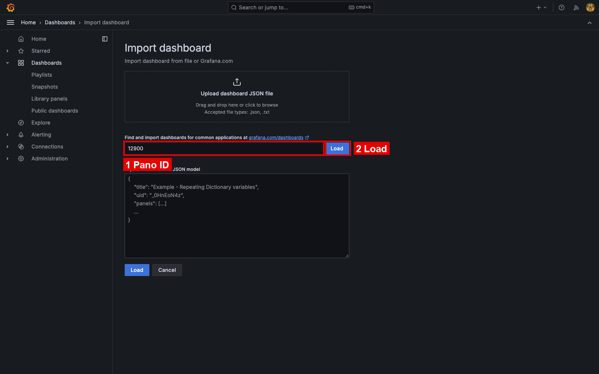{width=75%}

2. **Prometheus** kutusunda (3) veri kaynağını seçip **Import**'a (4) basın. `1860` veri kaynağını pano içinden seçtiği için bu kutu çıkmaz; doğrudan **Import**'a basın.

   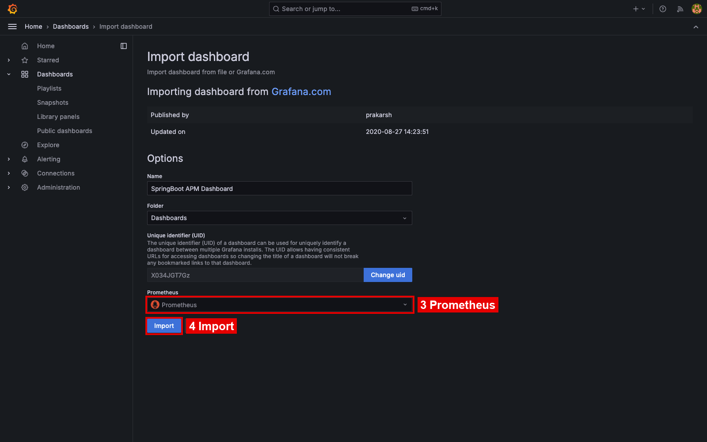{width=75%}

3. Pano açılır. Üstteki açılır menülerle (Instance, Application gibi) servis seçebilirsiniz.

   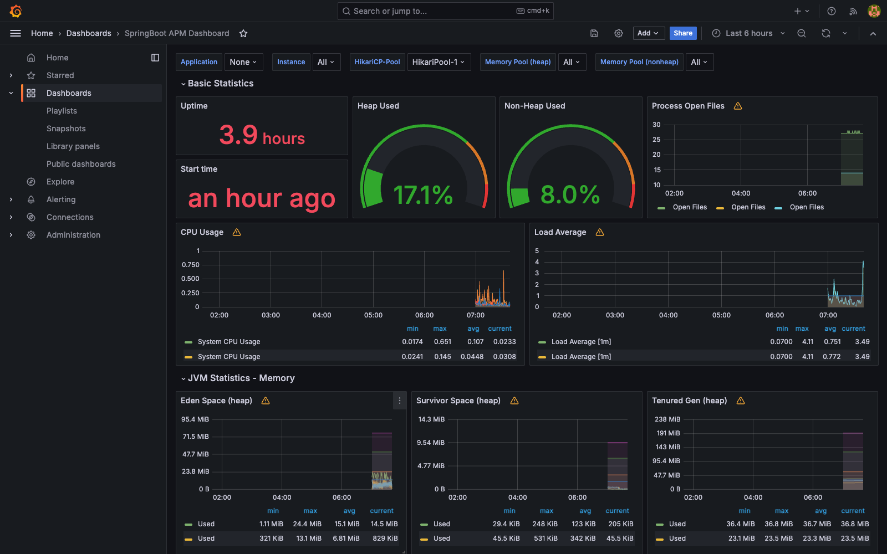{width=75%}

   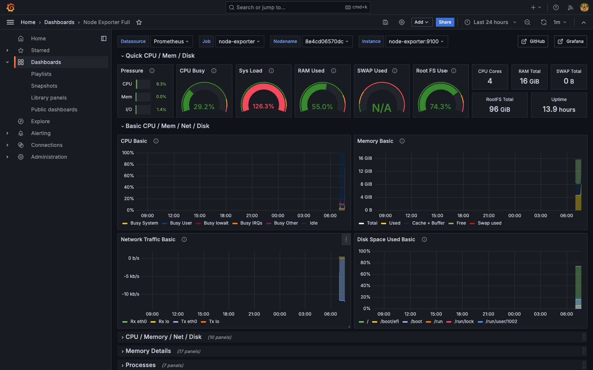{width=75%}

Topluluk panoları belirli etiket adlarına göre yazılır. Bir panelde `No data` görünüyorsa pano, bu labın metriklerinde olmayan bir etiket bekliyordur; ör. `14282` (cAdvisor exporter) bu yüzden boş gelir.

#### 6.3 Sıfırdan pano oluşturma

**Yeni pano ve veri kaynağı**

1. **Dashboards > New > New dashboard**'a, ardından **+ Add visualization**'a (1) tıklayın.

   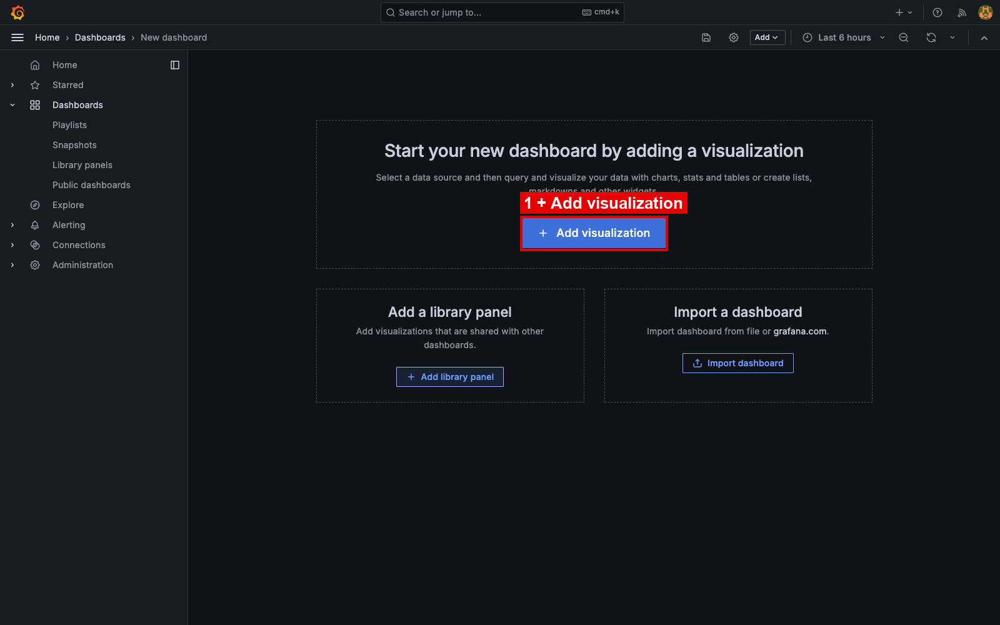{width=75%}

2. **Select data source** penceresinde **Prometheus**'u (2) seçin. Panel düzenleme ekranı açılır.

   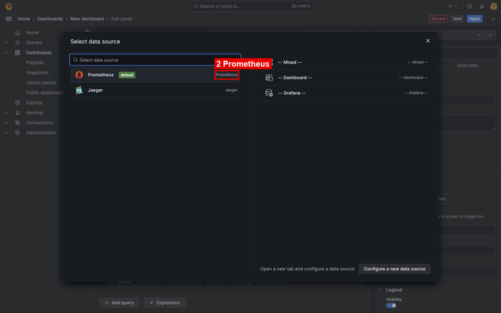{width=75%}

**Panel 1: istek hızı (Time series)**

3. Sorgu satırının sağındaki **Code**'a (3) tıklayın ve sorguyu kutuya (4) yapıştırın. Kutunun dışına tıklayınca grafik çizilir:

   ```promql
   sum by (job) (rate(http_server_requests_seconds_count[1m]))
   ```

4. Sorgunun altındaki **Options**'ı açın; **Legend** menüsünde **Custom**'ı seçip `{{job}}` yazın (5). Çizgiler `novashop-cart`, `novashop-orders` gibi servis adlarıyla etiketlenir.
5. Sağ paneldeki **Title** alanına (6) `Mikroservis İstek Hızları (RPS)` yazın ve sağ üstte **Apply**'a (7) basın.

   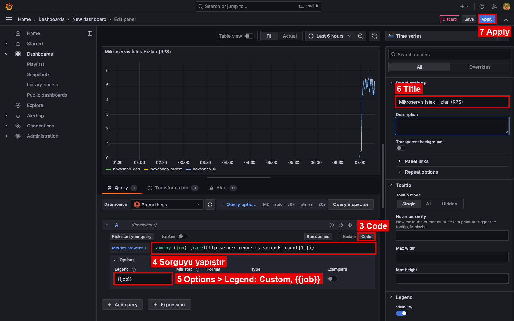{width=75%}

**Panel 2: başarılı istek sayısı (Stat)**

6. Pano ekranında üstteki **Add**'e (1), ardından **Visualization**'a (2) tıklayın.

   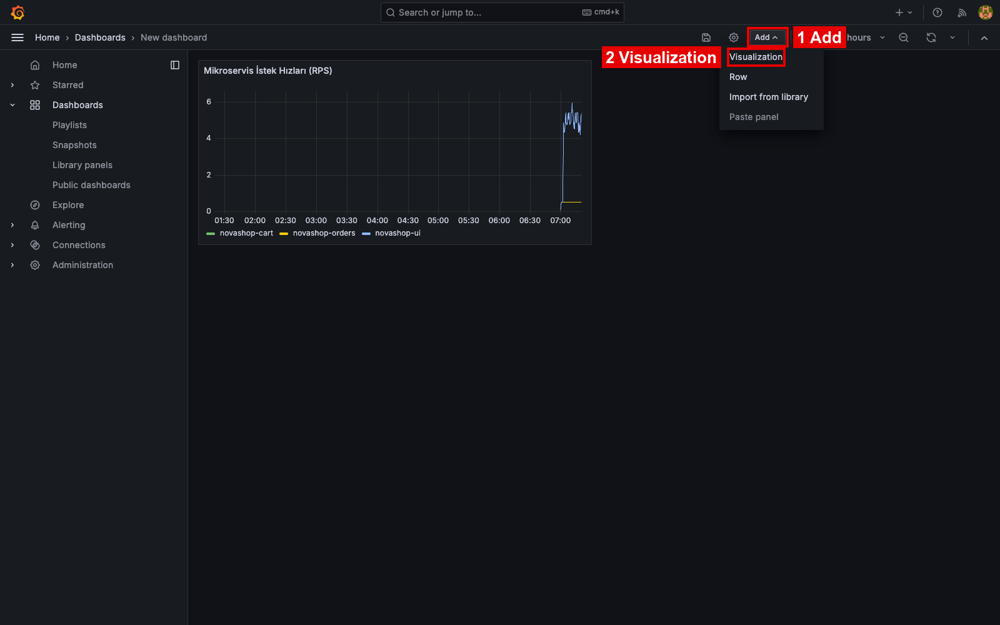{width=75%}

7. **Code** moduna geçip sorguyu yapıştırın:

   ```promql
   sum(http_server_requests_seconds_count{status=~"2.."})
   ```

8. Sağ üstteki panel türü menüsüne (`Time series` yazar) tıklayın (1) ve listeden **Stat**'ı (2) seçin. **Title** `Toplam Başarılı İstek (2xx)`, sonra **Apply**.

   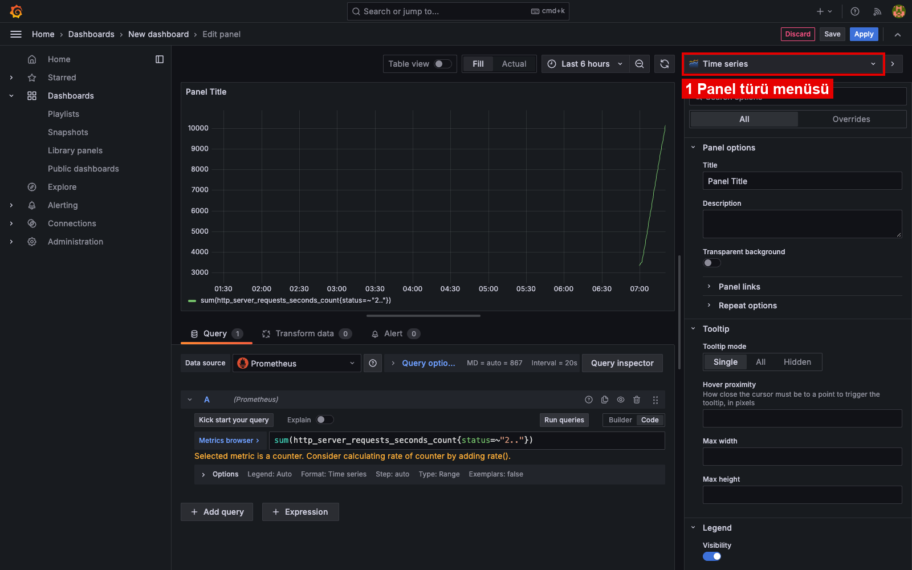{width=75%}

   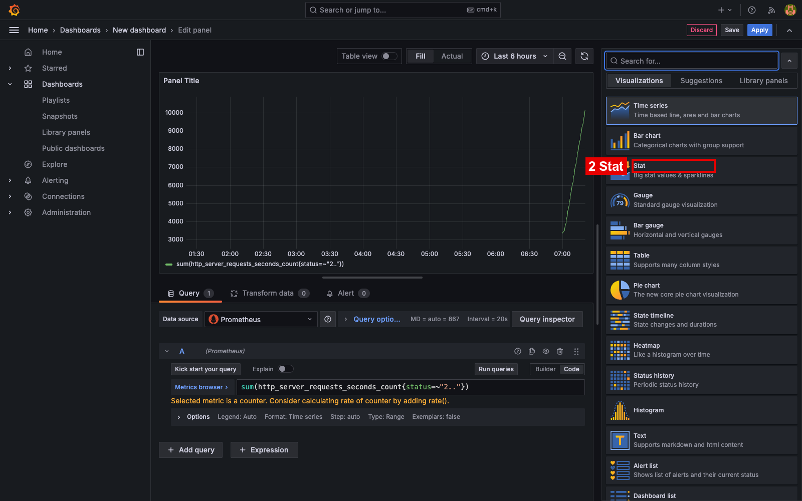{width=75%}

**Panel 3: CPU kullanımı (Gauge)**

9. **Add > Visualization** ile yeni panel açın, **Code** moduna geçip sorguyu yapıştırın; panel türünü **Gauge** yapın ve **Title** `Sunucu CPU Tüketimi` yazın:

   ```promql
   100 - (avg(rate(node_cpu_seconds_total{mode="idle"}[2m])) * 100)
   ```

10. Değerin `%` ile gösterilmesi için birimini ayarlayın. Sağ paneldeki **Search options** kutusuna `Unit` yazın (1); altında **Unit** alanı ve **Choose** yazan bir menü kalır. **Choose**'a tıklayın, açılan listede **Misc**'in (2) üzerine gelin ve sağda açılan listeden **Percent (0-100)**'ü (3) seçin.

    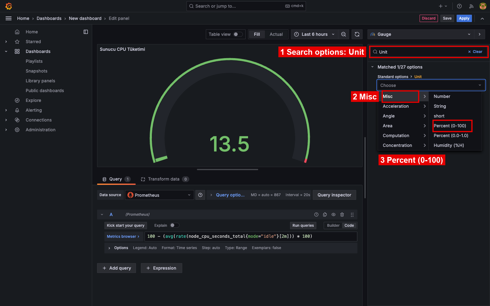{width=75%}

11. **Search options** kutusuna `Thresholds` yazın (4). Varsayılan `80` eşiği kırmızıdır: rengine tıklayıp sarı yapın, **+ Add threshold** (5) ile `90` ekleyip kırmızı yapın. Sonra **Apply**.

    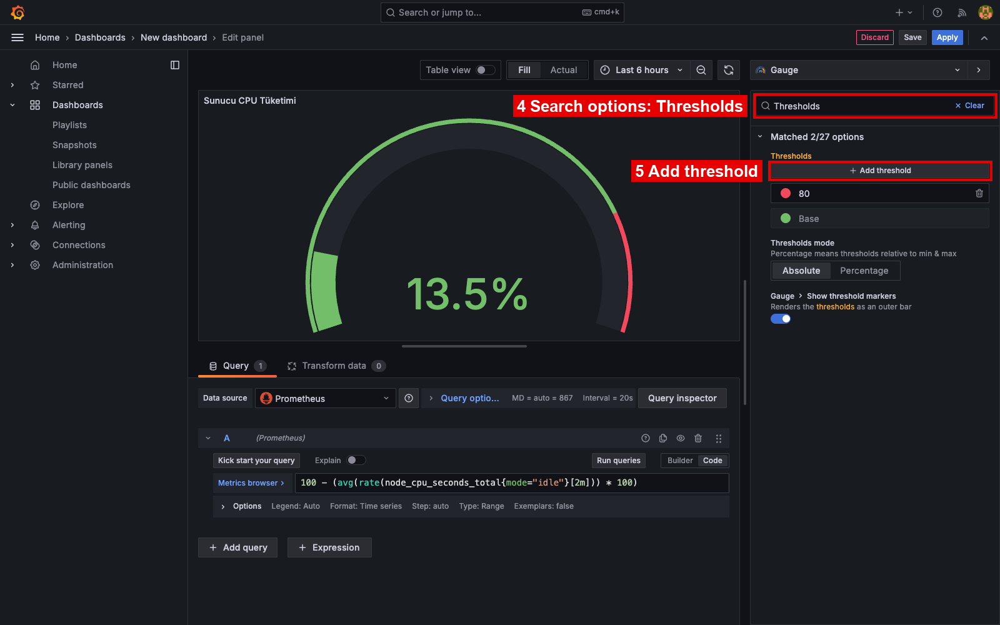{width=75%}

**Panoyu kaydetme**

12. Üst çubuktaki disket simgesine, **Save dashboard**'a (1) tıklayın.

    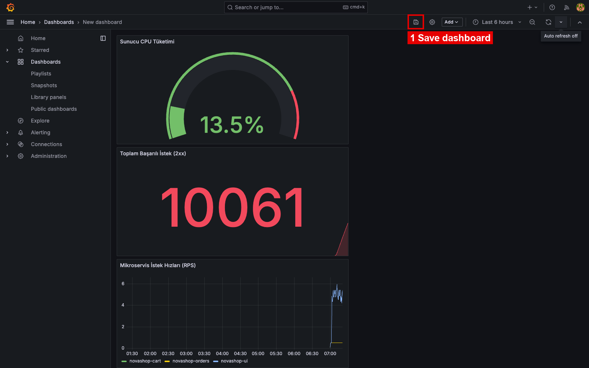{width=75%}

13. **Title** alanına `NovaShop Canlı İzleme` yazın (2) ve **Save**'e (3) basın.

    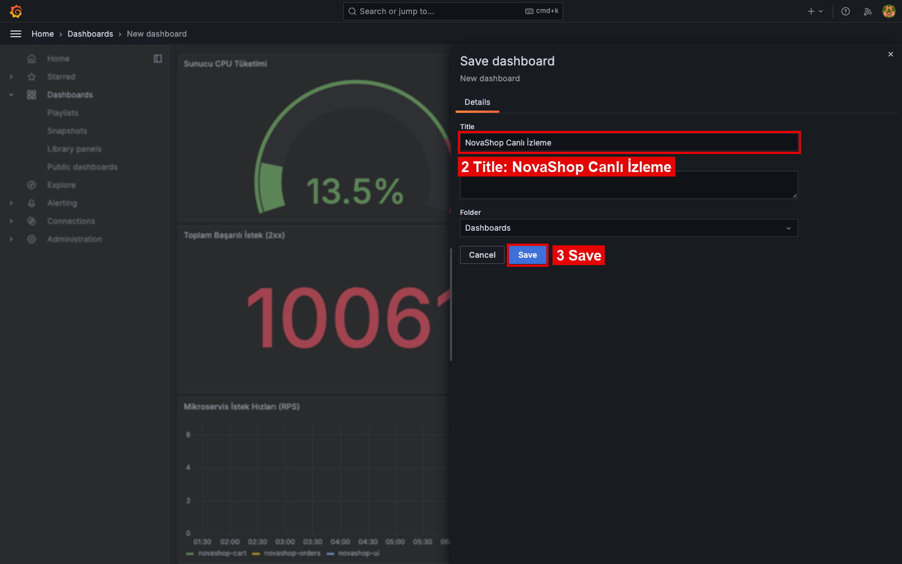{width=75%}

<details>
<summary><strong>Pano <code>New dashboard</code> adıyla kaydedildiyse adını değiştirme</strong></summary>

Grafana adı yalnız ilk kayıtta sorar; sonradan pano ayarlarından değiştirilir.

1. Panoyu açın, üst çubuktaki dişli simgesine, **Dashboard settings**'e (1) tıklayın.

   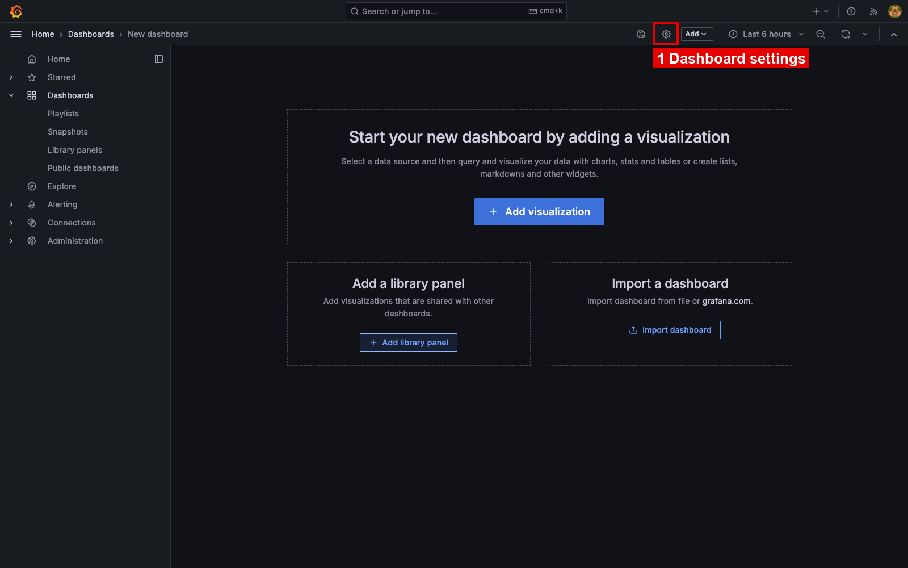{width=75%}

2. **General** sekmesindeki **Title** alanına (2) `NovaShop Canlı İzleme` yazın.
3. Sağ üstte **Save dashboard**'a (3), açılan pencerede **Save**'e basın.

   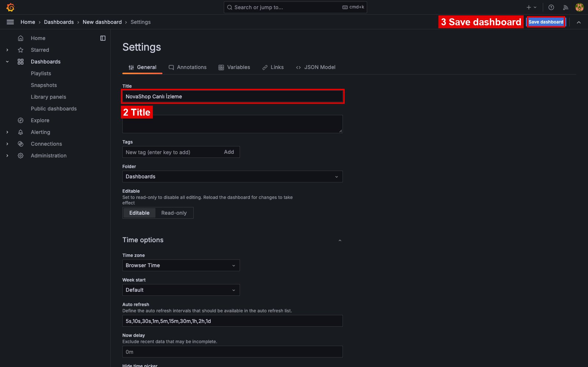{width=75%}

</details>

#### 6.4 Alarm kuralı

Spring servislerinde 5xx oranı %5'i geçerse alarm verir. Grafana kuralı her dakika çalıştırır: sorgu (A) oranı hesaplar, **Reduce** (B) son değeri alır, **Threshold** (C) bu değeri eşikle karşılaştırır.

1. Sol menüden **Alerting > Alert rules**'u açın ve **+ New alert rule**'a (1) tıklayın.

   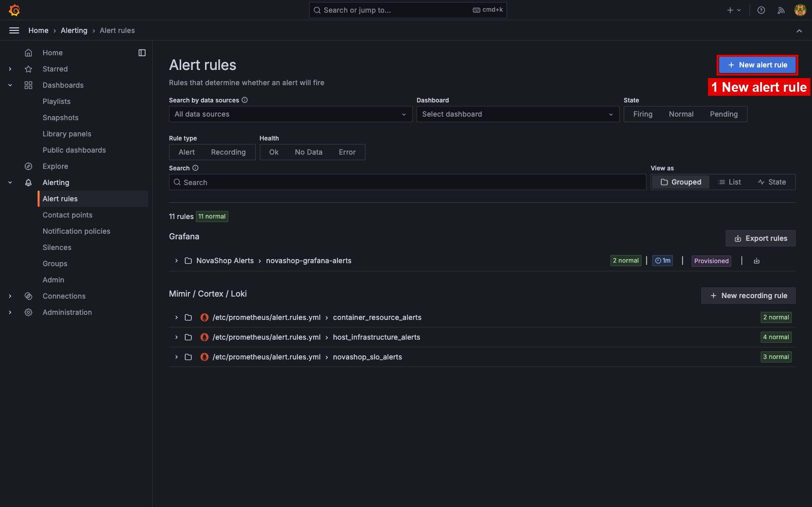{width=75%}

2. **1. Enter alert rule name** bölümündeki **Name** alanına `NovaShopHighErrorRateAlert` yazın (2).
3. **2. Define query and alert condition** bölümünde sorgu A'nın sağındaki **Code**'a (3) tıklayın ve sorguyu kutuya (4) yapıştırın:

   ```promql
   sum(rate(http_server_requests_seconds_count{status=~"5.."}[1m])) / sum(rate(http_server_requests_seconds_count[1m])) * 100
   ```

   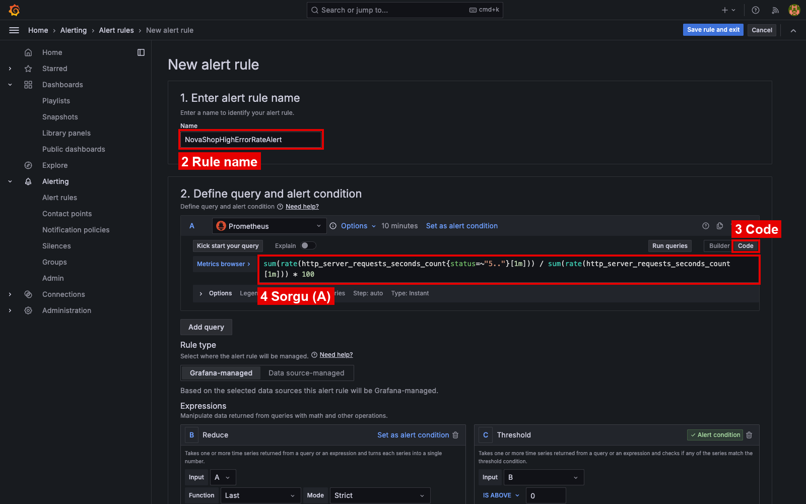{width=75%}

4. Aşağıdaki **Expressions** kısmında **C Threshold** kutusunda **IS ABOVE** değerini `0`'dan `5`'e çevirin (5).

   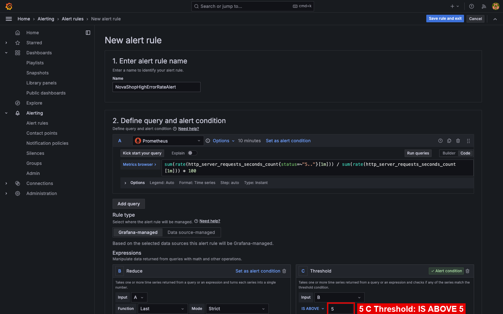{width=75%}

5. **3. Set evaluation behavior** bölümünde:
   - **Folder** yanındaki **+ New folder**'a tıklayıp `NovaShop Manual Alerts` adını verin, **Create**'e basın (6).
   - **Evaluation group** yanındaki **+ New evaluation group**'a tıklayın. Açılan pencerede ad `ecommerce-errors` (7), aralık `1m` (8) yazıp **Create**'e basın.

   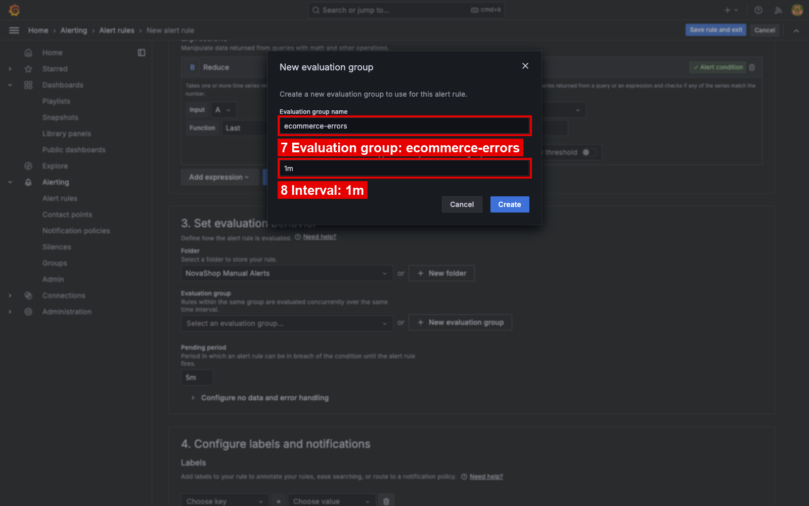{width=75%}

   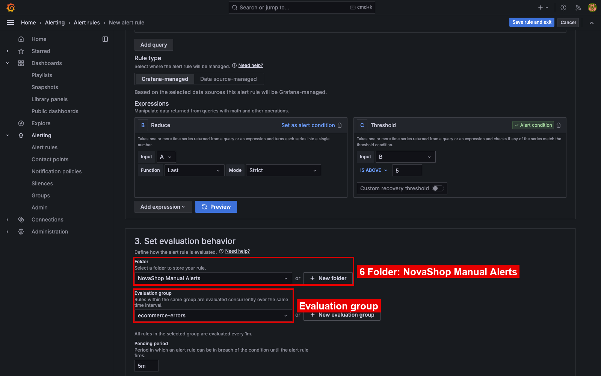{width=75%}

6. Sayfanın sağ üstündeki **Save rule and exit**'e (9) basın.

   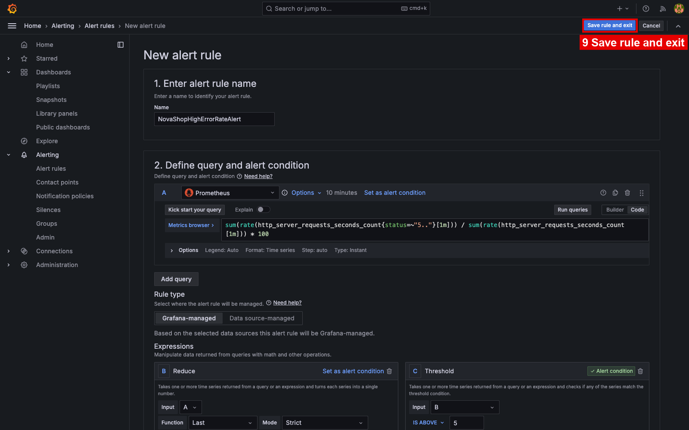{width=75%}

7. Kural **Alert rules** listesinde `NovaShop Manual Alerts > ecommerce-errors` altında görünür; 5xx oranı %5'in altındayken durumu `Normal`'dır.

   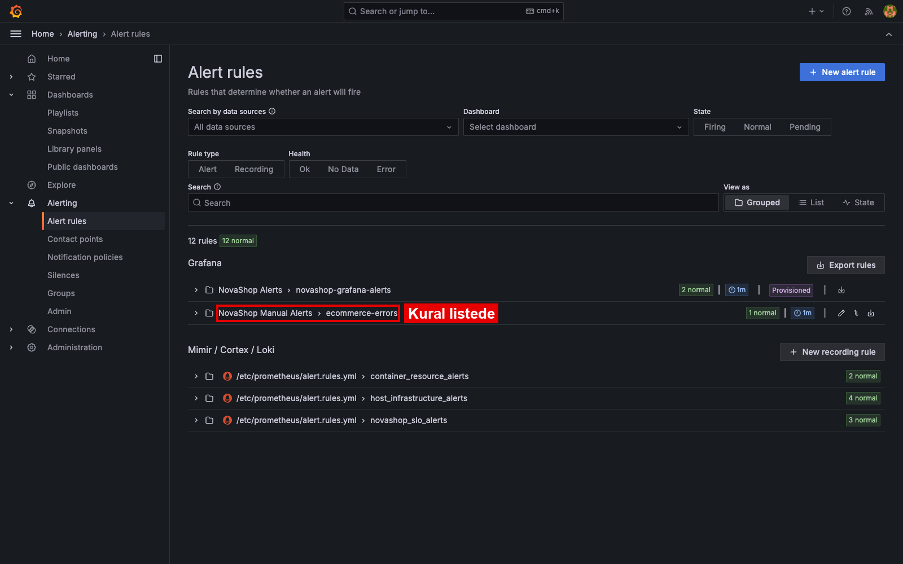{width=75%}

### 7. SLO ve hata bütçesi

SLO %99.9 ise hata bütçesi %0.1'dir: 1000 isteğin en çok 1'i 5xx olabilir.

1. 6.3'teki panoda **Add > Visualization** ile yeni panel açın, panel türünü **Gauge** yapın, **Title** `SLO - Başarı Oranı` yazın. **Code** moduna geçip sorguyu yapıştırın; sorgu Spring servislerinde 5xx olmayan isteklerin oranını verir:

   ```promql
   sum(rate(http_server_requests_seconds_count{status!~"5.."}[30d])) / sum(rate(http_server_requests_seconds_count[30d])) * 100
   ```

2. Değerin `%` ile gösterilmesi için birimini ayarlayın. Sorgu 0-100 arası bir sayı döndürür; birim seçilmezse kadranda yalnız `86.5` gibi bir sayı görünür.

   a. Sağdaki **Search options** kutusuna `Unit` yazın (1). Altında yalnız **Unit** alanı kalır; **Choose** menüsüne tıklayın (2).

   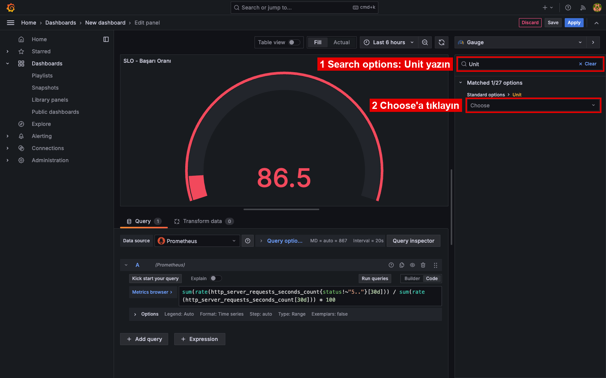{width=75%}

   b. Birim kategorileri listelenir. **Misc**'in üzerine gelin (3); sağda yeni bir liste açılır.

   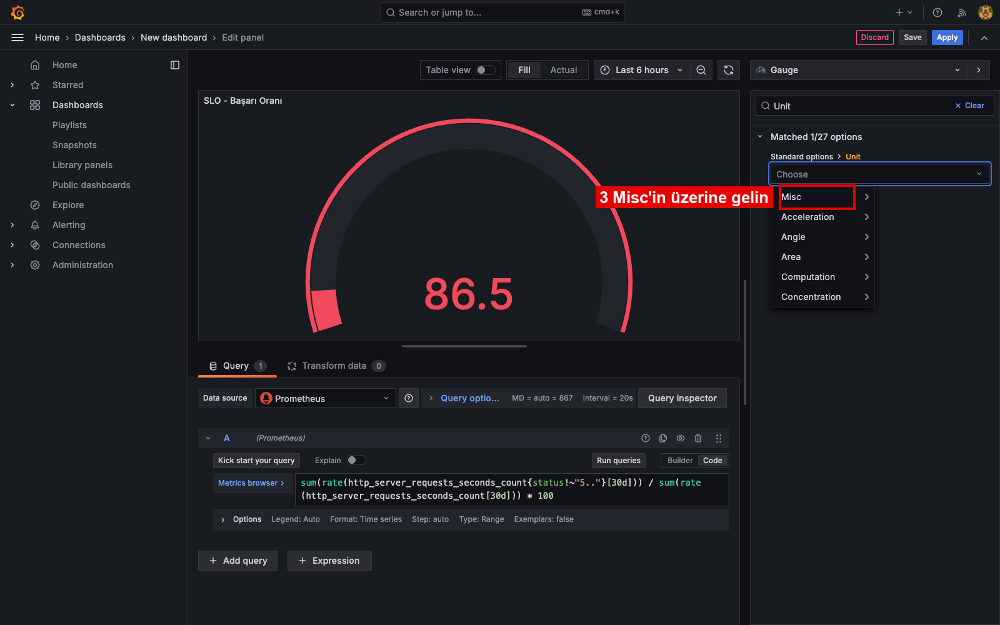{width=75%}

   c. Sağdaki listeden **Percent (0-100)**'ü seçin (4). `Percent (0.0-1.0)` 0-1 arası değerler içindir, onu seçmeyin.

   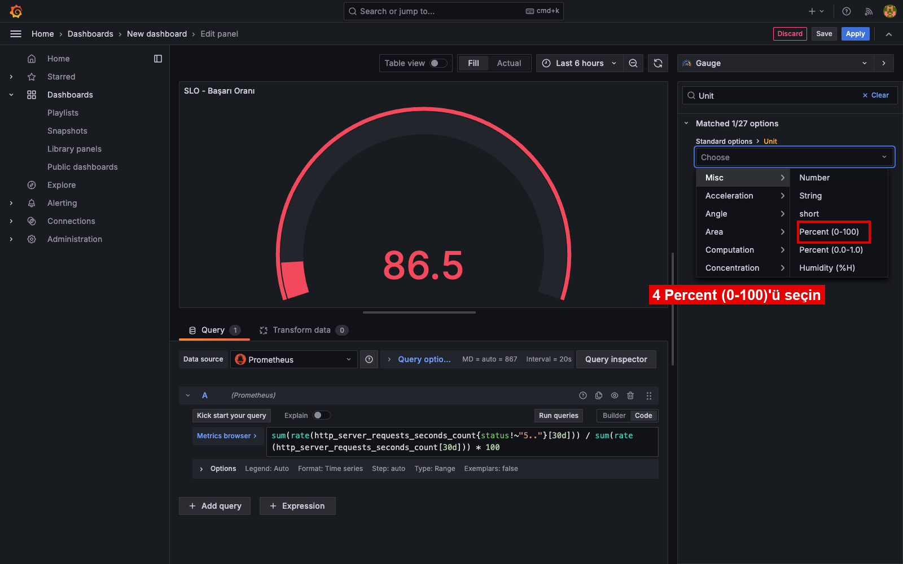{width=75%}

   d. **Unit** alanında `Percent (0-100)` yazar (5) ve kadrandaki değer `%` ile gösterilir.

   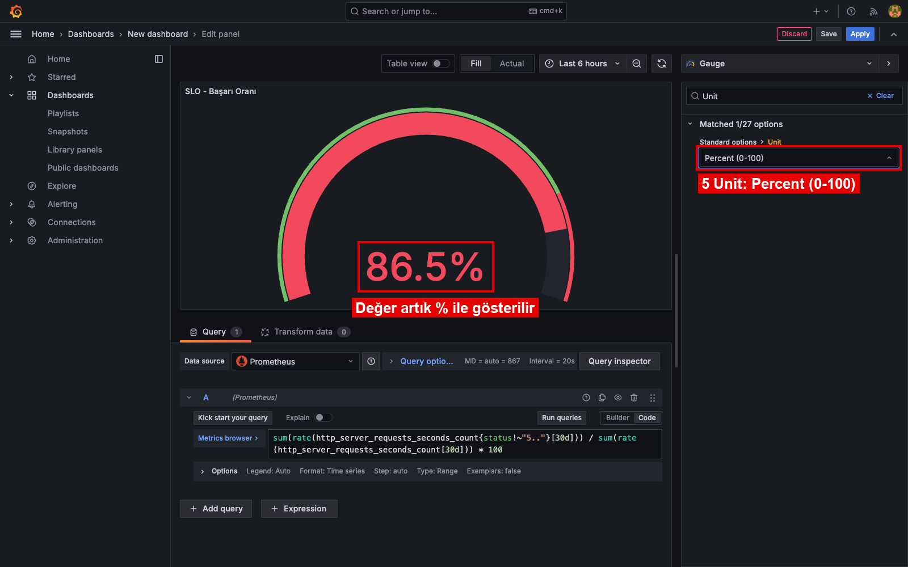{width=75%}
3. **Search options** kutusuna `Min` yazın (1) ve **Min** alanına `98` girin (2). Kadran 98-100 aralığını gösterir; böylece %99 ile %99.9 arasındaki fark görünür olur.

   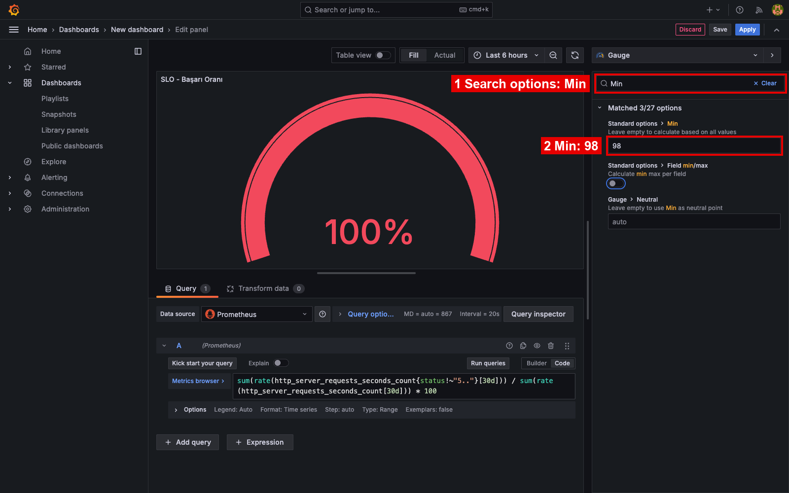{width=75%}

4. **Search options** kutusuna `Max` yazın (3) ve **Max** alanına `100` girin (4).

   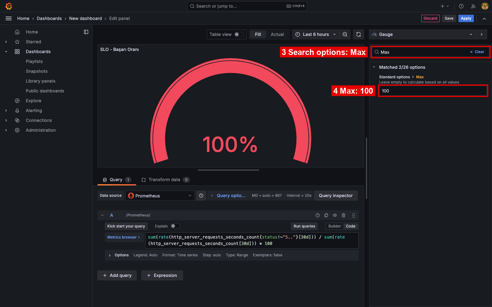{width=75%}

5. **Search options** kutusuna `Thresholds` yazın (5). Varsayılan `80` değerini `99` yapıp rengine tıklayın ve sarıyı seçin (7). **+ Add threshold** ile eklenen satırı `99.9` yapıp yeşil seçin (6). **Base** rengini kırmızı yapın (8). **Apply** ile panoya dönüp panoyu kaydedin.

   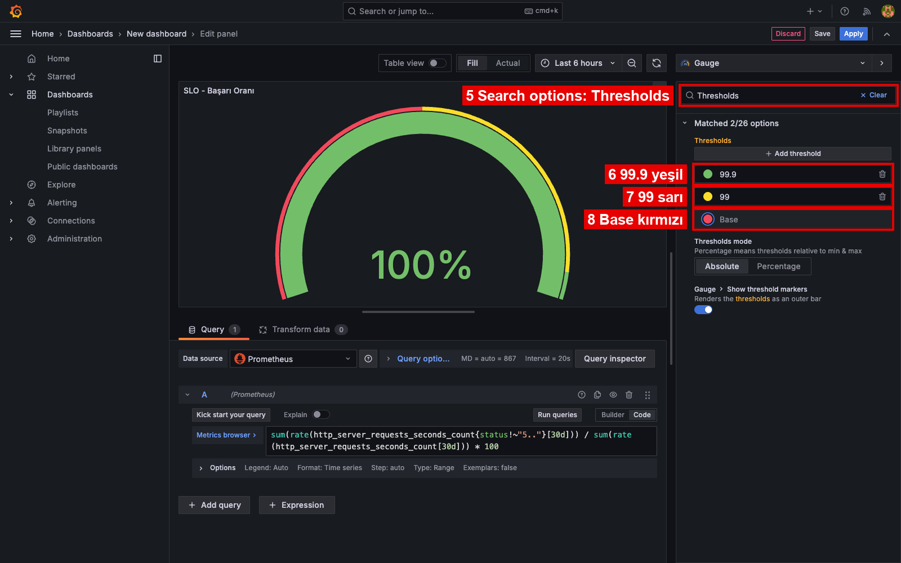{width=75%}

6. Hata yokken kadran %100 ve yeşildir:

   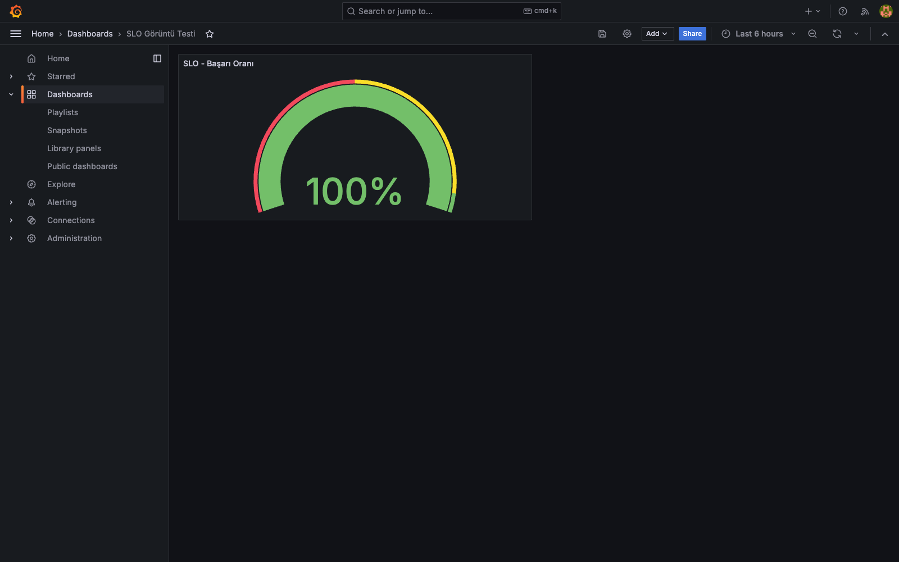{width=75%}

UI'nın `/utility/status/500` endpoint'i her çağrıda gerçek HTTP 500 döner. 200 adet 500 hatası üreterek hata bütçesini tüketin:

```bash
for i in $(seq 1 200); do curl -s -o /dev/null http://localhost:30080/utility/status/500; done
```

Hataların Prometheus'a ulaştığını kontrol edin (0'dan büyük bir sayı döner):

```bash
curl -s 'http://localhost:19090/api/v1/query' --data-urlencode 'query=sum(http_server_requests_seconds_count{job="novashop-ui",status="500"})' | jq -r '.data.result[0].value[1]'
```

Bir dakika içinde `SLO - Başarı Oranı` kadranı %99.9'un altına düşer ve sarıya döner: hata bütçesi tükenmiştir.

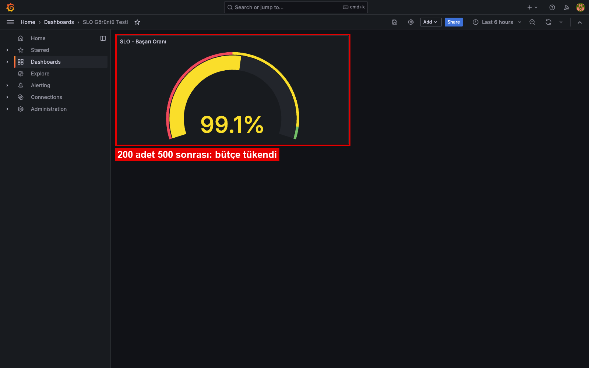{width=75%}

6.4'teki alarm bu sırada yalnız `Pending` olur ve bir dakika sonra `Normal`'e döner. Alarm kuralının **Pending period** değeri `5m`'dir: koşul 5 dakika kesintisiz sürmeden alarm `Firing` olmaz. Kısa bir hata patlaması alarm üretmez; gerçek ortamda da istenen budur.

`Firing` durumunu görmek için 6.5 dakika boyunca saniyede 5 hata üretin; komut bitince kendiliğinden durur:

```bash
end=$((SECONDS+390)); while [ $SECONDS -lt $end ]; do curl -s -o /dev/null http://localhost:30080/utility/status/500; sleep 0.2; done
```

Komut çalışırken **Alerting > Alert rules** sayfasında kural önce `Pending`, yaklaşık 5 dakika sonra `Firing` olur:

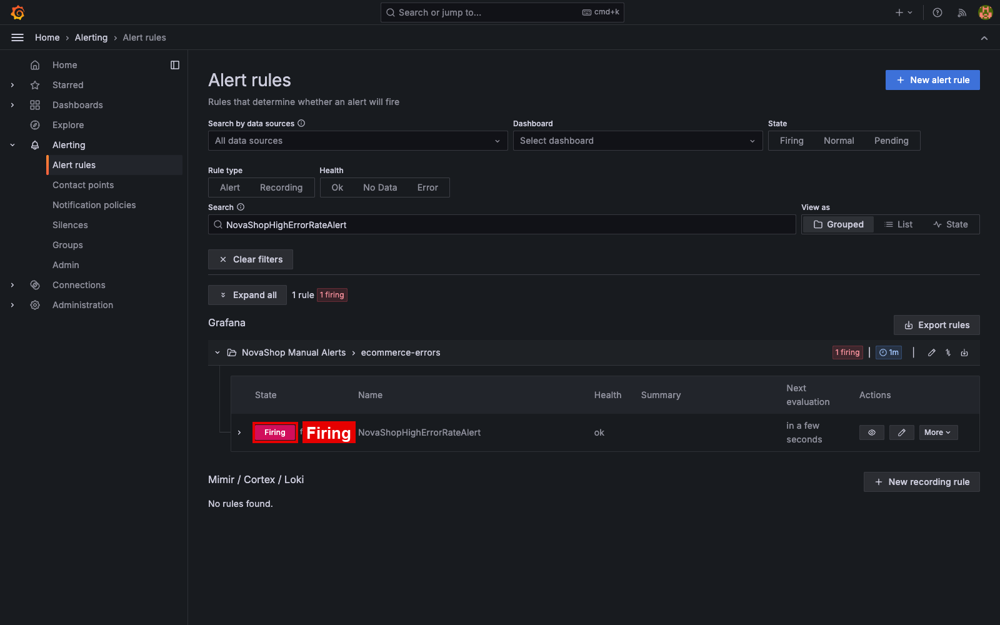{width=75%}

### 8. Dağıtık izler (OTel Collector ve Jaeger)

`UI -> Cart -> Orders -> Checkout` zincirini taklit eden örnek izleri OTel Collector'a (4466) gönderin:

```bash
python3 scripts/generate-sample-traces.py
```

Jaeger UI yalnızca sunucu içinde (`127.0.0.1:16686`) açıktır. Kendi bilgisayarınızın terminalinde arka planda çalışan bir SSH tüneli açın (`<KULLANICI>` ve `<SUNUCU>` yerine kendi bilgilerinizi yazın):

```bash
ssh -f -N -L 16686:127.0.0.1:16686 <KULLANICI>@<SUNUCU>
```

- `-L 16686:127.0.0.1:16686`: bilgisayarınızın 16686 portuna gelen bağlantıyı sunucunun içindeki Jaeger'a taşır.
- `-N`: sunucuda komut çalıştırmaz, yalnız tüneli tutar.
- `-f`: tüneli arka plana alır; komut terminali hemen geri verir.

İşiniz bitince tüneli kapatın:

```bash
pkill -f "16686:127.0.0.1:16686"
```

1. Tarayıcıda http://localhost:16686 adresini açın. **Service** menüsünden `novashop-ui`'yi seçin (1) ve **Find Traces**'e (2) tıklayın.

   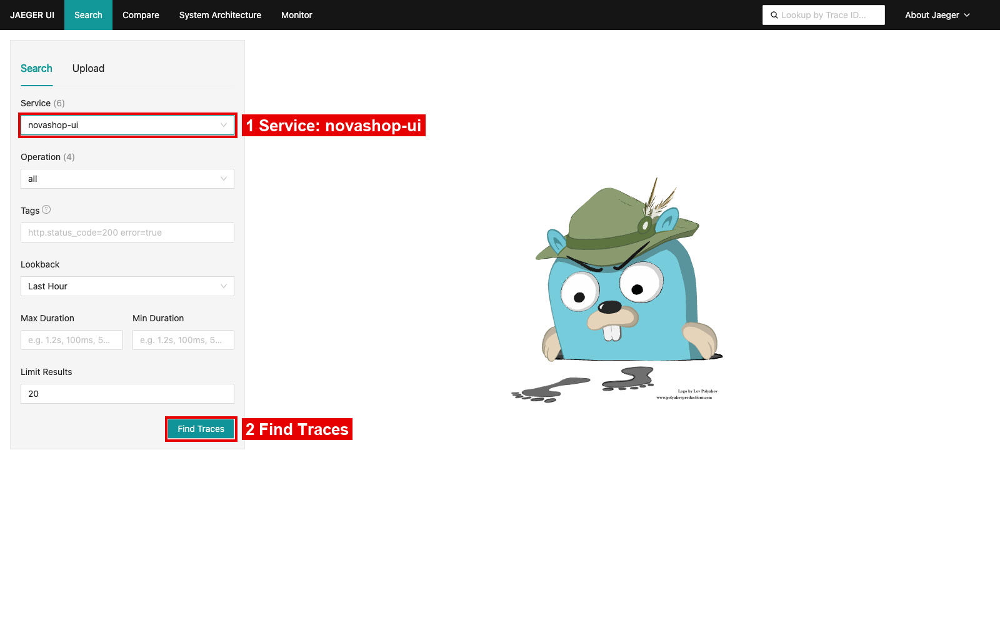{width=75%}

2. Sağda son izler listelenir. Üstteki grafikte her nokta bir izdir; yukarıdakiler yavaş, kırmızılar hatalı isteklerdir. Listeden bir ize (3) tıklayın; `2 Errors` etiketli izler hata içerir.

   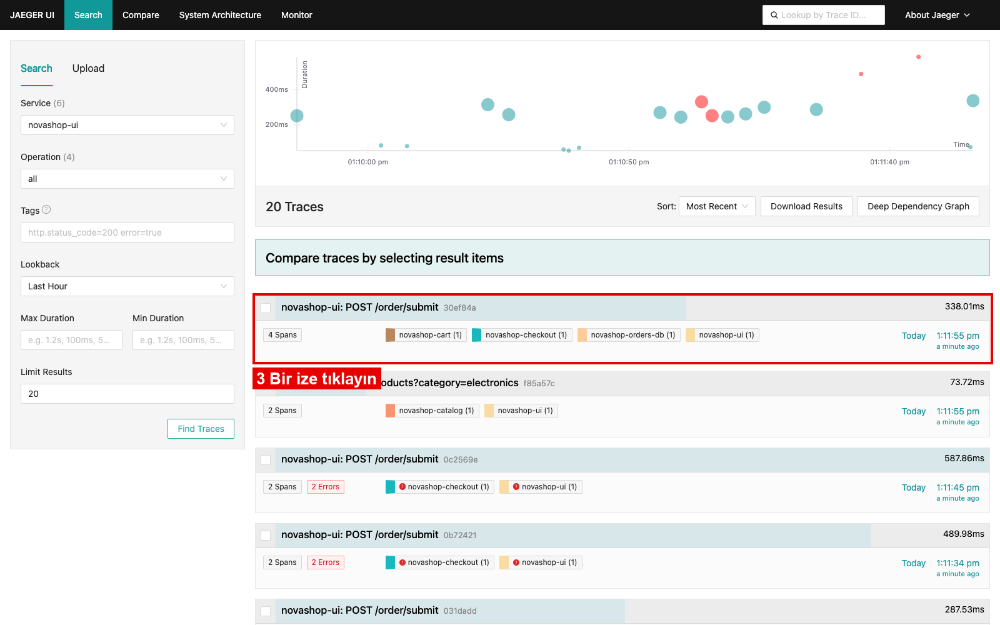{width=75%}

3. İz, şelale (waterfall) görünümünde açılır (4). Her satır bir servistir; çubuğun uzunluğu o serviste harcanan süreyi gösterir. Örnekte `POST /order/submit` isteği 338 ms sürmüş; bunun 113 ms'si `novashop-checkout`'ta, 77 ms'si veritabanı yazmasında geçmiştir.

   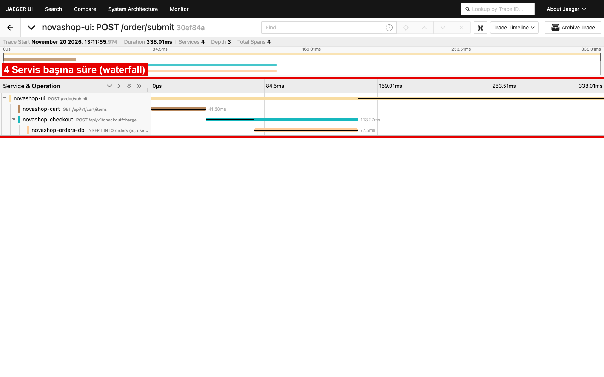{width=75%}

### 9. Otomatik doğrulama

Yapılandırma dosyalarını, UI sağlığını ve Prometheus hedeflerini kontrol eden betiği çalıştırın:

```bash
bash scripts/verify/verify-lab-10.sh 30080 localhost
```

*Beklenen:* son satırda `=== [LAB-10] Gözlemlenebilirlik Doğrulama Tamamlandı ===`.

## Temizlik

Trafik simülatörünü durdurun:

```bash
pkill -f simulate-traffic.py
```

Gözlemlenebilirlik container'larını kapatın:

```bash
bash scripts/compose-observability.sh down
```

LAB-10 Kind cluster'ını silin (başka cluster'lara dokunmaz):

```bash
kind delete cluster --name novashop-cluster
```

Kind worker'larının host'a yazdığı pod log dizinini silin:

```bash
sudo rm -rf /var/log/novashop-kind
```

Ön Koşullar'da `k8s-labs`'ı durdurduysanız geri başlatın; önce control-plane, sonra worker'lar:

```bash
docker start k8s-labs-control-plane && docker start k8s-labs-worker k8s-labs-worker2
```

`kubectl`'i yeniden `k8s-labs` cluster'ına yönlendirin (LAB-10 varsayılan context'i değiştirmişti):

```bash
kubectl config use-context kind-k8s-labs
```

API server'ın açılmasını bekleyip node'ların `Ready` olduğunu doğrulayın (yeniden başlatma sonrası API server birkaç saniye `Forbidden` döner):

```bash
until kubectl get nodes >/dev/null 2>&1; do sleep 3; done
kubectl wait --for=condition=Ready nodes --all --timeout=180s
```

Yeniden başlatma sonrası bazı pod'lar API server açılana kadar birkaç kez yeniden başlar ve 1-2 dakikada kendiliğinden düzelir. Bir dakika bekleyip `Running`/`Completed` olmayan pod'ları listeleyin:

```bash
sleep 60; kubectl get pods -A --no-headers | grep -vE 'Running|Completed' || echo "Tüm pod'lar çalışıyor"
```

Listede hâlâ pod varsa ait olduğu deployment'ı yeniden başlatın (`<NAMESPACE>` ve `<DEPLOYMENT>` listedeki pod'un namespace'i ve adının son iki parçası çıkarılmış hali):

```bash
kubectl rollout restart deployment -n <NAMESPACE> <DEPLOYMENT>
```
