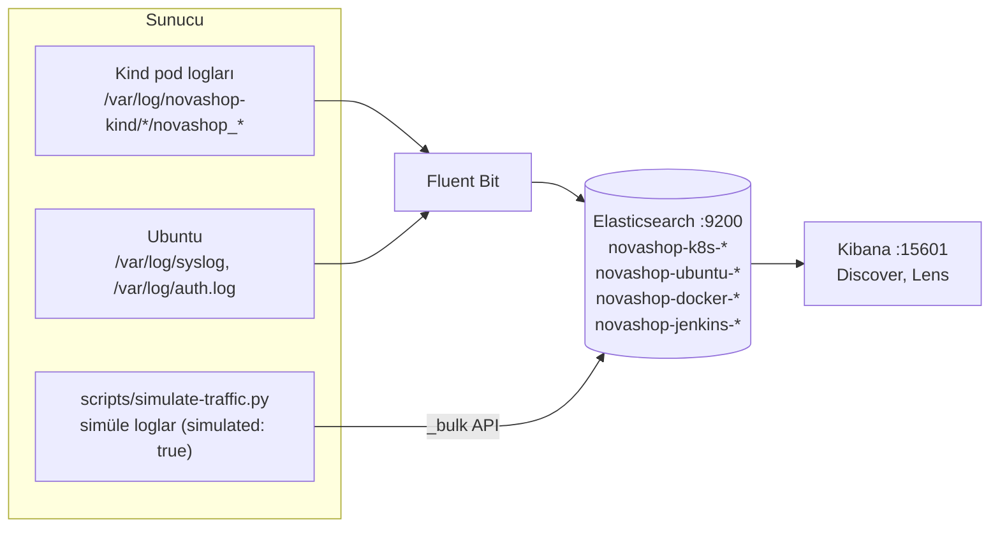

# LAB-11 — Merkezi Loglama: Elasticsearch, Kibana ve Fluent Bit

## Amaç

- Elasticsearch ve Kibana'yı kurup log index'leri için şablon tanımlamak.
- Fluent Bit ile Kind pod loglarını ve Ubuntu sistem loglarını Elasticsearch'e göndermek.
- Kibana'da data view, Discover (KQL ve `trace_id` korelasyonu) ve Lens panosu kurmak.

## Ön Koşullar

- Docker ve Docker Compose v2, `kind`, `kubectl`, `helm`, `curl`, `jq`, `python3`.
- ELK yaklaşık 2.5 GB RAM kullanır; ağır başka lab'ları kapatın.

Bütün komutlar repo kökünden çalıştırılır:

```bash
cd ~/novashop
```

Trafik ve log üreten Python betikleri `requests` modülünü kullanır; kurun:

```bash
sudo apt-get install -y python3-requests
```

**Port uyarısı:** Bu lab aşağıdaki host portlarını kullanır; başka bir lab veya container bu portları tutuyorsa ELK başlamaz.

| Port | Servis | Erişim |
|---|---|---|
| 9200 | Elasticsearch REST API | Sunucu içinden (`curl http://localhost:9200`) |
| 15601 | Kibana | Tarayıcı (alan adı yuvası) |
| 24224 | Fluent Bit forward (TCP/UDP) | Sunucu içinden; Docker fluentd logging driver |

Portların boş olduğunu kontrol edin; doluysa portu tutan süreç görünür, boşsa `Portlar boş` yazar:

```bash
ss -ltnp | grep -E ':(9200|15601|24224) ' || echo "Portlar boş"
```

Doluysa portu tutan container'ı bulun ve o lab'ı kapatın (ör. başka bir ELK lab'ı):

```bash
docker ps --format '{{.Names}}\t{{.Ports}}' | grep -E ':(9200|15601|24224)->' || echo "Portları tutan container yok"
```

### NovaShop Kind cluster'ı

Fluent Bit'in toplayacağı gerçek pod logları `novashop-cluster` Kind cluster'ındaki NovaShop servislerinden gelir. Cluster yoksa kurun (LAB-10'daki kurulumla aynıdır, 5-10 dakika sürer):

```bash
bash scripts/setup-kind-cluster.sh
```

Betik şunları yapar:

- `deploy/k8s/kind-cluster-config.yaml` ile 1 control-plane ve 2 worker node'lu cluster kurar ve `kubectl` context'ini `kind-novashop-cluster` yapar.
- `novashop` namespace'ine Helm chart ile 5 servisi (ui, catalog, cart, orders, checkout) kurar. UI `http://localhost:30080` adresinde açılır.

Log toplama için kritik olan, config dosyasındaki `extraMounts` bloğudur:

```yaml
  - role: worker
    extraMounts:
      - hostPath: /var/log/novashop-kind/worker1
        containerPath: /var/log/pods
```

- kubelet her container'ın stdout/stderr çıktısını node içinde `/var/log/pods/<namespace>_<pod>_<uid>/<container>/0.log` dosyasına yazar.
- Kind node'u bir Docker container'ıdır; bu dosyalar host'tan görünmez. `extraMounts` node'un `/var/log/pods` dizinini host'taki `/var/log/novashop-kind/worker1`'e bağlar, Fluent Bit logları host'tan okur.
- Her worker ayrı dizine yazar. Aynı dizini paylaşsalar her kubelet tanımadığı pod dizinlerini siler ve loglar kaybolur.

Pod'ların `Running` olduğunu ve log dizinlerinin host'ta oluştuğunu kontrol edin; dizin adları `novashop_<pod>_<uid>` biçimindedir:

```bash
kubectl get pods -n novashop
ls /var/log/novashop-kind/worker1 /var/log/novashop-kind/worker2
```

## Mimari



| Kaynak | Nasıl gelir | Index | Gerçek mi? |
|---|---|---|---|
| NovaShop pod logları | Fluent Bit `tail`: `/var/log/novashop-kind/*/novashop_*/*/*.log` | `novashop-k8s-*` | Gerçek |
| Ubuntu sistem logları | Fluent Bit `tail`: `/var/log/syslog`, `/var/log/auth.log` | `novashop-ubuntu-*` | Gerçek |
| Uygulama, Docker, Jenkins olayları | `simulate-traffic.py` doğrudan `_bulk` API'ye yazar | Dört index'in hepsi | Simülasyon, `simulated: true` |

Simülatör, gerçek kaynaklarda olmayan alanları (`trace_id`, `service`, `level`, `http_status`, Jenkins `stage`) içeren düzenli olaylar üretir; korelasyon ve pano adımları bu alanları kullanır. Fluent Bit'in topladığı gerçek kayıtlarda `simulated` alanı yoktur.

## Adım Adım Uygulama Rehberi

### 1. Elasticsearch ve Kibana'yı başlatma

Yığının tanımı `deploy/logging/docker-compose.logging.yml` dosyasındadır. Elasticsearch servisinin kritik satırları:

```yaml
    image: docker.elastic.co/elasticsearch/elasticsearch:8.13.0
    environment:
      - discovery.type=single-node
      - xpack.security.enabled=false
      - "ES_JAVA_OPTS=-Xms512m -Xmx512m"
    ports:
      - "9200:9200"
```

- `discovery.type=single-node`: başka node aramaz, tek node'lu cluster olarak hemen açılır.
- `xpack.security.enabled=false`: kullanıcı ve parola yoktur, HTTP ile erişilir. Yalnız eğitim içindir; gerçek ortamda güvenlik açık kalır.
- `-Xms512m -Xmx512m`: Java heap 512 MB'ta sabittir; sunucudaki diğer lab'lara bellek kalır.

Kibana aynı Docker ağında `http://elasticsearch:9200` adresine bağlanır ve host'ta `15601` portundan açılır.

Yalnız Elasticsearch ve Kibana'yı başlatın. Fluent Bit sonra başlatılır: önce Adım 2'deki index template'i kurulmalıdır; aksi halde Fluent Bit index'leri varsayılan ayarlarla (1 replica) açar ve tek node'lu cluster `yellow` kalır.

```bash
docker compose -p novashop-logging -f deploy/logging/docker-compose.logging.yml up -d elasticsearch kibana
```

Elasticsearch'ün istek kabul etmesini bekleyin (20-60 sn), ardından sürümü sorgulayın; `8.13.0` yazmalıdır:

```bash
until curl -fsS http://localhost:9200/_cluster/health >/dev/null 2>&1; do sleep 2; done
curl -s http://localhost:9200 | jq -r .version.number
```

Kibana'nın tamamen açılmasını bekleyin (1-2 dk), `hazır` yazınca adresini yazdırıp tarayıcıda açın. Kibana açılırken sayfayı açarsanız tarayıcı eksik eklenti listesi alır ve `Definition of plugin ... not found` hatası görünür. Parola sorulmaz; karşılama ekranında **Explore on my own**'a tıklayın:

```bash
until curl -s http://localhost:15601/api/status | grep -q '"level":"available"'; do sleep 3; done; echo hazır
echo "https://$(hostname)-kibana.devopsatolyesi.com"
```

### 2. Index template tanımlama

Index template, adı bir desene uyan her yeni index'e baştan uygulanacak ayarları ve alan türlerini (mapping) tanımlar. Fluent Bit her gün yeni bir index (`novashop-k8s-2026.11.20` gibi) açtığı için ayarlar index'e tek tek değil, template ile verilir.

Kibana'da **Management > Dev Tools**'u açın, aşağıdaki isteği yapıştırıp ▶ ile çalıştırın:

```http
PUT _index_template/novashop-lab-logs-v1
{
  "index_patterns": ["novashop-docker-*", "novashop-k8s-*", "novashop-jenkins-*", "novashop-ubuntu-*"],
  "priority": 200,
  "template": {
    "settings": {
      "number_of_shards": 1,
      "number_of_replicas": 0
    },
    "mappings": {
      "dynamic": true,
      "properties": {
        "@timestamp": { "type": "date" },
        "message": { "type": "text", "fields": { "keyword": { "type": "keyword", "ignore_above": 1024 } } },
        "log_source": { "type": "keyword" },
        "simulated": { "type": "boolean" },
        "service": { "type": "keyword" },
        "level": { "type": "keyword" },
        "trace_id": { "type": "keyword" },
        "span_id": { "type": "keyword" },
        "http_status": { "type": "integer" }
      }
    }
  }
}
```

Yanıt `"acknowledged": true` olmalıdır.

- `number_of_replicas: 0`: replica shard, primary'den farklı bir node'a yerleşmek zorundadır. Tek node'da yeri olmadığı için atanmaz ve cluster `yellow` olur; 0 replica ile `green` olur.
- `keyword` alanlar (`service`, `level`, `log_source`, `trace_id`) tam eşleşme, filtre ve gruplama için kullanılır; KQL `level: "ERROR"` ve Lens grupları bunları kullanır.
- `message` hem `text` (kelime araması) hem `message.keyword` (tam değer) olarak indekslenir.
- `dynamic: true`: listede olmayan alanlar ilk görüldükleri değere göre otomatik eklenir.

<details>
<summary><strong>Aynı işi betikle yapmak</strong></summary>

`scripts/setup-elasticsearch-indices.sh` aynı template'i kurar, bugünün dört index'ini açar ve önceden açılmış index'lerin replica sayısını 0 yapar. Elasticsearch hazır değilse en çok 120 sn bekler:

```bash
bash scripts/setup-elasticsearch-indices.sh
```

</details>

### 3. Fluent Bit'i başlatma

Fluent Bit'in ayarı `deploy/logging/fluent-bit.conf` dosyasındadır. Her kayıt **INPUT → FILTER → OUTPUT** sırasıyla geçer; bloklar birbirine `Tag` ve `Match` ile bağlanır.

**Pod loglarını okuyan INPUT:**

```ini
[INPUT]
    Name             tail
    Path             /var/log/novashop-kind/*/novashop_*/*/*.log
    Read_from_Head   On
    Tag              k8s.*
    DB               /tmp/flb_k8s.db
```

- `tail`: dosyaya eklenen her satırı bir kayıt olarak okur; satır `log` alanına yazılır.
- `Path`: iki worker'ın dizinlerinde yalnız `novashop_` ile başlayan, yani `novashop` namespace'indeki pod'ların dosyalarını seçer. kube-system gibi ilgisiz loglar alınmaz.
- `Read_from_Head On`: pod'lar Fluent Bit'ten önce başladığı için dosyalar baştan okunur; kapalı olsaydı yalnız yeni satırlar gelirdi.
- `Tag k8s.*`: kayda `k8s.` ile başlayan bir etiket verir; FILTER ve OUTPUT blokları bu etikete göre seçer.
- `DB`: her dosyada nerede kalındığını tutar; Fluent Bit yeniden başlarsa aynı satırları tekrar göndermez.

`/var/log/syslog` ve `/var/log/auth.log` için `ubuntu.syslog` ve `ubuntu.auth` etiketli iki `tail` INPUT daha vardır. Bunlarda `Read_from_Head` yoktur; yalnız Fluent Bit başladıktan sonra yazılan satırlar gelir.

**Kayıtları düzelten FILTER'lar:**

```ini
[FILTER]
    Name             modify
    Match            k8s.*
    Rename           log message

[FILTER]
    Name             record_modifier
    Match            k8s.*
    Record           log_source kubernetes_pod
```

- `modify`: `log` alanının adını `message` yapar. Bazı uygulamalar JSON loglarında `log` adlı bir nesne kullanır; aynı index'e `log` hem metin hem nesne olarak gelirse Elasticsearch belgeyi `can't merge a non object mapping [log]` hatasıyla reddeder.
- `record_modifier`: kaynağı belirten `log_source` alanını ekler. Ubuntu kayıtları `ubuntu_system` değerini alır.

**Elasticsearch'e yazan OUTPUT:**

```ini
[OUTPUT]
    Name             es
    Match            k8s.*
    Host             elasticsearch
    Port             9200
    Logstash_Format  On
    Logstash_Prefix  novashop-k8s
```

- `Host elasticsearch`: aynı compose ağındaki Elasticsearch servisinin adıdır.
- `Logstash_Format On`: her güne ayrı index açar (`novashop-k8s-YYYY.MM.DD`) ve kayda okuma zamanını `@timestamp` olarak ekler. Eski günler index'iyle birlikte silinerek temizlenir.

Dosyadaki `forward` INPUT'u (port `24224`) Docker'ın `fluentd` logging driver'ıyla log gönderen container'lar içindir. Bu labda öyle bir container çalışmaz; `novashop-docker-*` index'ini simülatör doldurur.

Fluent Bit'i başlatın:

```bash
docker compose -p novashop-logging -f deploy/logging/docker-compose.logging.yml up -d fluent-bit
```

Logunda hata olmadığını ve hangi dosyaları okuduğunu kontrol edin. Okumaya başladığı her dosya için bir `inotify_fs_add` satırı görünür: `syslog`, `auth.log` ve 5 pod'un log dosyası, toplam 7 satır. `error` içeren satır olmamalıdır:

```bash
docker logs novashop-fluent-bit 2>&1 | grep -Ei 'error|inotify_fs_add'
```

```text
[2026/11/20 05:18:11] [ info] [input:tail:tail.2] inotify_fs_add(): inode=32880 watch_fd=1 name=/var/log/syslog
[2026/11/20 05:18:11] [ info] [input:tail:tail.3] inotify_fs_add(): inode=32894 watch_fd=1 name=/var/log/auth.log
[2026/11/20 05:18:11] [ info] [input:tail:tail.1] inotify_fs_add(): inode=2448311 watch_fd=1 name=/var/log/novashop-kind/worker1/novashop_novashop-cart-755bf4c8...
...
```

Fluent Bit'in açtığı index'leri listeleyin. `novashop-k8s-<bugün>` `green` olmalı ve belge sayısı 0'dan büyük olmalıdır; `novashop-ubuntu-<bugün>` syslog'a yeni satır yazıldıkça birkaç saniye içinde gelir:

```bash
sleep 10; curl -s 'http://localhost:9200/_cat/indices/novashop-*?v&h=health,index,docs.count&s=index'
```

Gerçek bir pod logunu görün:

```bash
curl -s 'http://localhost:9200/novashop-k8s-*/_search?size=1&filter_path=hits.hits._source' | jq .
```

- `message`: kubelet'in yazdığı satırın tamamıdır: önce zaman, sonra `stdout`/`stderr`, `F`, ardından uygulamanın yazdığı metin.
- `log_source: kubernetes_pod`: FILTER'ın eklediği alandır.
- `@timestamp`: Fluent Bit'in satırı okuduğu zamandır.

### 4. Trafik ve simüle log üretme

Simülatör iki iş yapar:

- UI'ya (`http://localhost:30080`) HTTP isteği gönderir; pod'lar bu istekleri loglar, Fluent Bit bu gerçek satırları toplar.
- Her istek için dört index'e `trace_id`, `service`, `level` gibi alanları dolu, `simulated: true` işaretli olaylar yazar.

İzler OTel adresine gönderilir; LAB-10 yığını kapalıysa çıktıda `0/N dağıtık iz` yazar, bu lab için sorun değildir:

```bash
python3 scripts/simulate-traffic.py --burst 40 --log-multiplier 2 --ui-url http://localhost:30080 --es-url http://localhost:9200 --otel-url http://localhost:4466/v1/traces
```

Fluent Bit'in mapping hatası almadığını kontrol edin:

```bash
docker logs --since 5m novashop-fluent-bit 2>&1 | grep -Ei 'mapping.*conflict|cannot.*merge' || echo "Mapping conflict yok."
```

`novashop-k8s-*` içinde simüle ve gerçek kayıtları ayrı ayrı sayın; ikisi de 0'dan büyük olmalıdır:

```bash
curl -s 'http://localhost:9200/novashop-k8s-*/_count?q=simulated:true' | jq .count
curl -s 'http://localhost:9200/novashop-k8s-*/_count?q=NOT%20simulated:true' | jq .count
```

İndeksleri ve belge sayılarını listeleyin; bugünün tarihiyle dört `novashop-*` index'i `green` olmalıdır:

```bash
curl -s 'http://localhost:9200/_cat/indices/novashop-*?v&h=health,index,docs.count&s=index'
```

<details>
<summary><strong><code>can't merge a non object mapping [log]</code> hatası görülürse</strong></summary>

Aynı index'te `log` alanı hem metin hem nesne olarak yazılmıştır. Fluent Bit'i güncel yapılandırmayla yeniden başlatın:

```bash
docker compose -p novashop-logging -f deploy/logging/docker-compose.logging.yml restart fluent-bit
```

Yalnızca bugünün NovaShop index'lerini silip temiz şemayla yeniden oluşturun (geçmiş günlere dokunmaz):

```bash
bash scripts/setup-elasticsearch-indices.sh localhost:9200 --reset-today
```

</details>

### 5. Elasticsearch API: belge ekleme, arama, mapping

Kibana **Dev Tools**'ta çalışın. `novashop-demo` index'ine bir hata kaydı ekleyin; index yoksa otomatik açılır. `refresh=true` belgeyi hemen aranabilir yapar; yanıtta `"result": "created"` görünür:

```http
POST novashop-demo/_doc?refresh=true
{
  "@timestamp": "2026-01-01T12:00:00Z",
  "service": "novashop-checkout",
  "level": "ERROR",
  "http_status": 504,
  "trace_id": "c1d2e3f4a5b67890",
  "message": "Payment gateway timeout after 5000ms"
}
```

Kaydı arayın; `hits.total.value` 1 olur:

```http
GET novashop-demo/_search?q=level:ERROR
```

Elasticsearch'ün oluşturduğu mapping'e bakın:

```http
GET novashop-demo/_mapping
```

`novashop-demo` adı template desenlerine uymaz; alan türlerini Elasticsearch ilk değerden tahmin eder. Metin alanları (`service`, `level`) `text` olur ve altında `service.keyword` gibi bir `keyword` alanı açılır. Template'li `novashop-*` index'lerinde ise `service` doğrudan `keyword`'dür. Karşılaştırmak için:

```http
GET novashop-k8s-*/_mapping/field/service
```

### 6. Kibana örnek veri seti

Kibana'nın hazır örnek verisi, kendi panonuzu kurmadan önce hazır bir panoyu incelemenizi sağlar.

Kibana ana sayfası > **Add sample data** > **Sample eCommerce orders** > **Add data**; ardından **View data** ile `[eCommerce] Revenue Dashboard` açılır.

<details>
<summary><strong>Aynı işi betikle yapmak</strong></summary>

Betik eCommerce ve Web Logs örnek setlerini Kibana API'si ile yükler:

```bash
bash scripts/load-kibana-sample-data.sh
```

</details>

### 7. Data view tanımlama

Data view, Kibana'ya hangi index'lerin okunacağını ve zaman alanını söyler; Discover ve panolar data view üzerinden çalışır.

1. **Management > Stack Management > Kibana > Data Views**'a tıklayın.
2. **Create data view**: **Name** `NovaShop — Tüm Loglar`, **Index pattern** `novashop-*`, **Timestamp field** `@timestamp`.
3. **Save data view to Kibana**.

Adım 9'daki hazır pano `novashop-all` kimlikli data view'ı kullanır. Betik onu ve kaynak bazlı dört data view'ı (`novashop-docker-*`, `novashop-k8s-*`, `novashop-jenkins-*`, `novashop-ubuntu-*`) kurar:

```bash
bash scripts/setup-kibana-dataviews.sh
```

### 8. Discover ve KQL

**Analytics > Discover**'ı açın, sol üstten `NovaShop — Tüm Loglar` data view'ını seçin, zaman aralığını **Last 1 hour** yapın. Arama çubuğuna yazılacak örnek KQL sorguları:

| Amaç | KQL |
|---|---|
| Fluent Bit'in topladığı gerçek pod logları | `log_source: "kubernetes_pod" and not simulated: true` |
| Gerçek Ubuntu sistem logları | `log_source: "ubuntu_system" and not simulated: true` |
| Yalnızca hatalar (simülasyon) | `level: "ERROR"` |
| Tek servisin hataları | `service: "novashop-checkout" and level: "ERROR"` |
| HTTP 5xx | `http_status >= 500` |
| Jenkins (simülasyon) hataları | `log_source: "jenkins_cicd" and level: "ERROR"` |

#### 8.1 Trace-ID korelasyonu

Simülatörün ürettiği loglarda bir isteğin geçtiği tüm servisler aynı `trace_id`'yi taşır. En son üretilen `trace_id`'yi bulun:

```bash
curl -s 'http://localhost:9200/novashop-*/_search?size=1&sort=@timestamp:desc&q=_exists_:trace_id' | jq -r '.hits.hits[0]._source.trace_id'
```

Çıkan değeri Discover'da arayın (`<TRACE_ID>` yerine yapıştırın); aynı isteğe ait satırlar kronolojik sırayla listelenir:

```kql
trace_id: "<TRACE_ID>"
```

Aynı sorgu terminalden:

```bash
TRACE_ID=$(curl -s 'http://localhost:9200/novashop-*/_search?size=1&sort=@timestamp:desc&q=_exists_:trace_id' | jq -r '.hits.hits[0]._source.trace_id')
curl -s "http://localhost:9200/novashop-*/_search?size=20&sort=@timestamp:asc&q=trace_id:${TRACE_ID}" | jq -r '.hits.hits[]._source | "\(.["@timestamp"]) \(.service) \(.level) \(.message)"'
```

### 9. Kibana panoları

#### 9.1 Lens ile sıfırdan pano

1. **Analytics > Dashboards > Create dashboard > Create visualization**'a tıklayın; veri kaynağı `NovaShop — Tüm Loglar`.
2. **Panel 1 (Metric):** sağdaki listeden **Records**'u ortaya sürükleyin. **Save and return**.
3. **Panel 2 (Donut):** `service` alanını ortaya sürükleyin, grafik tipi **Donut**. **Save and return**.
4. **Panel 3 (Hata trendi):** arama çubuğuna `level: "ERROR"`; yatay eksen `@timestamp`, dikey eksen **Records**, tip **Bar**. **Save and return**.
5. **Panel 4 (Jenkins aşamaları, simülasyon):** arama çubuğuna `log_source: "jenkins_cicd"`; yatay eksen `stage.keyword`, dikey eksen **Records**. **Save and return**.
6. Sağ üstte **Save**: `NovaShop — Canlı Operasyon Panosu`.

Log tabanlı başarı oranı (SLI) için yeni bir **Metric** panelinde **Formula** alanına yazın; hatasız log satırlarının yüzdesini verir:

```text
(count() - count(kql='level: "ERROR"')) / count() * 100
```

#### 9.2 Hazır panoyu içe aktarma

Merkezi loglama panosunun betik kopyasını Saved Objects API ile yükleyin:

```bash
bash scripts/import-kibana-dashboard.sh
```

Panoyu canlı veriyle beslemek için daha fazla log üretin:

```bash
bash scripts/simulate-traffic.sh --burst 250 --log-multiplier 4 --ui-url http://localhost:30080
```

Pano adresini yazdırın:

```bash
echo "https://$(hostname)-kibana.devopsatolyesi.com/app/dashboards#/view/novashop-central-logging"
```

İndeks, kaynak, servis, seviye ve son hataları özetleyen Markdown raporu üretin (dosya yolu çıktıda yazar):

```bash
python3 scripts/generate-lab11-report.py
```

### 10. Otomatik doğrulama

Elasticsearch, index'ler ve yapılandırmayı kontrol eden betiği çalıştırın:

```bash
bash scripts/verify/verify-lab-11.sh localhost:9200
```

*Beklenen:* son satırda `=== [LAB-11] Merkezi Günlükleme Doğrulama Tamamlandı ===`.

## Temizlik

ELK container'larını ve Elasticsearch verisini (volume) silin:

```bash
docker compose -p novashop-logging -f deploy/logging/docker-compose.logging.yml down -v
```

Ön Koşullar'da kurulan `novashop-cluster` Kind cluster'ını silin (başka cluster'lara dokunmaz):

```bash
kind delete cluster --name novashop-cluster
```

Kind worker'larının host'a yazdığı pod log dizinini silin:

```bash
sudo rm -rf /var/log/novashop-kind
```

Sunucuda `k8s-labs` cluster'ı varsa `kubectl`'i yeniden ona yönlendirin (kurulum betiği varsayılan context'i değiştirmişti):

```bash
kind get clusters | grep -qx k8s-labs && kubectl config use-context kind-k8s-labs || echo "k8s-labs yok"
```
