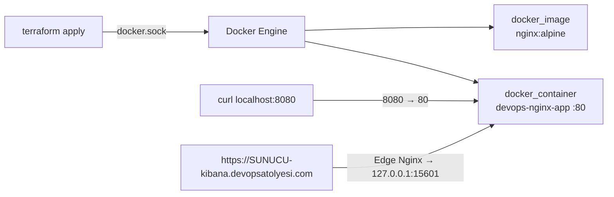

# LAB-TF-01 — Terraform ile Docker Container Yönetimi

| Profil / Araçlar | Açık Portlar |
|---|---|
| `terraform`, `docker`, `kreuzwerker/docker ~> 4.7`, `nginx:alpine` | 8080, 15601, `https://<sunucu-adı>-kibana.devopsatolyesi.com` |

## Amaç

- `kreuzwerker/docker` provider'ını yapılandırmak.
- `docker_image` ile image çekmek, `docker_container` ile port eşlemeli container çalıştırmak.
- `init`, `plan`, `apply`, `output` ve `destroy` döngüsünü uygulamak.

## Ön Koşullar

- Docker ve Terraform kurulu olmalıdır.
- Host üzerinde **8080** ve **15601** portları boş olmalıdır (sunucudaki `-kibana` alan adı 15601'e gelir).

## Terraform Registry

- **Provider:** [kreuzwerker/docker (v4.7.0)](https://registry.terraform.io/providers/kreuzwerker/docker/4.7.0)
- **Kullanılan resource'lar:**
  - [`docker_image`](https://registry.terraform.io/providers/kreuzwerker/docker/4.7.0/docs/resources/image) — Image çekme ve yerel image yönetimi
  - [`docker_container`](https://registry.terraform.io/providers/kreuzwerker/docker/4.7.0/docs/resources/container) — Container oluşturma, port eşleme ve restart politikası
- **Örnekler:** Sayfaların sağ üst köşesinden sürümün `4.7.0` olduğunu kontrol edip sol menüden ilgili kaynağın *Example Usage* ve *Argument Reference* kısımlarını inceleyebilirsiniz.

## Lab Topolojisi



## Adım Adım Uygulama Rehberi

### 1. Provider'ı İndirme

```bash
cd ~/terraform-lab/lab-01-terraform-docker-basics
```

`versions.tf`'teki `kreuzwerker/docker` provider'ını `.terraform/` klasörüne indirir:

```bash
terraform init
```

Çıktının sonu: `Terraform has been successfully initialized!`

### 2. Plan ve Apply

Hiçbir şey oluşturmadan neyin oluşturulacağını gösterir:

```bash
terraform plan
```

Plan sonunda `Plan: 2 to add, 0 to change, 0 to destroy.` görünür: bir image, bir container.

Planı uygular; image çekilir ve container başlar:

```bash
terraform apply -auto-approve
```

Çıktının sonu: `Apply complete! Resources: 2 added, 0 changed, 0 destroyed.`

### 3. Container'ı Test Etme

Terraform'un oluşturduğu container; `PORTS` sütununda iki eşleme görünür (`8080->80`, `15601->80`):

```bash
docker ps --filter "name=devops-nginx-app"
```

nginx'in yanıt verdiğini başlıklarla gösterir; ilk satır `HTTP/1.1 200 OK` olmalıdır:

```bash
curl -I http://localhost:8080
```

`outputs.tf`'te tanımlı değerleri yazdırır:

```bash
terraform output
```

```text
application_url = "http://localhost:8080"
container_id = "..."
```

Tarayıcıda açılacak adres (alan adı):

```bash
echo "https://$(hostname)-kibana.devopsatolyesi.com"
```

Aynı sayfa sunucunun IP adresi ve portuyla da açılır (firewall'da `8080` açık olmalıdır):

```bash
echo "http://$(curl -s ifconfig.me):8080"
```

## Temizlik

Container'ı ve state'teki image kaydını siler (`keep_locally = true` olduğu için image diskte kalır):

```bash
terraform destroy -auto-approve
```
