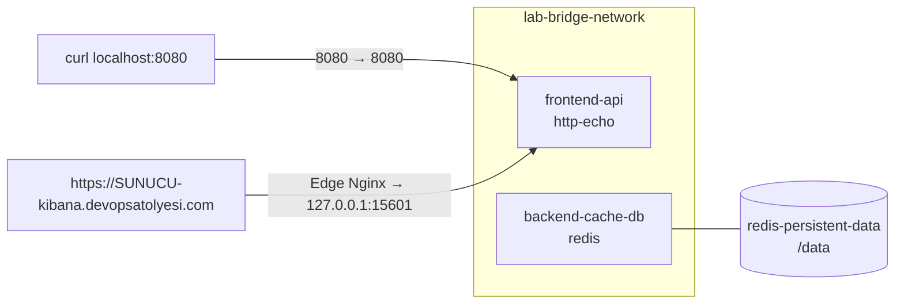

# LAB-TF-02 — Terraform ile Docker Network ve Volume

| Profil / Araçlar | Açık Portlar |
|---|---|
| `terraform`, `docker`, `redis:7-alpine`, `hashicorp/http-echo` | 8080, 15601, `https://<sunucu-adı>-kibana.devopsatolyesi.com` |

## Amaç

- `docker_network` ile kullanıcı tanımlı bridge network oluşturmak.
- `docker_volume` ile Redis verisini kalıcı diske bağlamak.
- İki container'ı aynı network'e `networks_advanced` ile bağlamak.

## Ön Koşullar

- Host üzerinde **8080** ve **15601** portları boş olmalıdır (sunucudaki `-kibana` alan adı 15601'e gelir).

## Terraform Registry

- **Provider:** [kreuzwerker/docker (v4.7.0)](https://registry.terraform.io/providers/kreuzwerker/docker/4.7.0)
- **Kullanılan resource'lar:**
  - [`docker_network`](https://registry.terraform.io/providers/kreuzwerker/docker/4.7.0/docs/resources/network) — Kullanıcı tanımlı bridge network ve DNS izolasyonu
  - [`docker_volume`](https://registry.terraform.io/providers/kreuzwerker/docker/4.7.0/docs/resources/volume) — Kalıcı veri için volume
  - [`docker_container`](https://registry.terraform.io/providers/kreuzwerker/docker/4.7.0/docs/resources/container) — Network ve volume bağlama ayarları
- **Örnekler:** Sürüm menüsünden `4.7.0` seçerek sol menüden `docker_network` ve `docker_volume` sayfalarındaki *Example Usage* bloklarını inceleyebilirsiniz.

## Lab Topolojisi



## Adım Adım Uygulama Rehberi

### 1. Dağıtım

```bash
cd ~/terraform-lab/lab-02-docker-networks-and-volumes
```

Docker provider'ını indirir:

```bash
terraform init
```

Network, volume, iki image ve iki container oluşturur:

```bash
terraform apply -auto-approve
```

Çıktının sonu: `Apply complete! Resources: 6 added, 0 changed, 0 destroyed.`

### 2. Network ve Volume

`lab-bridge-network`'e bağlı container'ları ve IP adreslerini listeler:

```bash
docker network inspect lab-bridge-network -f '{{range .Containers}}{{.Name}} {{.IPv4Address}}{{"\n"}}{{end}}'
```

```text
backend-cache-db 172.29.0.2/16
frontend-api 172.29.0.3/16
```

İki container da aynı network'te IP almıştır (adresler sizde farklı olabilir).

Volume'un host üzerindeki dizinini gösterir; Redis verisi burada saklanır:

```bash
docker volume inspect redis-persistent-data -f '{{.Mountpoint}}'
```

```text
/var/lib/docker/volumes/redis-persistent-data/_data
```

### 3. Container'ları Test Etme

Redis container'ının içinde `redis-cli` çalıştırır; yanıt `PONG` olmalıdır:

```bash
docker exec backend-cache-db redis-cli ping
```

Web container'ı `-text` ile verilen metni döndürür:

```bash
curl http://localhost:8080
```

```text
Özel Docker Ağında Çalışıyor
```

Tarayıcıda açılacak adres (alan adı):

```bash
echo "https://$(hostname)-kibana.devopsatolyesi.com"
```

Aynı sayfa sunucunun IP adresi ve portuyla da açılır (firewall'da `8080` açık olmalıdır):

```bash
echo "http://$(curl -s ifconfig.me):8080"
```

## Temizlik

Container'ları, network'ü ve volume'u siler:

```bash
terraform destroy -auto-approve
```
