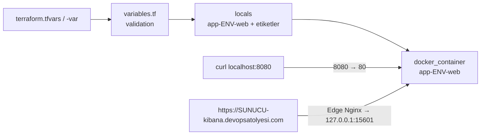

# LAB-TF-03 — Değişkenler, Validation, Locals ve tfvars

| Profil / Araçlar | Açık Portlar |
|---|---|
| `terraform`, `docker`, `nginx:1.30-alpine` | 8080, 15601, `https://<sunucu-adı>-kibana.devopsatolyesi.com` |

## Amaç

- Değişken tipleri (`string`, `number`, `map`) ve `validation` kuralı yazmak.
- `locals` ile isim ve etiket üretmek.
- Değerleri `-var` ve `terraform.tfvars` ile değiştirmek.

## Ön Koşullar

- Host üzerinde **8080** ve **15601** portları boş olmalıdır (sunucudaki `-kibana` alan adı 15601'e gelir).

## Terraform Registry

- **Provider:** [kreuzwerker/docker (v4.7.0)](https://registry.terraform.io/providers/kreuzwerker/docker/4.7.0)
- **Terraform HCL Değişken Rehberi:** [Terraform Input Variables & Validation](https://developer.hashicorp.com/terraform/language/values/variables)
- **Kullanılan resource'lar:**
  - [`docker_container`](https://registry.terraform.io/providers/kreuzwerker/docker/4.7.0/docs/resources/container) — Port, environment ve etiket eşlemeleri
- **Örnekler:** `variables.tf` içerisindeki custom validation sözdizimi için resmi Terraform dili dokümanlarını, Docker parametreleri için ise Provider v4.7.0 dokümanını inceleyebilirsiniz.

## Lab Topolojisi



## Adım Adım Uygulama Rehberi

### 1. Varsayılan Değerlerle Dağıtım

```bash
cd ~/terraform-lab/lab-03-variables-outputs-and-tfvars
```

Docker provider'ını indirir:

```bash
terraform init
```

`variables.tf`'teki varsayılan değerlerle (`environment = "development"`) container'ı kurar:

```bash
terraform apply -auto-approve
```

`locals` bloğunun ürettiği container adını ve portları gösterir:

```bash
docker ps --filter "name=app-" --format '{{.Names}} {{.Ports}}'
```

Container adı `app-development-web`.

### 2. Validation Kuralı

İzin verilmeyen bir ortam adıyla plan alır; `validation` bloğu planı durdurur:

```bash
terraform plan -var="environment=invalid_env"
```

Plan, `Ortam yalnızca 'development', 'staging' veya 'production' olabilir.` hatasıyla durur.

### 3. tfvars ile Production

Örnek dosyayı `terraform.tfvars` adıyla kopyalar; Terraform bu dosyayı otomatik okur:

```bash
cp terraform.tfvars.example terraform.tfvars
```

`environment = "production"` ve yeni etiketlerle tekrar uygular:

```bash
terraform apply -auto-approve
```

Container adı değiştiği için Terraform container'ı yeniden oluşturur: `Apply complete! Resources: 1 added, 0 changed, 1 destroyed.`

Yeni container'ın etiketlerini gösterir; `env`, `project` ve `team` tfvars'tan gelir:

```bash
docker inspect app-production-web --format '{{json .Config.Labels}}'
```

```text
{"env":"production","maintainer":"NGINX Docker Maintainers <docker-maint@nginx.com>","managed_by":"terraform","project":"portal","team":"core-infra"}
```

Container adı, etiketler ve erişim adresi:

```bash
terraform output
```

Tarayıcıda açılacak adres (alan adı):

```bash
echo "https://$(hostname)-kibana.devopsatolyesi.com"
```

Aynı sayfa sunucunun IP adresi ve portuyla da açılır (firewall'da `8080` açık olmalıdır):

```bash
echo "http://$(curl -s ifconfig.me):8080"
```

## Temizlik

Container'ı siler:

```bash
terraform destroy -auto-approve
```

Kopyaladığınız tfvars dosyasını siler; bir sonraki çalıştırma yine varsayılan değerlerle başlar:

```bash
rm -f terraform.tfvars
```
