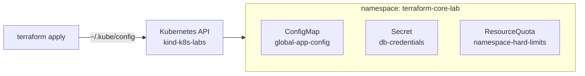

# LAB-TF-04 — Terraform ile Namespace, ConfigMap, Secret ve ResourceQuota

| Profil / Araçlar | Açık Portlar |
|---|---|
| `terraform`, `kubectl`, `hashicorp/kubernetes ~> 3.5`, Kind `k8s-labs` | Yok |

## Amaç

- `hashicorp/kubernetes` provider'ını `~/.kube/config` ile kullanmak.
- Namespace, ConfigMap, Secret ve ResourceQuota'yı Terraform ile oluşturmak.
- `sensitive = true` değişkenin plan çıktısında maskelendiğini görmek.

## Ön Koşullar

- `kubectl config current-context` çıktısı `kind-k8s-labs` olmalıdır.

## Terraform Registry

- **Provider:** [hashicorp/kubernetes (v3.5.0)](https://registry.terraform.io/providers/hashicorp/kubernetes/3.5.0)
- **Kullanılan resource'lar:**
  - [`kubernetes_namespace_v1`](https://registry.terraform.io/providers/hashicorp/kubernetes/3.5.0/docs/resources/namespace_v1) — Namespace tanımlama ve etiketleme
  - [`kubernetes_config_map_v1`](https://registry.terraform.io/providers/hashicorp/kubernetes/3.5.0/docs/resources/config_map_v1) — Konfigürasyon yönetimi
  - [`kubernetes_secret_v1`](https://registry.terraform.io/providers/hashicorp/kubernetes/3.5.0/docs/resources/secret_v1) — Opaque ve Base64 gizli veri yönetimi
  - [`kubernetes_resource_quota_v1`](https://registry.terraform.io/providers/hashicorp/kubernetes/3.5.0/docs/resources/resource_quota_v1) — CPU, RAM ve pod kota limitleri
- **Örnekler:** Sürüm menüsünden `3.5.0` seçip sol menüden ilgili kaynağa tıklayarak *Example Usage* bloklarını inceleyebilirsiniz.

## Lab Topolojisi



## Adım Adım Uygulama Rehberi

### 1. Dağıtım

```bash
cd ~/terraform-lab/lab-04-terraform-kubernetes-core
```

Kubernetes provider'ını indirir:

```bash
terraform init
```

Oluşturulacak 4 kaynağı gösterir:

```bash
terraform plan
```

Plan sonunda `Plan: 4 to add, 0 to change, 0 to destroy.` görünür. Secret içindeki `DB_PASS` değeri planda `(sensitive value)` olarak görünür.

Namespace, ConfigMap, Secret ve ResourceQuota'yı cluster'da oluşturur:

```bash
terraform apply -auto-approve
```

Çıktının sonu: `Apply complete! Resources: 4 added, 0 changed, 0 destroyed.`

### 2. Kaynakları İnceleme

Terraform'un `managed_by=terraform` etiketiyle açtığı namespace:

```bash
kubectl get namespaces -l managed_by=terraform
```

```text
NAME                 STATUS   AGE
terraform-core-lab   Active   1s
```

Namespace içindeki ConfigMap, Secret ve ResourceQuota (`kube-root-ca.crt` Kubernetes'in otomatik oluşturduğu ConfigMap'tir):

```bash
kubectl get configmap,secret,resourcequota -n terraform-core-lab
```

Kota limitleri ve kullanılan miktarlar; namespace boş olduğu için `Used` sütunu `0`'dır:

```bash
kubectl describe resourcequota namespace-hard-limits -n terraform-core-lab
```

```text
Resource         Used  Hard
--------         ----  ----
limits.cpu       0     2
limits.memory    0     2Gi
pods             0     10
requests.cpu     0     1
requests.memory  0     1Gi
```

### 3. Secret Değerini Okuma

Secret'taki `DB_PASS` alanı Base64 olarak saklanır; komut değeri çözüp yazdırır. Plan çıktısında gizlenen değer cluster'da okunabilir durumdadır:

```bash
kubectl get secret db-credentials -n terraform-core-lab -o jsonpath='{.data.DB_PASS}' | base64 --decode; echo
```

## Temizlik

Dört kaynağı ve namespace'i siler:

```bash
terraform destroy -auto-approve
```
