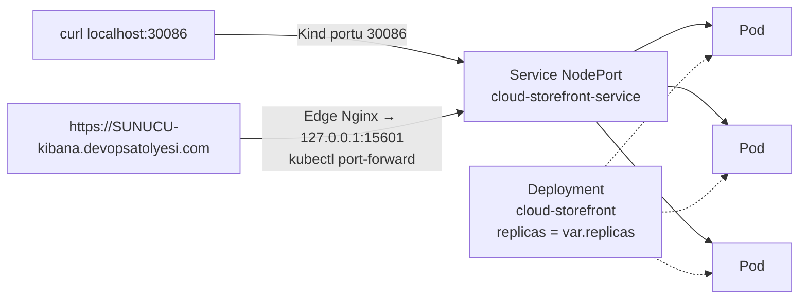

# LAB-TF-05 — Terraform ile Deployment ve NodePort Service

| Profil / Araçlar | Açık Portlar |
|---|---|
| `terraform`, `kubectl`, `hashicorp/kubernetes ~> 3.5`, `nginx:1.30-alpine` | 30086 (NodePort), 15601 (port-forward), `https://<sunucu-adı>-kibana.devopsatolyesi.com` |

## Amaç

- `kubernetes_deployment_v1` ile replica, kaynak limiti ve `liveness_probe` tanımlamak.
- `kubernetes_service_v1` ile NodePort Service açmak.
- Replica sayısını Terraform değişkeniyle değiştirmek.

## Ön Koşullar

- `kubectl config current-context` çıktısı `kind-k8s-labs` olmalıdır.
- NodePort **30086** başka bir lab tarafından kullanılmıyor olmalıdır.
- Host üzerinde **15601** portu boş olmalıdır (sunucudaki `-kibana` alan adı bu porta gelir).

## Terraform Registry

- **Provider:** [hashicorp/kubernetes (v3.5.0)](https://registry.terraform.io/providers/hashicorp/kubernetes/3.5.0)
- **Kullanılan resource'lar:**
  - [`kubernetes_deployment_v1`](https://registry.terraform.io/providers/hashicorp/kubernetes/3.5.0/docs/resources/deployment_v1) — Replica, pod şablonu, container limitleri ve probe'lar
  - [`kubernetes_service_v1`](https://registry.terraform.io/providers/hashicorp/kubernetes/3.5.0/docs/resources/service_v1) — ClusterIP ve NodePort Service tanımları
- **Örnekler:** Sürüm menüsünden `3.5.0` seçip `kubernetes_deployment_v1` sayfasındaki *Example Usage* ve *spec.template.spec.container* parametre detaylarını inceleyebilirsiniz.

## Lab Topolojisi



## Adım Adım Uygulama Rehberi

### 1. Dağıtım

```bash
cd ~/terraform-lab/lab-05-kubernetes-deployments-and-services
```

Kubernetes provider'ını indirir:

```bash
terraform init
```

Deployment'ı (3 replica) ve NodePort Service'i oluşturur:

```bash
terraform apply -auto-approve
```

Çıktının sonu: `Apply complete! Resources: 2 added, 0 changed, 0 destroyed.`

### 2. Kubernetes Kaynakları

Deployment, pod'lar ve Service; `READY` sütunu `3/3` olmalıdır:

```bash
kubectl get deployment,pods,svc -l app=cloud-storefront
```

Service tipi ve port eşlemesi; `PORT(S)` sütununda `80:30086/TCP` görünür:

```bash
kubectl get svc cloud-storefront-service
```

### 3. Service'e Erişim

NodePort üzerinden nginx'e istek atar; ilk satır `HTTP/1.1 200 OK` olmalıdır:

```bash
curl -I http://localhost:30086
```

Sunucudaki Nginx `-kibana` alan adını `127.0.0.1:15601`'e gönderir. Bu portu Service'e bağlayın; komut arka planda çalışır ve terminal açık kaldığı sürece sürer:

```bash
kubectl port-forward svc/cloud-storefront-service 15601:80 >/dev/null 2>&1 &
```

Tarayıcıda açılacak adres (alan adı):

```bash
echo "https://$(hostname)-kibana.devopsatolyesi.com"
```

Aynı sayfa sunucunun IP adresi ve NodePort'uyla da açılır (firewall'da `30086` açık olmalıdır):

```bash
echo "http://$(curl -s ifconfig.me):30086"
```

### 4. Ölçekleme

`replicas` değişkenini 5 yaparak tekrar uygular; Terraform yalnızca Deployment'ı günceller:

```bash
terraform apply -var="replicas=5" -auto-approve
```

Çıktının sonu: `Apply complete! Resources: 0 added, 1 changed, 0 destroyed.`

Pod sayısı 5 olmalıdır:

```bash
kubectl get pods -l app=cloud-storefront
```

## Temizlik

port-forward'u durdurur:

```bash
pkill -f "kubectl port-forward svc/cloud-storefront-service"
```

Deployment'ı ve Service'i siler:

```bash
terraform destroy -auto-approve
```
