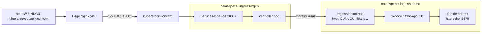

# LAB-TF-06 — Terraform Helm Provider ile Ingress NGINX

| Profil / Araçlar | Açık Portlar |
|---|---|
| `terraform`, `kubectl`, `helm`, `hashicorp/helm ~> 3.3`, `hashicorp/kubernetes ~> 3.5`, ingress-nginx chart `4.15.1` | 30087 (NodePort), 15601 (port-forward), `https://<sunucu-adı>-kibana.devopsatolyesi.com` |

## Amaç

- `hashicorp/helm` provider'ıyla ingress-nginx chart'ını kurmak.
- Chart değerlerini `set` ile ezmek (Service tipi, NodePort, replica).
- Demo uygulamayı alan adına bağlayan Ingress kuralını Terraform ile yazmak.

## Ön Koşullar

- `kubectl config current-context` çıktısı `kind-k8s-labs` olmalıdır.
- NodePort **30087** başka bir lab tarafından kullanılmıyor olmalıdır.
- Host üzerinde **15601** portu boş olmalıdır (sunucudaki `-kibana` alan adı bu porta gelir).

## Terraform Registry

- **Provider:** [hashicorp/helm (v3.3.0)](https://registry.terraform.io/providers/hashicorp/helm/3.3.0), [hashicorp/kubernetes (v3.5.0)](https://registry.terraform.io/providers/hashicorp/kubernetes/3.5.0)
- **Kullanılan resource'lar:**
  - [`helm_release`](https://registry.terraform.io/providers/hashicorp/helm/3.3.0/docs/resources/release) — Helm chart yükleme, `set`, `values` ve repository parametreleri
  - [`kubernetes_deployment_v1`](https://registry.terraform.io/providers/hashicorp/kubernetes/3.5.0/docs/resources/deployment_v1), [`kubernetes_service_v1`](https://registry.terraform.io/providers/hashicorp/kubernetes/3.5.0/docs/resources/service_v1) — Demo uygulama ve Service
  - [`kubernetes_ingress_v1`](https://registry.terraform.io/providers/hashicorp/kubernetes/3.5.0/docs/resources/ingress_v1) — `ingress_class_name = "nginx"` ve `host` ile Ingress kuralı
- **Örnekler:** Sürüm menüsünden `3.3.0` seçip `helm_release` sayfasındaki *Example Usage* ve *set / set_sensitive* bloklarını inceleyebilirsiniz.

## Lab Topolojisi



## Adım Adım Uygulama Rehberi

### 1. Alan Adını Belirleme

Ingress kuralı sunucunun `-kibana` alan adını kullanır; Terraform değeri `TF_VAR_domain_name` değişkeninden okur:

```bash
export TF_VAR_domain_name="$(hostname)-kibana.devopsatolyesi.com"
```

```bash
echo $TF_VAR_domain_name
```

### 2. Dağıtım

```bash
cd ~/terraform-lab/lab-06-terraform-helm-provider
```

`helm` ve `kubernetes` provider'larını indirir:

```bash
terraform init
```

ingress-nginx chart'ını, demo uygulamayı ve Ingress kuralını kurar. Ingress, controller hazır olduktan sonra oluşturulur (`depends_on`):

```bash
terraform apply -auto-approve
```

Çıktının sonu: `Apply complete! Resources: 5 added, 0 changed, 0 destroyed.`

### 3. Release ve Kaynaklar

Terraform'un kurduğu Helm release'i; `STATUS` sütunu `deployed`, `CHART` sütunu `ingress-nginx-4.15.1` olmalıdır:

```bash
helm list -n ingress-nginx
```

Controller pod'u ve `set` ile verilen NodePort; Service satırında `80:30087/TCP` görünür:

```bash
kubectl get pods,svc -n ingress-nginx
```

Release durumu, chart sürümü ve uygulama adresi:

```bash
terraform output
```

```text
app_url = "https://student103-kibana.devopsatolyesi.com"
release_status = "deployed"
release_version = "4.15.1"
```

### 4. Ingress Kuralı

Kural `nginx` class'ını kullanır ve yalnızca `HOSTS` sütunundaki alan adına yanıt verir:

```bash
kubectl get ingress -n ingress-demo
```

```text
NAME       CLASS   HOSTS                                  ADDRESS   PORTS   AGE
demo-app   nginx   student103-kibana.devopsatolyesi.com             80      1s
```

Kuralın yönlendirdiği demo pod ve Service:

```bash
kubectl get pods,svc -n ingress-demo
```

Alan adını `Host` başlığıyla vererek controller'ı NodePort üzerinden deneyin:

```bash
curl -H "Host: $TF_VAR_domain_name" http://localhost:30087
```

```text
LAB-TF-06: ingress-nginx -> demo-app
```

`404 Not Found` görürseniz controller kuralı henüz yüklememiştir; birkaç saniye sonra tekrar deneyin. `Host` başlığı olmadan gelen istek kurala uymadığı için her zaman `404` alır.

### 5. Alan Adından Erişim

Sunucudaki Nginx `-kibana` alan adını `127.0.0.1:15601`'e gönderir. Bu portu controller Service'ine bağlayın; komut arka planda çalışır ve terminal açık kaldığı sürece sürer:

```bash
kubectl port-forward -n ingress-nginx svc/nginx-ingress-controller-ingress-nginx-controller 15601:80 >/dev/null 2>&1 &
```

İstek Edge Nginx → port-forward → controller → Ingress kuralı → `demo-app` yolunu izler:

```bash
curl https://$TF_VAR_domain_name
```

```text
LAB-TF-06: ingress-nginx -> demo-app
```

`error code: 502` görürseniz port-forward henüz başlamamıştır; bir saniye sonra tekrar deneyin.

Tarayıcıda açılacak adres:

```bash
echo "https://$TF_VAR_domain_name"
```

## Temizlik

port-forward'u durdurur:

```bash
pkill -f "kubectl port-forward -n ingress-nginx"
```

Release'i, demo uygulamayı ve Ingress'i siler:

```bash
terraform destroy -auto-approve
```

`create_namespace` ile açılan namespace Helm tarafından silinmez:

```bash
kubectl delete namespace ingress-nginx
```
