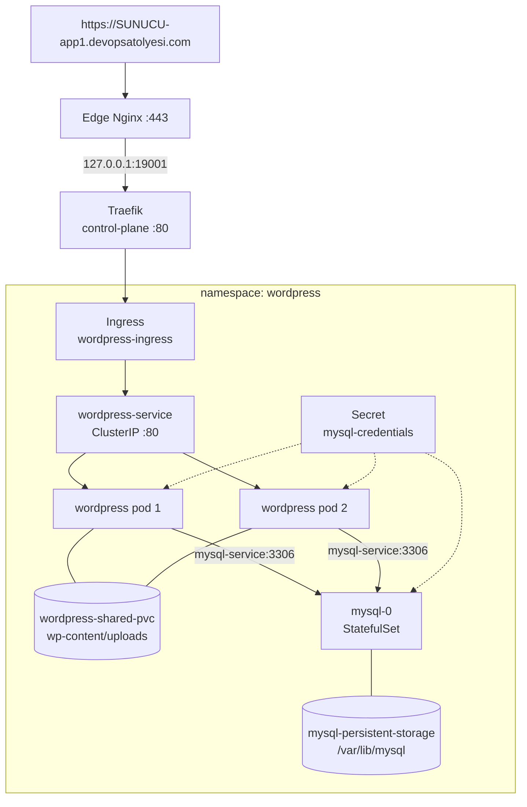

# LAB-TF-07 — Bitirme Projesi: WordPress ve MySQL

| Profil / Araçlar | Açık Portlar |
|---|---|
| `terraform`, `kubectl`, `hashicorp/kubernetes ~> 3.5`, `wordpress:7.0-apache`, `mysql:8.4` | 19001 (Ingress), `https://<sunucu-adı>-app1.devopsatolyesi.com` |

## Amaç

- MySQL'i StatefulSet, headless Service ve `volume_claim_template` ile kurmak.
- WordPress'i 2 replica'lı Deployment ve ortak PVC ile kurmak.
- Parolaları Secret'ta tutup pod'lara `secret_key_ref` ile vermek.
- WordPress'i Ingress ile sunucunun `-app1` alan adından yayınlamak.

## Ön Koşullar

- `kubectl config current-context` çıktısı `kind-k8s-labs` olmalıdır.
- Cluster'da Traefik Ingress Controller çalışıyor olmalıdır (k8s-labs I01): `kubectl get ingressclass` çıktısında `traefik` görünür.
- `-app1` alan adını kullanan başka bir Ingress olmamalıdır: `kubectl get ingress -A` çıktısında `HOSTS` sütununda `<sunucu-adı>-app1.devopsatolyesi.com` görünmemelidir.

## Terraform Registry

- **Provider:** [hashicorp/kubernetes (v3.5.0)](https://registry.terraform.io/providers/hashicorp/kubernetes/3.5.0)
- **Kullanılan resource'lar:**
  - [`kubernetes_stateful_set_v1`](https://registry.terraform.io/providers/hashicorp/kubernetes/3.5.0/docs/resources/stateful_set_v1) — MySQL StatefulSet ve `volume_claim_template`
  - [`kubernetes_deployment_v1`](https://registry.terraform.io/providers/hashicorp/kubernetes/3.5.0/docs/resources/deployment_v1) — WordPress 2 replica'lı Deployment ve sağlık probe'ları
  - [`kubernetes_ingress_v1`](https://registry.terraform.io/providers/hashicorp/kubernetes/3.5.0/docs/resources/ingress_v1) — Ingress kuralları (Traefik IngressClass)
  - [`kubernetes_persistent_volume_claim_v1`](https://registry.terraform.io/providers/hashicorp/kubernetes/3.5.0/docs/resources/persistent_volume_claim_v1) — Paylaşımlı kalıcı diskler
- **Örnekler:** Sürüm menüsünden `3.5.0` seçerek `kubernetes_stateful_set_v1` ve `kubernetes_ingress_v1` sayfalarındaki *Example Usage* bloklarını inceleyebilirsiniz.

## Lab Topolojisi



## Adım Adım Uygulama Rehberi

### 1. Alan Adını Belirleme

Ingress kuralı sunucunun `-app1` alan adını kullanır; Terraform değeri `TF_VAR_domain_name` değişkeninden okur:

```bash
export TF_VAR_domain_name="$(hostname)-app1.devopsatolyesi.com"
```

```bash
echo $TF_VAR_domain_name
```

### 2. Dağıtım

```bash
cd ~/terraform-lab/lab-07-capstone-wordpress-production
```

Kubernetes provider'ını indirir:

```bash
terraform init
```

Namespace, Secret, iki Service, PVC, MySQL StatefulSet, WordPress Deployment ve Ingress planlanır:

```bash
terraform plan
```

Plan sonunda `8 to add` görünür.

Kaynakları oluşturur; MySQL hazır olmadan WordPress başlatılmadığı için yaklaşık bir dakika sürer:

```bash
terraform apply -auto-approve
```

Çıktının sonu: `Apply complete! Resources: 8 added, 0 changed, 0 destroyed.`

### 3. Pod'ları Bekleme

Namespace'teki tüm pod'lar `Ready` olana kadar bekler:

```bash
kubectl wait --for=condition=Ready pod --all -n wordpress --timeout=300s
```

Pod'lar, PVC'ler ve Ingress; PVC'ler `Bound`, Ingress `HOSTS` sütununda `-app1` alan adı görünür:

```bash
kubectl get pods,pvc,ingress -n wordpress
```

### 4. Erişim

İsteği alan adı `Host` başlığıyla Traefik'e gönderir; yanıt `200` olmalıdır:

```bash
curl -s -o /dev/null -w '%{http_code}\n' -H "Host: $TF_VAR_domain_name" http://localhost:19001/wp-admin/install.php
```

Tarayıcıda açılacak adres; açılan sayfa WordPress kurulum ekranıdır:

```bash
terraform output wordpress_url
```

Ingress yalnızca bu alan adına yanıt verir; `http://<IP>:19001` ile açılmaz. Pod'lar `Ready` olduktan hemen sonra birkaç saniye `502` görebilirsiniz; WordPress ilk açılışını tamamlayınca sayfa gelir.

## Temizlik

WordPress, MySQL, PVC'ler ve namespace silinir:

```bash
terraform destroy -auto-approve
```
