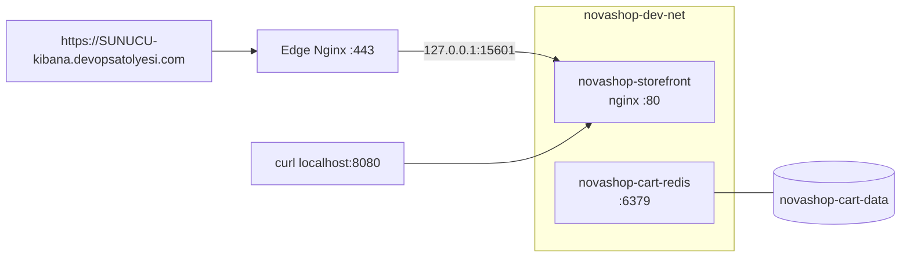

# LAB-TF-08 — Terraform ile NovaShop Docker Stack

| Profil / Araçlar | Açık Portlar |
|---|---|
| `terraform`, `docker`, `redis:7.4-alpine`, `nginx:alpine` | 8080, 15601, `https://<sunucu-adı>-kibana.devopsatolyesi.com` |

## Amaç

- NovaShop'un network, volume, Redis ve vitrin container'larını tek Terraform yapılandırmasıyla kurmak.
- `upload` bloğuyla container'a dosya yazmak.

## Ön Koşullar

- Host üzerinde **8080** ve **15601** portları boş olmalıdır (sunucudaki `-kibana` alan adı 15601'e gelir).

## Terraform Registry

- **Provider:** [kreuzwerker/docker (v4.7.0)](https://registry.terraform.io/providers/kreuzwerker/docker/4.7.0)
- **Kullanılan resource'lar:**
  - [`docker_network`](https://registry.terraform.io/providers/kreuzwerker/docker/4.7.0/docs/resources/network) — NovaShop bridge network
  - [`docker_volume`](https://registry.terraform.io/providers/kreuzwerker/docker/4.7.0/docs/resources/volume) — Redis sepet verisi için kalıcı volume
  - [`docker_container`](https://registry.terraform.io/providers/kreuzwerker/docker/4.7.0/docs/resources/container) — Redis ve storefront container'ları
- **Örnekler:** Sürüm menüsünden `4.7.0` seçip `docker_container` sayfasında `networks_advanced`, `volumes` ve `upload` bloklarına bakın.

## Lab Topolojisi



## Adım Adım Uygulama Rehberi

### 1. Dağıtım

```bash
cd ~/terraform-lab/lab-08-novashop-docker-stack
```

Docker provider'ını indirir:

```bash
terraform init
```

Oluşturulacak kaynakları gösterir; `upload` bloğundaki HTML de planda görünür:

```bash
terraform plan
```

Plan sonunda `6 to add` görünür: 1 network, 1 volume, 2 image, 2 container.

Planı uygular:

```bash
terraform apply -auto-approve
```

Çıktının sonu: `Apply complete! Resources: 6 added, 0 changed, 0 destroyed.`

### 2. Uygulamayı Test Etme

NovaShop container'ları ve portları; storefront iki porta yayınlanır, Redis dışarı açılmaz:

```bash
docker ps --filter "name=novashop-" --format '{{.Names}} {{.Ports}}'
```

`upload` bloğuyla container'a yazılan `index.html`'in başlığını gösterir:

```bash
curl -s http://localhost:8080 | grep "<h1>"
```

```text
    <h1>🛍️ NovaShop Storefront</h1>
```

Tarayıcıda açılacak adres (alan adı):

```bash
echo "https://$(hostname)-kibana.devopsatolyesi.com"
```

Aynı sayfa sunucunun IP adresi ve portuyla da açılır (firewall'da `8080` açık olmalıdır):

```bash
echo "http://$(curl -s ifconfig.me):8080"
```

## Temizlik

Container'ları, network'ü ve volume'u siler:

```bash
terraform destroy -auto-approve
```
